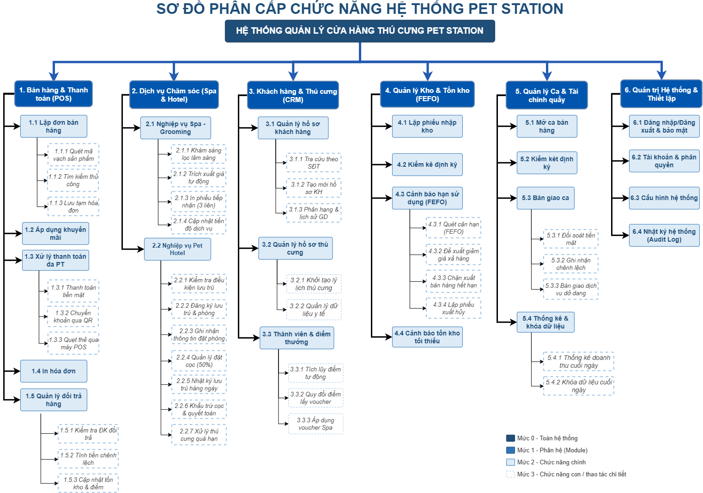

# Pet Station — Quản lý cửa hàng thú cưng

Đồ án Phát triển ứng dụng, Nhóm 03. Ứng dụng Java Swing dành cho nhân viên, quản lý bán hàng, kho, Spa và Hotel thú cưng.

GitHub: [PTUD Nhóm 03 — Pet Station](https://github.com/htnhang132/PTUD_Nhom03_QuanLyCuaHangThuCung_PETSTATION).

# PTUD_Nhom03_QuanLyCuaHangThuCung_PETSTATION
Hệ thống Quản lý Cửa hàng Thú cưng - Đồ án môn Phát triển Ứng dụng (10/08/2026 - 27/10/2026).
### 📊 Sơ đồ Phân cấp Chức năng Hệ thống


## Chạy dự án

Cần **JDK 17 trở lên** và **SQL Server 2019 trở lên**. Dự án có Maven Wrapper 3.9.11; không cần chép thư viện JAR hoặc cấu hình riêng theo IDE.

```powershell
./mvnw.cmd -v
powershell -NoProfile -ExecutionPolicy Bypass -File scripts/setup-database.ps1
New-Item -ItemType Directory -Force config | Out-Null
Copy-Item src/main/resources/db.properties.example config/db.properties
# Sửa tài khoản SQL Server trong config/db.properties trước khi chạy.
./mvnw.cmd -B -ntp package
java -jar target/petstation.jar
```

Hướng dẫn đầy đủ cho VS Code, IntelliJ, Eclipse, SQL Authentication và các lỗi thường gặp: **[SETUP.md](SETUP.md)**. Nếu đã có database cũ, xem mục nâng cấp trước khi chạy; lệnh mặc định không tự xóa database cũ.

Tài khoản ứng dụng mẫu sau khi nạp SQL mới:

| Tài khoản | Vai trò |
| --- | --- |
| `admin` | Cửa hàng trưởng |
| `demo.sales` | Bán hàng |
| `demo.stock` | Kho |
| `demo.spa` | Spa–Hotel |

Mật khẩu mẫu: **`PetStation@123`**; phải đổi khi đăng nhập lần đầu. Đây là tài khoản ứng dụng, khác tài khoản đăng nhập SQL Server. Bộ dữ liệu mẫu có duy nhất 1 tài khoản Cửa hàng trưởng là `admin`.

## Tài liệu

- [Cấu trúc và luồng xử lý](ARCHITECTURE.md)
- [Kịch bản kiểm thử và demo](docs/KIEM_THU_VA_YEU_CAU.md)
- [Chuẩn code](docs/CHUAN_CODE.md)
- [Bản đồ truy vết màn hình, lớp và bảng SQL](docs/BAN_DO_TRUY_VET_CODE.md)
- [Thuyết trình và vấn đáp](docs/THUYET_TRINH_VA_VAN_DAP.md)
- [Rà soát từng file](docs/RA_SOAT_MA_NGUON.md)
- [Quy ước làm việc nhóm](CONTRIBUTING.md)
- [Nhật ký sử dụng AI](AI_USAGE_LOG.md)
- [Nguồn sản phẩm và ảnh](docs/NGUON_SAN_PHAM.md)
- [Ví dụ bảo mật SQL để tham khảo](docs/SQL_SECURITY_EXAMPLES.md)

Cài mới hoặc cập nhật database chỉ cần `scripts/setup-database.ps1`, hoặc chạy thủ công lần lượt `database/001_schema.sql` rồi `database/002_sample_data.sql`. `001` tạo mới/nâng cấp schema; `002` nạp mẫu nếu trống và giữ nguyên dữ liệu nếu đã có. Schema hiện tại: **20261124**. Xem [hướng dẫn](SETUP.md) và [kết quả kiểm chứng](docs/RA_SOAT_MA_NGUON.md#ket-qua-trien-khai).
