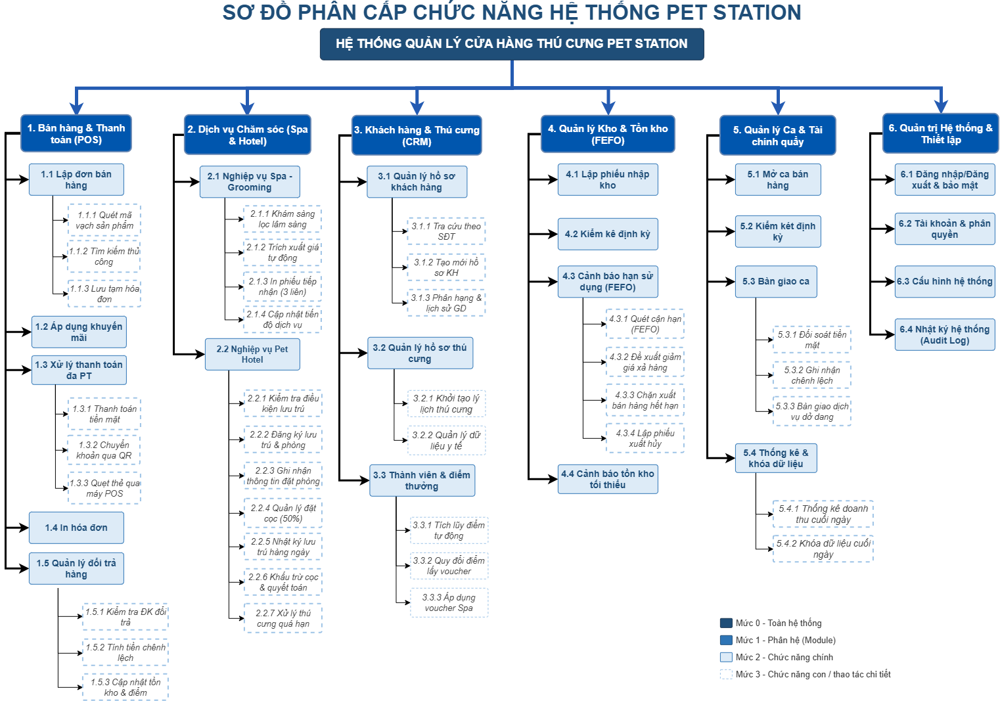

# PTUD_Nhom03_QuanLyCuaHangThuCung_PETSTATION
Hệ thống Quản lý Cửa hàng Thú cưng - Đồ án môn Phát triển Ứng dụng (10/08/2026 - 27/10/2026).
### 📊 Sơ đồ Phân cấp Chức năng Hệ thống

Hướng dẫn chạy: [SETUP.md](SETUP.md). Kịch bản demo đủ 37 mục menu, tài khoản cục bộ và bảng đối chiếu: [docs/KICH_BAN_DEMO.md](docs/KICH_BAN_DEMO.md).

Danh mục 60 sản phẩm có ảnh thực tế và bảng đối chiếu nguồn: [docs/NGUON_SAN_PHAM.md](docs/NGUON_SAN_PHAM.md). Ảnh được đóng gói trong JAR, hiển thị trên thẻ lập hóa đơn và khung chi tiết danh mục; dữ liệu giao dịch liên thông đi kèm được ghi rõ là DEMO.
