# TÀI LIỆU TOÀN DIỆN: CẨM NANG THUYẾT TRÌNH, PHÂN TÍCH CHUYÊN SÂU & HỎI ĐÁP BẢO VỆ ĐỒ ÁN (10 CHỨC NĂNG TRỌNG TÂM)

> **Mục tiêu tài liệu:**  
> 1. Dành cho **người chưa hiểu sâu về code**: giải thích bản chất đời thực cực kỳ bình dân, dễ hiểu, có quy trình bấm chuột từ A đến Z và kịch bản nói mẫu trước Hội đồng Giảng viên.  
> 2. Dành cho **yêu cầu kỹ thuật chuyên sâu**: cung cấp đầy đủ **Sơ đồ mô tả luồng xử lý nghiệp vụ và các file liên quan (Mermaid Flowchart 3 tầng)** cho từng chức năng, phân tích từng lớp UI - Service - DAO, câu lệnh SQL chi tiết và chỉ rõ chính xác số dòng code để "Thầy hỏi là chỉ tay vào được ngay".

---

## MỤC LỤC TỔNG QUAN

- [I. NGUYÊN TẮC BÀN TAY 3 TẦNG (CÔNG THỨC VÀNG TRẢ LỜI MỌI CÂU HỎI)](#i-nguyen-tac-ban-tay-3-tang)
- [II. KIẾN TRÚC TỔNG THỂ HỆ THỐNG (SYSTEM ARCHITECTURE)](#ii-kien-truc-tong-the-he-thong)
- [III. PHÂN TÍCH CHI TIẾT 10 CHỨC NĂNG TRỌNG TÂM (KÈM SƠ ĐỒ LUỒNG TỪNG CHỨC NĂNG)](#iii-phan-tich-chi-tiet-10-chuc-nang-trong-tam)
  - [1. Thống kê Doanh thu (ThongKeDoanhThuPanel)](#1-thong-ke-doanh-thu)
  - [2. Thống kê Hàng hóa (ThongKeHangHoaPanel)](#2-thong-ke-hang-hoa)
  - [3. Kiểm kê tồn kho (KiemKePanel)](#3-kiem-ke-ton-kho)
  - [4. Phân lịch nhân viên (PhanLichNhanVienPanel)](#4-phan-lich-nhan-vien)
  - [5. Tìm kiếm Hóa đơn (TimKiemHoaDonPanel)](#5-tim-kiem-hoa-don)
  - [6. Tra cứu Lịch làm việc toàn cửa hàng (TraCuuLichLamViecPanel)](#6-tra-cuu-lich-lam-viec-toan-cua-hang)
  - [7. Lịch làm việc cá nhân & Xin nghỉ (LichCaNhanPanel)](#7-lich-lam-viec-ca-nhan)
  - [8. Danh mục Sản phẩm & Mã vạch EAN-13 (DanhSachSanPhamPanel)](#8-danh-muc-san-pham)
  - [9. Danh mục Nhân viên & Ràng buộc CCCD (DanhMucNhanVienPanel)](#9-danh-muc-nhan-vien)
  - [10. Cài đặt hệ thống & Nhận diện thiết bị (CaiDatPanel)](#10-cai-dat-he-thong)
- [IV. BẢNG TỔNG HỢP TRA CỨU SIÊU TỐC ĐỂ MỞ CODE TRƯỚC HỘI ĐỒNG](#iv-bang-tong-hop-tra-cuu-sieu-toc)
- [V. BỘ CÂU HỎI BẪY PHẢN BIỆN THƯỜNG GẶP VÀ CÁCH ĐÁP TRẢ](#v-bo-cau-hoi-bay-phan-bien)

---

## I. NGUYÊN TẮC BÀN TAY 3 TẦNG

Khi Giảng viên hỏi: *"Chức năng này chạy như thế nào?"* hoặc *"Quy trình xử lý ra sao?"*, bạn luôn trả lời theo 3 bước mạch lạc:

```
[1. Tầng Giao Diện (UI)] ---> [2. Tầng Nghiệp Vụ (Service)] ---> [3. Tầng Cơ Sở Dữ Liệu (DAO/DB)]
(Người dùng thấy gì,          (Kiểm tra điều kiện, tính toán,    (Truy vấn SQL, ghi nhận sổ sách,
 bấm nút nào, nhập ô gì)      bắt lỗi, bảo mật phân quyền)       đảm bảo toàn vẹn giao dịch)
```

1. **Tầng Giao diện (Mắt thấy):** *"Người dùng thao tác trên màn hình (nhập ô gì, chọn dropdown nào, bấm nút nào)..."*
2. **Tầng Nghiệp vụ (Não xử lý):** *"Hệ thống kiểm tra tính hợp lệ (đủ 18 tuổi chưa, số tồn có âm không, có bị trùng ca không, phân quyền ai được sửa giá)..."*
3. **Tầng Dữ liệu (Sổ sách ghi chép):** *"Dữ liệu được lưu an toàn xuống CSDL SQL Server qua Transaction và cập nhật hiển thị kết quả ngược lại cho người dùng."*

---

## II. KIẾN TRÚC TỔNG THỂ HỆ THỐNG

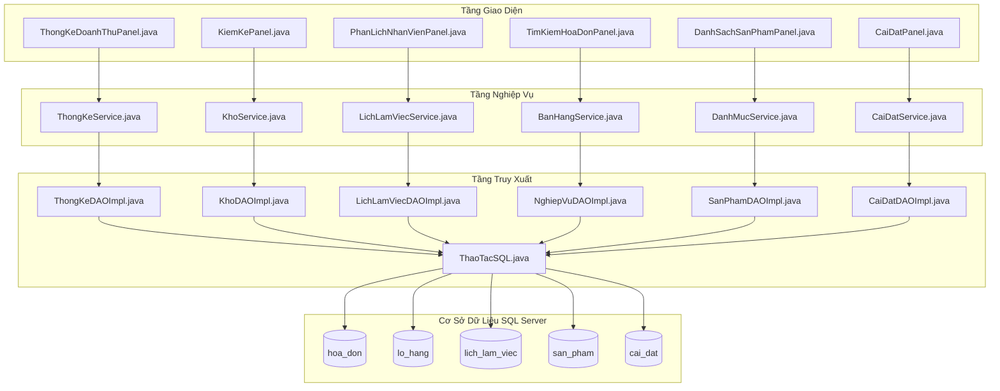

---

## III. PHÂN TÍCH CHI TIẾT 10 CHỨC NĂNG TRỌNG TÂM

---

### 1. THỐNG KÊ DOANH THU

#### A. Ý nghĩa thực tế ở tiệm thú cưng
Tiền vào tiệm thú cưng không chỉ là tiền bán đồ ăn hay phụ kiện. Tiền còn đến từ:
* **Tiền khách gửi thú cưng đặt cọc khách sạn Pet Hotel** trước cả tuần.
* **Tiền bị giảm trừ** do khách đem trả hàng đổi lấy tiền mặt.  
👉 Nếu phần mềm chỉ tính tổng tiền trên các hóa đơn bán hàng thì **sai lệch dòng tiền thực tế**. Hệ thống Pet Station kết hợp 3 nguồn tiền để ra con số doanh thu ròng chính xác từng đồng.

#### B. Quy trình thao tác trên phần mềm (Từ A đến Z)
1. Vào menu **Thống kê** $\rightarrow$ Chọn **Doanh thu**.
2. **Chọn kỳ thống kê:** Bấm chọn nhanh: `Hôm nay`, `Hôm qua`, `7 ngày`, `Tháng này`, hoặc chọn từ ngày - đến ngày.
3. **Chọn góc nhìn thống kê:**
   * **Theo ngày:** Xem ngày nào đông khách, ngày nào vắng để phân bổ nhân viên.
   * **Theo thanh toán:** Xem khách trả tiền mặt, chuyển khoản VietQR hay quẹt thẻ nhiều hơn.
   * **Theo thu ngân:** Xem nhân viên nào có doanh số bán cao nhất để tính thưởng KPI.
   * **Theo nguồn thu:** Tỷ trọng doanh thu giữa Bán sản phẩm, Dịch vụ Spa và Khách sạn Hotel.
4. Bấm nút **[Xuất Excel]** nếu muốn tải file bảng tính báo cáo doanh thu về nộp cho sếp.

#### C. Sơ đồ luồng xử lý nghiệp vụ & Các file liên quan

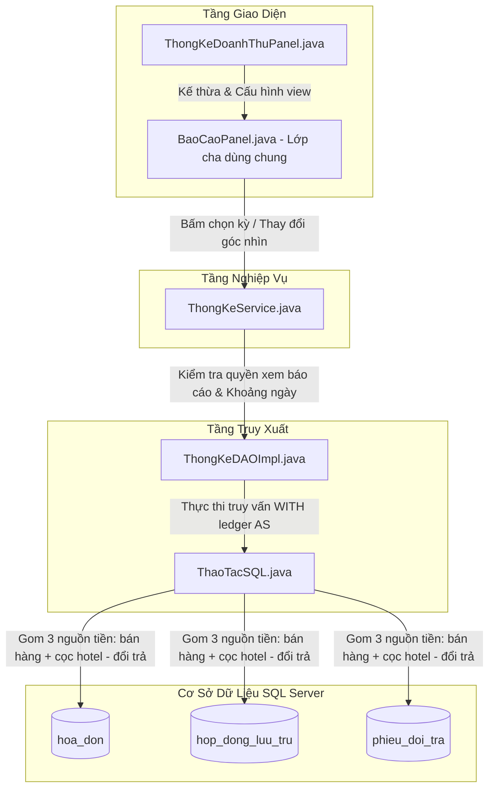

#### D. Mổ xẻ mã nguồn chi tiết
* **File Giao diện:** `src/main/java/com/petstation/gui/report/ThongKeDoanhThuPanel.java` (kế thừa `BaoCaoPanel.java`).
* **File Service:** `src/main/java/com/petstation/service/ThongKeService.java`.
* **File DAO & Câu lệnh SQL đắt giá:** `src/main/java/com/petstation/dao/impl/ThongKeDAOImpl.java`, tại **dòng 84 – 105** trong hàm `layDoanhThuTheoNgay()`:
```sql
WITH ledger AS (
    -- Nguồn 1: Tiền bán hàng từ các hóa đơn đã hoàn tất (PAID)
    SELECT CAST(h.thanh_toan_luc AS date) AS ngay, h.tong_tien AS so_tien
    FROM hoa_don h JOIN phien_lam_viec s ON s.id = h.phien_lam_viec_id 
    WHERE h.trang_thai = 'PAID'
    UNION ALL
    -- Nguồn 2: Tiền hoàn trả lại cho khách khi đổi/trả hàng (mang giá trị âm hoặc trừ)
    SELECT CAST(p.tao_luc AS date), p.chenh_lech 
    FROM phieu_doi_tra p JOIN hoa_don h ON h.id = p.hoa_don_id 
    WHERE p.trang_thai = 'COMPLETED' AND p.loai_phieu = 'LEGACY_RETURN'
    UNION ALL
    -- Nguồn 3: Tiền khách cọc trước giữ chỗ lưu trú Pet Hotel
    SELECT CAST(k.nhan_coc_luc AS date), k.tien_coc 
    FROM hop_dong_luu_tru k 
    WHERE k.da_nhan_coc = 1 AND k.nhan_coc_luc IS NOT NULL
)
SELECT ngay, SUM(so_tien) FROM ledger 
WHERE ngay >= ? AND ngay < ? 
GROUP BY ngay ORDER BY ngay;
```
* **Cơ chế phân quyền báo cáo (`ThongKeService.java`, dòng 28 – 47):**
  * Quản lý có quyền `XEM_BAO_CAO_CHUNG` $\rightarrow$ xem toàn bộ doanh thu tiệm.
  * Thu ngân chỉ có quyền `XEM_BAO_CAO_CA` $\rightarrow$ hệ thống tự động gán tham số `taiKhoanId = layIdTaiKhoan()`, chỉ xem doanh số trong phiên làm việc của mình.

#### E. "Thầy hỏi - Chỉ tay vào đâu"
* **Thầy hỏi:** *"Tại sao công thức tính doanh thu của em không dùng mỗi bảng `hoa_don`?"*
* **Bạn chỉ tay vào màn hình:** Mở `ThongKeDAOImpl.java`, chỉ vào **dòng 88**.
* **Bạn trả lời:** *"Dạ thưa Thầy/Cô, trong tiệm thú cưng thực tế có tiền đặt cọc giữ phòng Hotel (bảng `hop_dong_luu_tru`) và tiền hoàn lại khi khách trả hàng (bảng `phieu_doi_tra`). Nếu chỉ tính bảng `hoa_don` thì tiền thực tế trong két sẽ lệch với phần mềm. Nhóm em dùng câu lệnh SQL `WITH ledger AS` gom cả 3 nguồn tiền để phản ánh chính xác dòng tiền ròng thực tế của cửa hàng."*

#### F. Kịch bản nói mẫu đạt điểm 10
> *"Dạ thưa Thầy/Cô, chức năng Thống kê doanh thu của nhóm em được thiết kế theo chuẩn dòng tiền kế toán thực tế. Doanh thu ròng không chỉ lấy từ hóa đơn bán lẻ, mà hệ thống sử dụng câu lệnh SQL gom 3 nguồn tiền: tiền bán hàng đã hoàn tất, cộng thêm tiền đặt cọc giữ chỗ của khách sạn Pet Hotel, và trừ đi các khoản hoàn trả khi khách đổi hàng. Nhờ vậy, người quản lý luôn nắm được chính xác số tiền thực tế đang có trong két và trong tài khoản ngân hàng."*

---

### 2. THỐNG KÊ HÀNG HÓA

#### A. Ý nghĩa thực tế ở tiệm thú cưng
Thức ăn hạt, pate lon và thuốc thú y có đặc thù là **có hạn sử dụng (HSD)**. Nếu để cận date hết hạn thì phải vứt bỏ, mất trắng tiền vốn. Đồng thời, chủ tiệm sợ nhất là **"chôn vốn"** (nhập hàng về nằm chết một chỗ trong kho hàng tháng trời không ai mua).

#### B. Quy trình thao tác trên phần mềm
1. Vào menu **Thống kê** $\rightarrow$ Chọn **Hàng hóa**.
2. Chọn các góc nhìn phân tích:
   * **Sản phẩm bán chạy:** Xem Top 10 món đồ khách mua nhiều nhất để chủ động đặt hàng thêm.
   * **Cảnh báo sắp hết hạn:** Tự động lọc ra những lô hàng nào còn dưới 30 ngày nữa là hết hạn để đem ra quầy giảm giá thanh lý gấp.
   * **Hàng chôn vốn / Tồn đọng lâu ngày:** Xem mặt hàng nào đang chiếm nhiều vốn của tiệm nhất mà không bán được đơn nào trong 30, 60 hoặc 90 ngày.
   * **Hao hụt từ kiểm kê:** Xem tổng số lượng và giá trị hàng thất thoát sau các đợt đếm kho.
3. Bấm **[Xuất Excel]** danh sách hàng cận date gửi cho nhân viên bán hàng dán nhãn xả kho.

#### C. Sơ đồ luồng xử lý nghiệp vụ & Các file liên quan

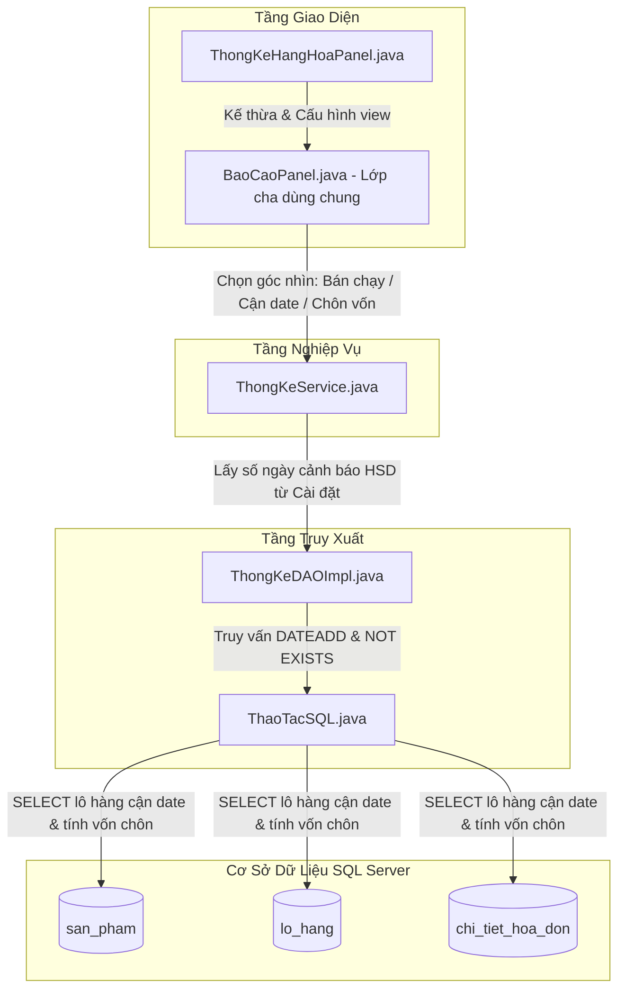

#### D. Mổ xẻ mã nguồn chi tiết
* **File Giao diện:** `src/main/java/com/petstation/gui/report/ThongKeHangHoaPanel.java`.
* **File DAO:** `src/main/java/com/petstation/dao/impl/ThongKeDAOImpl.java`.
* **1. Cảnh báo cận hạn sử dụng (Dòng 22 – 28, hàm `timHanSuDung`):**
  ```sql
  SELECT p.ma_san_pham, p.ten, l.so_lo, l.han_su_dung, l.so_luong_ton 
  FROM lo_hang l JOIN san_pham p ON p.id = l.san_pham_id 
  WHERE l.so_luong_ton > 0 
    AND l.han_su_dung <= DATEADD(day, ?, CAST(GETDATE() AS date)) 
  ORDER BY l.han_su_dung;
  ```
  Số ngày cảnh báo `?` được lấy động từ cấu hình hệ thống: `CaiDatService.layHanSuDungCanhBaoSoNgay()` (mặc định 30 ngày).
* **2. Top sản phẩm bán chạy (Dòng 174 – 192, hàm `laySanPhamBanChay`):**
  Tính tổng số bán từ `chi_tiet_hoa_don` và trừ đi số lượng khách đổi trả từ `chi_tiet_doi_tra`, lấy `TOP(10)` theo số lượng bán ròng.
* **3. Hàng chôn vốn (Dòng 397 – 408, hàm `laySanPhamTonDong`):**
  Dùng mệnh đề `NOT EXISTS` kiểm tra những sản phẩm trong kho còn tồn (`so_luong_ton > 0`) nhưng không hề có hóa đơn `PAID` nào trong $N$ ngày qua, tính vốn đọng: `von_chon = so_luong_ton * gia_nhap_gan_nhat`.

#### E. "Thầy hỏi - Chỉ tay vào đâu"
* **Thầy hỏi:** *"Câu lệnh nào tìm hàng sắp hết hạn?"*
* **Bạn chỉ tay vào màn hình:** Mở `ThongKeDAOImpl.java`, chỉ vào **dòng 26**.
* **Bạn trả lời:** *"Dạ thưa Thầy/Cô, nhóm em quản lý hạn sử dụng chi tiết theo từng Lô hàng (bảng `lo_hang`). Câu lệnh SQL dùng hàm `DATEADD(day, ?, GETDATE())` để so sánh hạn sử dụng của lô với ngày hiện tại cộng với số ngày cảnh báo. Nhờ vậy cửa hàng luôn phát hiện hàng cận date trước ít nhất 30 ngày."*

#### F. Kịch bản nói mẫu đạt điểm 10
> *"Dạ thưa Thầy/Cô, đối với cửa hàng thú cưng, thức ăn và thuốc có hạn sử dụng rất nghiêm ngặt. Hệ thống của nhóm em có tính năng cảnh báo hàng sắp hết hạn tự động trước 30 ngày để nhân viên kịp thời xả hàng, tránh tổn thất. Đồng thời có báo cáo 'Chôn vốn' giúp chủ tiệm biết món nào đang ứ đọng vốn nhiều nhất để điều tiết kế hoạch nhập hàng."*

---

### 3. KIỂM KÊ TỒN KHO

#### A. Ý nghĩa thực tế ở tiệm thú cưng
Trên máy tính báo còn 10 hộp pate, nhưng thực tế ngoài kệ chỉ còn 8 hộp (do bị rơi vỡ, chuột cắn, hoặc khách lỡ làm rách bao bì). Kiểm kê là việc nhân viên cầm súng bắn mã vạch đi đếm thực tế ngoài kho xem máy tính và ngoài kệ có khớp nhau không. Sau đó Quản lý phải duyệt **Cân bằng kho** thì số tồn trên máy mới được sửa lại.

#### B. Quy trình thao tác trên phần mềm
1. Vào menu **Xử lý** $\rightarrow$ Chọn **Kiểm kê tồn kho**.
2. Bấm nút **[+ Lập đợt kiểm kê]** $\rightarrow$ Cửa sổ Modal Workspace mở ra.
3. Nhân viên cầm súng quét Barcode bắn vào từng gói hàng trên kệ:
   * Mỗi lần nghe tiếng `Tít`, ô Barcode nhận mã, sản phẩm đó tự động tăng số lượng thực tế lên 1.
   * Cột **Chênh lệch** tự tính: $\text{Chênh lệch} = \text{Thực tế} - \text{Sổ sách}$.
   * Nếu thiếu hàng (âm): Số hiện **màu đỏ**.
   * Nếu thừa hàng (dương): Số hiện **màu xanh dương**.
   * Nếu khớp (bằng 0): Số hiện **màu xám nhạt**.
4. Chọn lý do (Hư hỏng, Hết hạn, Nhầm lẫn) $\rightarrow$ Bấm **[Lưu biên bản kiểm kê]**.
5. Cửa hàng trưởng mở biên bản $\rightarrow$ Bấm **[Cân bằng kho (Duyệt)]** $\rightarrow$ Kho trên máy tính chính thức cập nhật lại bằng số thực tế ngoài kệ.

#### C. Sơ đồ luồng xử lý nghiệp vụ & Các file liên quan

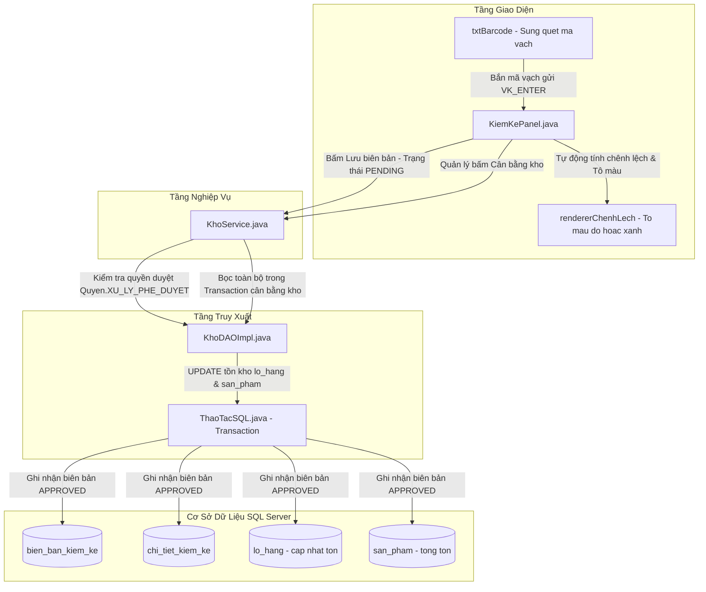

#### D. Sơ đồ tuần tự (Sequence Diagram) & Mổ xẻ mã nguồn

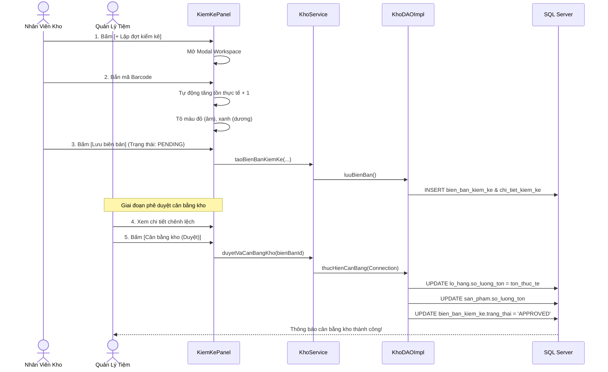

* **File Giao diện:** `src/main/java/com/petstation/gui/processing/inventory/KiemKePanel.java`.
* **File Service:** `src/main/java/com/petstation/service/KhoService.java`.
* **Lắng nghe súng bắn Barcode (`KiemKePanel.java`, dòng 542 – 579):**
  Súng quét mã vạch hoạt động như một bàn phím tốc độ cao và luôn tự động gửi phím `ENTER` sau khi quét xong:
  ```java
  txtBarcode.addKeyListener(new KeyAdapter() {
      public void keyPressed(KeyEvent e) {
          if (e.getKeyCode() == KeyEvent.VK_ENTER) {
              String code = txtBarcode.getText().trim();
              tangSoLuongThucTe(code); // Tự tìm sản phẩm và cộng dồn số lượng đếm
              txtBarcode.setText("");  // Xóa trắng để đón lượt quét tiếp theo
          }
      }
  });
  ```
* **Tô màu chênh lệch (`KiemKePanel.java`, dòng 76 – 110):**
  Sử dụng `rendererChenhLech` can thiệp cột số 6: Nếu `val < 0` $\rightarrow$ đổi màu chữ sang `Color(220, 38, 38)` (đỏ đậm).
* **Chế độ kiểm kê mù (Blind Count Pattern) (`KiemKePanel.java`, dòng 31 & dòng 280):**
  Nếu cấu hình bật kiểm kê mù, hệ thống ẩn cột "Tồn hệ thống", buộc nhân viên phải đếm thật ngoài kệ chứ không được nhìn số trên máy tính rồi chép vào.
* **Cân bằng kho an toàn (`KhoService.java`, hàm `duyetVaCanBangKho`):**
  Bọc trong Database Transaction: cập nhật `lo_hang.so_luong_ton`, cập nhật tổng tồn `san_pham`, và đổi trạng thái biên bản thành `APPROVED`.

#### E. "Thầy hỏi - Chỉ tay vào đâu"
* **Thầy hỏi:** *"Chỗ nào quét mã vạch và tô màu chênh lệch?"*
* **Bạn chỉ tay vào màn hình:** Mở `KiemKePanel.java`, chỉ vào **dòng 76 – 110** (tô màu) và **dòng 543** (bắt sự kiện Barcode).
* **Bạn trả lời:** *"Dạ thưa Thầy/Cô, súng quét Barcode gửi mã kèm phím Enter vào ô `txtBarcode`. Hệ thống lắng nghe sự kiện này để tăng tồn thực tế ngay lập tức. Sau đó Renderer tự động tính `Thực tế - Sổ sách`: nếu âm thì tô đỏ cảnh báo mất mát, nếu khớp thì hiện màu xám. Và chỉ khi Quản lý bấm 'Cân bằng kho' thì Transaction mới cập nhật lại số tồn chính thức trong CSDL."*

#### F. Kịch bản nói mẫu đạt điểm 10
> *"Dạ thưa Thầy/Cô, phân hệ Kiểm kê tồn kho của nhóm em có 2 tính năng nổi bật: Thứ nhất là hỗ trợ súng bắn Barcode giúp nhân viên đếm hàng siêu nhanh và tự động tô màu cảnh báo chênh lệch. Thứ hai là chế độ 'Kiểm kê mù' (Blind Count) – cho phép giấu số tồn trên máy tính để nhân viên kho bắt buộc phải đếm thật chứ không được nhìn số trên máy rồi chép vào. Cuối cùng, chỉ có Quản lý mới có quyền bấm 'Cân bằng kho' để cập nhật lại số tồn chính thức."*

---

### 4. PHÂN LỊCH NHÂN VIÊN

#### A. Ý nghĩa thực tế ở tiệm thú cưng
Cửa hàng mở từ 8h sáng đến 10h đêm mỗi ngày nên phải chia làm 2 ca: Ca sáng (8h - 15h) và Ca chiều (15h - 22h). Mỗi ca phải có đủ các vị trí: Thu ngân bán hàng, Kỹ thuật viên Spa thú cưng, và Quản lý. Nếu xếp bằng giấy hay Excel rất dễ bị trùng giờ hoặc một bạn bị xếp làm 2 ca liên tiếp.

#### B. Quy trình thao tác trên phần mềm
1. Vào menu **Xử lý** $\rightarrow$ Chọn **Phân lịch nhân viên**.
2. Trên màn hình hiển thị **Ma trận lưới tuần**: 7 cột (Thứ Hai đến Chủ Nhật) và 2 hàng (Ca sáng, Ca chiều).
3. Thẻ nhân viên có màu sắc theo chức vụ:
   * Màu lam: Nhân viên bán hàng.
   * Màu xanh lá cây: Nhân viên kỹ thuật Spa.
   * Màu vàng cam: Cửa hàng trưởng.
4. **Các thao tác thông minh:**
   * **Thêm nhân viên:** Nhấp chuột vào ô ca $\rightarrow$ Chọn tên nhân viên $\rightarrow$ Bấm Thêm. Hệ thống kiểm tra ngay nếu bị trùng ca trong ngày thì chặn lại.
   * **Đổi ca:** Bấm nút **[Đổi ca]** $\rightarrow$ Chọn 2 nhân viên $\rightarrow$ Hệ thống tự động tráo đổi lịch làm việc của 2 bạn.
   * **Sao chép tuần trước:** Sang tuần mới, bấm nút **[Sao chép tuần trước]** $\rightarrow$ Bê nguyên lịch tuần trước sang tuần mới trong 1 giây mà không phải ngồi xếp lại từ đầu.

#### C. Sơ đồ luồng xử lý nghiệp vụ & Các file liên quan

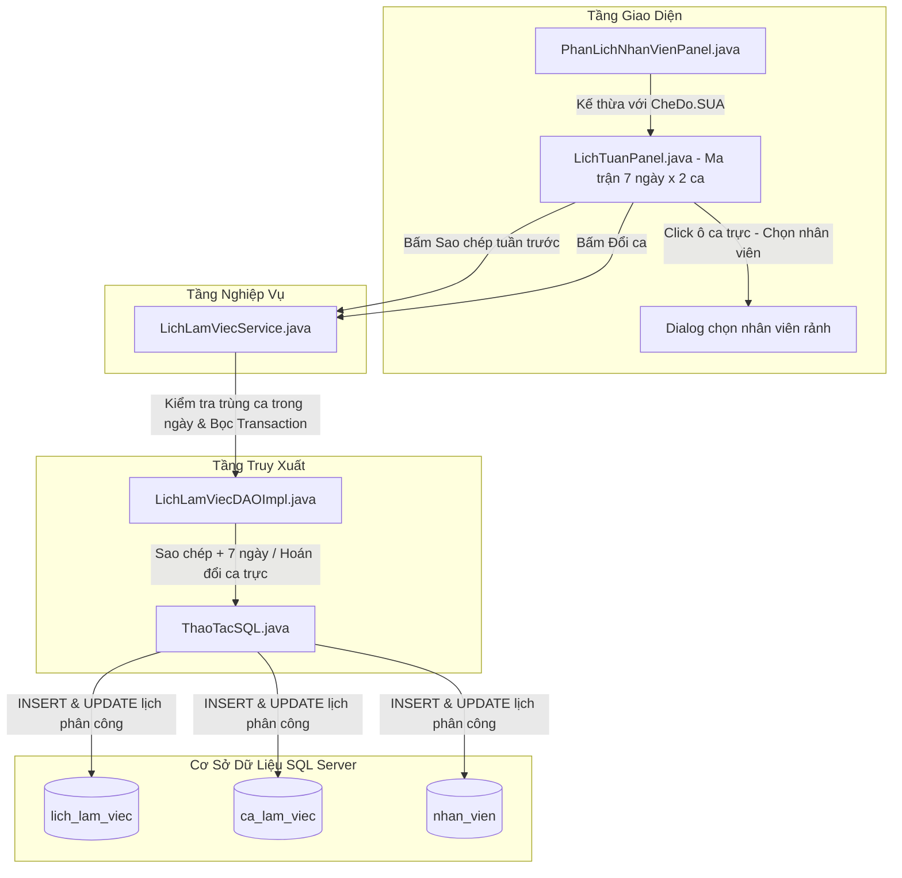

#### D. Mổ xẻ mã nguồn chi tiết
* **File Giao diện điều phối:** `src/main/java/com/petstation/gui/processing/staff/PhanLichNhanVienPanel.java`.
* **Component Lưới tuần dùng chung:** `src/main/java/com/petstation/gui/components/LichTuanPanel.java`.
* **1. Sao chép lịch tuần trước (`LichTuanPanel.java`, dòng 700 – 725, hàm `saoChepLichTuan`):**
  Lấy ngày đầu tuần hiện tại lùi lại 7 ngày (`dauTuanHienTai.minusWeeks(1)`), đọc các ca trực của tuần cũ trong CSDL rồi tịnh tiến ngày thêm 7 ngày và `INSERT` hàng loạt vào tuần mới.
* **2. Đổi ca làm việc giữa 2 nhân viên (`LichTuanPanel.java`, dòng 800 – 900):**
  Thực thi hoán đổi `nhan_vien_id` của 2 bản ghi trong bảng `lich_lam_viec` bên trong một Transaction để đảm bảo tính nhất quán.

#### E. "Thầy hỏi - Chỉ tay vào đâu"
* **Thầy hỏi:** *"Chức năng sao chép lịch tuần trước viết ở đâu và hoạt động thế nào?"*
* **Bạn chỉ tay vào màn hình:** Mở `LichTuanPanel.java`, chỉ vào **dòng 700 – 725**.
* **Bạn trả lời:** *"Dạ thưa Thầy/Cô, hàm `saoChepLichTuan()` lấy ngày đầu tuần trừ đi 7 ngày để truy vấn toàn bộ ca trực của tuần trước, sau đó cộng 7 ngày vào từng ca và lưu sang tuần mới. Quản lý chỉ cần xếp lịch chuẩn cho tuần đầu tiên, các tuần sau chỉ cần bấm nút Sao chép trong 1 giây là xong ạ."*

#### F. Kịch bản nói mẫu đạt điểm 10
> *"Dạ thưa Thầy/Cô, màn hình Phân lịch nhân viên được nhóm em thiết kế dạng ma trận trực quan gồm 2 ca và 7 ngày trong tuần. Có màu sắc phân biệt rõ ràng giữa nhân viên Bán hàng, nhân viên Spa và Quản lý. Để giảm tải công việc cho cửa hàng trưởng, nhóm em tích hợp tính năng 'Sao chép tuần trước' và tính năng 'Đổi ca trực tiếp' giữa 2 nhân viên, giúp việc điều phối nhân sự cực kỳ nhanh chóng và tránh hoàn toàn việc trùng ca."*

---

### 5. TÌM KIẾM HÓA ĐƠN

#### A. Ý nghĩa thực tế ở tiệm thú cưng
Khách hàng quay lại tiệm hỏi: *"Hôm qua tôi mua gói cát vệ sinh mà quên lấy hóa đơn, in lại giúp tôi"*, hoặc Quản lý muốn lọc xem hôm nay thu được bao nhiêu đơn chuyển khoản VietQR. Thu ngân cần một chỗ tìm kiếm siêu nhanh và xem trước được tờ hóa đơn y như thật để bấm in lại ngay.

#### B. Quy trình thao tác trên phần mềm
1. Vào menu **Tìm kiếm** $\rightarrow$ Chọn **Hóa đơn** (hoặc bấm phím tắt **`F3`**).
2. Toàn bộ thanh công cụ nằm gọn trên **cùng 1 hàng**:
   * Ô tìm kiếm từ khóa: gõ mã HĐ, tên khách, hoặc tên thu ngân.
   * Ô **Từ ngày** và **Đến ngày**: mặc định lùi 60 ngày để hiện đầy đủ tất cả 34 hóa đơn mẫu.
   * ComboBox **Phương thức**: `TẤT CẢ`, `Tiền mặt`, `Chuyển khoản`, `Thẻ`.
   * ComboBox **Trạng thái**: `TẤT CẢ`, `Đã thanh toán`, `Đã hủy`, `Đã hoàn`.
   * Bên phải có 2 nút: **[Làm mới]** và **[Xuất Excel]**.
3. Bảng bên trái hiện danh sách các hóa đơn khớp điều kiện.
4. Click chọn 1 hóa đơn bên trái $\rightarrow$ **Bên phải lập tức hiện tờ hóa đơn in nhiệt K80 (80mm)** có đầy đủ logo tiệm, ngày giờ, danh sách món hàng, mã VietQR, tiền khách đưa, tiền thừa.
5. Bấm nút **[In lại hóa đơn (K80 / A5)]** để gửi lệnh in ra máy in nhiệt tại quầy.

#### C. Sơ đồ luồng xử lý nghiệp vụ & Các file liên quan

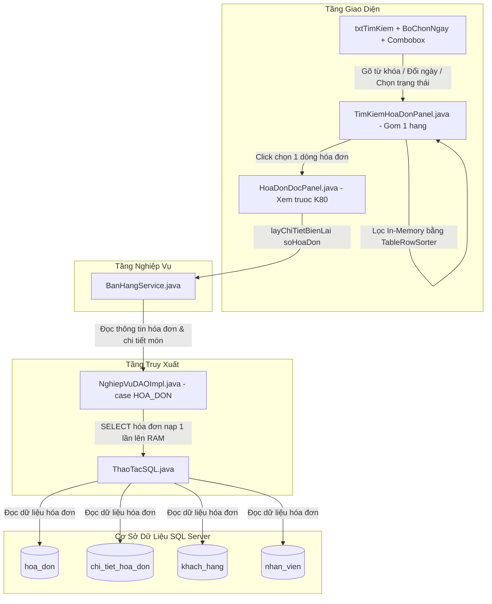

#### D. Mổ xẻ mã nguồn chi tiết
* **File chính:** `src/main/java/com/petstation/gui/search/TimKiemHoaDonPanel.java`.
* **1. Gom thanh công cụ trên 1 hàng (`TimKiemHoaDonPanel.java`, dòng 93 – 131):**
  Sử dụng `BorderLayout`: bên trái (`BorderLayout.CENTER`) là `pnlBoLoc` chứa ô tìm kiếm và các combobox; bên phải (`BorderLayout.EAST`) là `pnlNutPhai` chứa 2 nút Làm mới và Xuất Excel.
* **2. Mặc định 60 ngày hiển thị 34/34 kết quả (`TimKiemHoaDonPanel.java`, dòng 55):**
  `LocalDate macDinhTuNgay = LocalDate.now().minusDays(60);` bảo đảm bao trọn toàn bộ các hóa đơn mẫu tạo từ tháng trước.
* **3. Bộ lọc Regex đa tiêu chí (`TimKiemHoaDonPanel.java`, dòng 265 – 340, hàm `apDungBoLocNangCao`):**
  ```java
  // Lọc phương thức thanh toán tại cột 6
  String maPt = switch (phuongThuc) {
      case "Tiền mặt" -> "CASH|TIEN_MAT|Tiền mặt";
      case "Chuyển khoản" -> "TRANSFER|CHUYEN_KHOAN|Chuyển khoản.*";
      case "Thẻ" -> "CARD|THE|QUET_THE|Thẻ";
      default -> "SPLIT|MIXED|KET_HOP|Kết hợp";
  };
  cacBoLoc.add(RowFilter.regexFilter("(?iu)^(" + maPt + ")$", 6));
  
  // Lọc khoảng ngày tại cột 4 (thanh_toan_luc)
  cacBoLoc.add(new RowFilter<>() {
      public boolean include(Entry<?, ?> entry) {
          LocalDate d = LocalDate.parse(entry.getValue(4).toString().substring(0, 10));
          return (tuNgay == null || !d.isBefore(tuNgay)) && (denNgay == null || !d.isAfter(denNgay));
      }
  });
  sorter.setRowFilter(RowFilter.andFilter(cacBoLoc));
  ```
* **4. Xem trước hóa đơn K80 bên phải (`TimKiemHoaDonPanel.java`, dòng 246 – 256):**
  Lấy mã hóa đơn khi click bảng $\rightarrow$ gọi `BanHangService.layChiTietBienLai()` $\rightarrow$ nạp vào component `HoaDonDocPanel.java`.

#### E. "Thầy hỏi - Chỉ tay vào đâu"
* **Thầy hỏi:** *"Tại sao ban đầu lại hiển thị 28/34 kết quả và nhóm đã giải quyết như thế nào?"*
* **Bạn chỉ tay vào màn hình:** Mở `TimKiemHoaDonPanel.java`, chỉ vào **dòng 55** và **dòng 280 – 300**.
* **Bạn trả lời:** *"Dạ thưa Thầy/Cô, trong CSDL có tổng cộng 37 đơn, trong đó 3 đơn là giỏ hàng chờ `GIO_TREO` nên chỉ có 34 hóa đơn thực tế hoàn tất. Ban đầu hệ thống để mặc định lọc 30 ngày gần nhất, trong khi 6 hóa đơn mẫu phát sinh từ cuối tháng 9 (cách đây hơn 30 ngày) nên bị bộ lọc ẩn đi còn đúng 28 kết quả. Nhóm em đã nới khoảng lọc mặc định thành 60 ngày tại dòng 55 để hiển thị trọn vẹn 34/34 kết quả ngay khi mở màn hình, đồng thời việt hóa 100% các mục chọn và hỗ trợ xem trước hóa đơn khổ in nhiệt K80 ngay bên cạnh."*

#### F. Kịch bản nói mẫu đạt điểm 10
> *"Dạ thưa Thầy/Cô, màn hình Tìm kiếm hóa đơn được nhóm em thiết kế theo mô hình Master-Detail hiện đại: Bên trái là bảng danh sách hóa đơn với bộ lọc đa tiêu chí trên cùng một hàng (tìm kiếm từ khóa, khoảng ngày, phương thức thanh toán và trạng thái bằng tiếng Việt chuẩn). Bên phải là khung xem trước hóa đơn theo đúng khổ giấy in nhiệt K80 thực tế của các siêu thị và cửa hàng tiện lợi, cho phép in lại hóa đơn bất cứ lúc nào."*

---

### 6 & 7. LỊCH LÀM VIỆC TOÀN CỬA HÀNG & LỊCH CÁ NHÂN

#### A. Ý nghĩa thực tế ở tiệm thú cưng
* **Lịch toàn cửa hàng:** Nhân viên vào xem để biết hôm nay ai trực cùng mình, ai làm ca chiều. Màn hình này **chỉ xem, không được sửa**.
* **Lịch cá nhân:** Nhân viên chỉ muốn nhìn thấy các ca của riêng mình để không bị rối mắt. Nếu có việc bận đột xuất thì có nút **"Đăng ký nghỉ phép"** để gửi yêu cầu cho Quản lý phê duyệt.

#### B. Quy trình thao tác trên phần mềm
* **Xem toàn cửa hàng:** Vào **Tìm kiếm** $\rightarrow$ Chọn **Lịch làm việc**. Xem lịch cả tuần của toàn bộ nhân sự, có thể lọc theo Chức vụ hoặc tìm theo Tên.
* **Xem cá nhân & Xin nghỉ:**
  1. Vào **Tìm kiếm** $\rightarrow$ Chọn **Lịch làm việc cá nhân**.
  2. Màn hình tự động ẩn ca của người khác, chỉ hiện các ca của chính mình.
  3. Muốn xin nghỉ: Bấm nút **[Đăng ký nghỉ phép]** $\rightarrow$ Chọn ngày, chọn ca muốn nghỉ, nhập lý do (Bị ốm, Việc gia đình) $\rightarrow$ Bấm Gửi. Yêu cầu chuyển về trạng thái `PENDING` chờ Quản lý duyệt.

#### C. Sơ đồ luồng xử lý nghiệp vụ & Các file liên quan

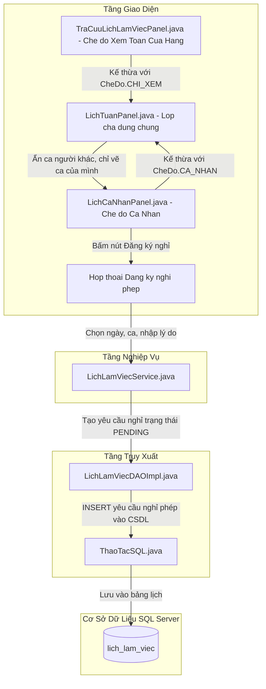

#### D. Mổ xẻ mã nguồn chi tiết
* **Kế thừa hướng đối tượng (OOP):** Cả 2 màn hình đều kế thừa từ lớp cha `src/main/java/com/petstation/gui/components/LichTuanPanel.java`.
* **File Tra cứu toàn tiệm:** `src/main/java/com/petstation/gui/search/TraCuuLichLamViecPanel.java`.
  * Khởi tạo với: `super(CheDo.CHI_XEM, null);` $\rightarrow$ Tự động ẩn toàn bộ các nút chỉnh sửa/sao chép lịch.
* **File Lịch cá nhân:** `src/main/java/com/petstation/gui/search/LichCaNhanPanel.java`.
  * Khởi tạo với: `super(CheDo.CA_NHAN, maNhanVienDangNhap);` (Dòng 8).
  * Lớp cha `LichTuanPanel` tự động kích hoạt bộ lọc:
    ```java
    if (cheDo == CheDo.CA_NHAN && !ca.maNhanVien.equals(this.maNhanVienHienTai)) {
        continue; // Ẩn ca của người khác, chỉ vẽ ca của chính nhân viên này
    }
    ```
  * Hiển thị nút `btnDangKyNghiPhep` (Dòng 650 – 700) tạo bản ghi nghỉ phép vào CSDL.

#### E. "Thầy hỏi - Chỉ tay vào đâu"
* **Thầy hỏi:** *"Tại sao nhóm tách làm 2 màn hình riêng, code có bị trùng lặp không?"*
* **Bạn chỉ tay vào màn hình:** Mở `LichCaNhanPanel.java`, chỉ vào **dòng 8**.
* **Bạn trả lời:** *"Dạ thưa Thầy/Cô, hoàn toàn không trùng lặp code vì nhóm áp dụng triệt để tính **Kế thừa trong OOP**. Toàn bộ giao diện lưới lịch tuần và logic vẽ thẻ nằm ở lớp cha `LichTuanPanel`. Màn hình cá nhân chỉ cần truyền vào `CheDo.CA_NHAN` kèm mã nhân viên đăng nhập là lớp cha tự động lọc lịch và mở tính năng xin nghỉ phép tương ứng."*

#### F. Kịch bản nói mẫu đạt điểm 10
> *"Dạ thưa Thầy/Cô, nhóm em áp dụng triệt để tính năng kế thừa trong lập trình hướng đối tượng. Cả màn hình Phân lịch, Tra cứu lịch toàn cửa hàng và Lịch cá nhân đều dùng chung một component lưới tuần là `LichTuanPanel`. Nếu là nhân viên xem cá nhân thì hệ thống chỉ hiển thị ca trực của chính nhân viên đó và kích hoạt nút 'Đăng ký nghỉ phép'. Điều này giúp tái sử dụng mã nguồn tối đa và tránh trùng lặp code."*

---

### 8. DANH MỤC SẢN PHẨM

#### A. Ý nghĩa thực tế ở tiệm thú cưng
Quản lý các mặt hàng trong tiệm (thức ăn hạt, pate, chuồng, sữa tắm). Khi nhập hàng về tiệm bắt buộc phải có **mã vạch (Barcode)** để lúc bán hàng thu ngân quét `Tít` là ra giá tiền. Nếu hàng thủ công chưa có mã vạch thì phần mềm phải tự sinh được mã vạch chuẩn cho sản phẩm.

#### B. Quy trình thao tác trên phần mềm
1. Vào menu **Danh mục** $\rightarrow$ Chọn **Sản phẩm**.
2. **Thêm sản phẩm mới:**
   * Bấm nút **[+ Thêm]** $\rightarrow$ Form bên phải sáng lên.
   * Nhập Tên, Chọn nhóm hàng, Đơn vị tính, Giá bán, Tồn kho tối thiểu.
   * Nếu chưa có mã vạch: Bấm nút **[Tạo Barcode]** $\rightarrow$ Hệ thống tự sinh mã 13 số chuẩn Việt Nam (đầu `893`).
   * Chọn ảnh đại diện từ máy tính $\rightarrow$ Bấm nút **[Lưu]** (màu xanh lá).
3. **Quy tắc bảo vệ dữ liệu:**
   * Chỉ Quản lý mới được sửa giá bán, nhân viên bán hàng chỉ được xem (`read-only`).
   * Sản phẩm đã từng bán thì không được xóa thẳng (`DELETE`), chỉ chuyển sang trạng thái "Ngừng kinh doanh" để bảo toàn lịch sử hóa đơn.

#### C. Sơ đồ luồng xử lý nghiệp vụ & Các file liên quan

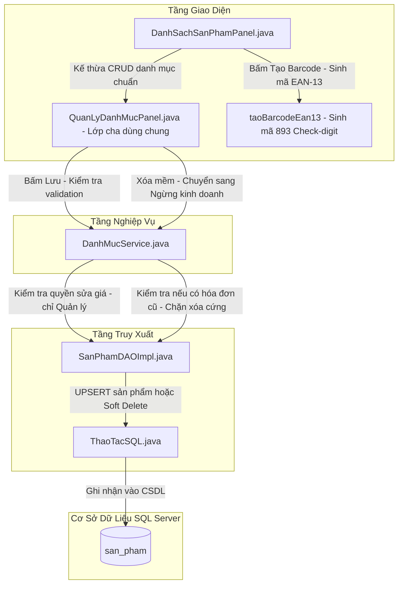

#### D. Mổ xẻ mã nguồn chi tiết
* **File chính:** `src/main/java/com/petstation/gui/catalog/DanhSachSanPhamPanel.java`.
* **Thuật toán sinh mã vạch GS1 EAN-13 chuẩn quốc tế (Dòng 23 – 41):**
  ```java
  // Đầu số mã quốc gia Việt Nam là 893
  String base12 = "893" + String.format("%09d", num % 1000000000L);
  // Thuật toán tính số kiểm tra Check-digit Modulo 10:
  int sum = 0;
  for (int i = 0; i < 12; i++) {
      int d = base12.charAt(i) - '0';
      sum += (i % 2 == 0) ? d : d * 3; // Vị trí lẻ x 1, vị trí chẵn x 3
  }
  int checkDigit = (10 - (sum % 10)) % 10;
  return base12 + checkDigit; // Ghép lại thành mã vạch 13 số chuẩn
  ```
* **Xóa mềm (Soft Delete) bảo vệ lịch sử hóa đơn (Dòng 100 – 110):**
  Kiểm tra nếu sản phẩm đã phát sinh chi tiết hóa đơn thì cập nhật cờ `dang_kinh_doanh = 0` chứ không gọi lệnh `DELETE FROM san_pham`.

#### E. "Thầy hỏi - Chỉ tay vào đâu"
* **Thầy hỏi:** *"Chỗ nào tự sinh mã vạch và kiểm tra tính hợp lệ của mã vạch?"*
* **Bạn chỉ tay vào màn hình:** Mở `DanhSachSanPhamPanel.java`, chỉ vào **dòng 23 – 41**.
* **Bạn trả lời:** *"Dạ thưa Thầy/Cô, nhóm em cài đặt thuật toán sinh mã vạch EAN-13 chuẩn GS1 với tiền tố 893 của Việt Nam, tính số kiểm tra Check-digit bằng thuật toán Modulo 10 ở dòng 39. Mọi máy quét mã vạch trên thị trường đều nhận diện chính xác 100% mã này."*

#### F. Kịch bản nói mẫu đạt điểm 10
> *"Dạ thưa Thầy/Cô, màn hình Danh mục sản phẩm của nhóm em có tích hợp thuật toán sinh mã vạch chuẩn quốc tế GS1 EAN-13 với đầu số 893 của Việt Nam, tự động tính số kiểm tra Check-digit để máy quét mã vạch nhận diện chuẩn xác 100%. Đồng thời, hệ thống có phân quyền chặt chẽ: chỉ có Quản lý mới được sửa giá bán; nếu sản phẩm đã từng có lịch sử bán hàng thì hệ thống không cho xóa cứng mà tự động chuyển sang 'Ngừng kinh doanh' để bảo vệ toàn vẹn lịch sử hóa đơn."*

---

### 9. DANH MỤC NHÂN VIÊN

#### A. Ý nghĩa thực tế ở tiệm thú cưng
Lưu hồ sơ nhân viên trong tiệm. Theo Luật Lao động Việt Nam, **nhân viên chính thức phải đủ 18 tuổi trở lên**. Khi nhân viên quên mật khẩu thì Quản lý phải có nút cấp lại mật khẩu ngay mà không cần gọi thợ kỹ thuật can thiệp database.

#### B. Quy trình thao tác trên phần mềm
1. Vào menu **Danh mục** $\rightarrow$ Chọn **Nhân viên**.
2. **Thêm nhân viên mới:**
   * Bấm nút **[+ Thêm]**.
   * Nhập Họ tên (phải từ 2 từ trở lên, không chứa số).
   * Nhập Số điện thoại (đúng 10 số, bắt đầu bằng số `0`).
   * Nhập Số CCCD (đúng 12 số).
   * **Kiểm tra tuổi tự động:** Phần mềm giải mã năm sinh từ số CCCD. Nếu chưa đủ 18 tuổi, hệ thống lập tức báo lỗi đỏ và chặn lưu!
   * Chọn Chức vụ $\rightarrow$ Bấm **[Lưu]**.
3. **Cấp lại mật khẩu:** Quản lý chọn nhân viên $\rightarrow$ Bấm nút **[Đặt lại MK]** trên thanh công cụ $\rightarrow$ Mật khẩu tự động reset về mặc định `123456`.

#### C. Sơ đồ luồng xử lý nghiệp vụ & Các file liên quan

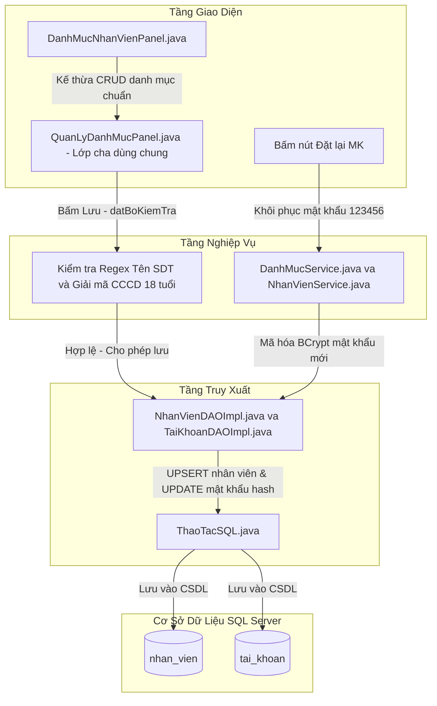

#### D. Mổ xẻ mã nguồn chi tiết
* **File chính:** `src/main/java/com/petstation/gui/catalog/DanhMucNhanVienPanel.java`.
* **Thuật toán giải mã CCCD kiểm tra đủ 18 tuổi (Dòng 47 – 64):**
  Cấu trúc CCCD 12 số gắn chip:
  * Ký tự thứ 4 đại diện thế kỷ và giới tính: `0, 1` là thế kỷ 20 (năm sinh 19xx); `2, 3` là thế kỷ 21 (năm sinh 20xx).
  * 2 ký tự tiếp theo là 2 số cuối của năm sinh.
  ```java
  char theKyChar = cccd.charAt(3);
  int namDau = (theKyChar == '0' || theKyChar == '1') ? 1900 : 2000;
  int namSinh = namDau + Integer.parseInt(cccd.substring(4, 6));
  int tuoi = Year.now().getValue() - namSinh;
  if (tuoi < 18) {
      throw new ValidationException("Nhân viên chưa đủ 18 tuổi theo quy định!");
  }
  ```
* **Đặt lại mật khẩu (Dòng 78 – 95):**
  Hash mật khẩu `123456` bằng thuật toán mã hóa 1 chiều an toàn `BCrypt` và cập nhật vào bảng `tai_khoan`.

#### E. "Thầy hỏi - Chỉ tay vào đâu"
* **Thầy hỏi:** *"Chỗ nào kiểm tra đủ 18 tuổi từ số CCCD?"*
* **Bạn chỉ tay vào màn hình:** Mở `DanhMucNhanVienPanel.java`, chỉ vào **dòng 47 – 64**.
* **Bạn trả lời:** *"Dạ thưa Thầy/Cô, nhóm em bóc tách ký tự thứ 4 để xác định thế kỷ 20 hay 21, lấy 2 ký tự tiếp theo để tính ra năm sinh và lấy năm hiện tại trừ đi năm sinh để kiểm tra điều kiện `tuoi < 18`. Nếu vi phạm hệ thống sẽ chặn không cho lưu hồ sơ ạ."*

#### F. Kịch bản nói mẫu đạt điểm 10
> *"Dạ thưa Thầy/Cô, ở danh mục Nhân viên, nhóm em cài đặt các bộ kiểm tra nghiệp vụ rất thực tế: Tên nhân viên không được chứa số, số điện thoại phải chuẩn 10 số. Đặc biệt, nhóm em xây dựng thuật toán tự động bóc tách mã thế kỷ và năm sinh từ số CCCD 12 số để xác thực nhân viên phải đủ từ 18 tuổi trở lên theo Luật Lao động thì mới cho phép tạo hồ sơ."*

---

### 10. CÀI ĐẶT HỆ THỐNG

#### A. Ý nghĩa thực tế ở tiệm thú cưng
Mỗi tiệm thú cưng có tên riêng, số tài khoản ngân hàng riêng, máy in riêng. Nếu người lập trình viết cứng (hardcode) những thông tin này vào mã nguồn thì khi tiệm đổi số tài khoản hay mua máy in mới, họ sẽ phải gọi thợ lập trình đến sửa code rất tốn kém. Màn hình Cài đặt cho phép chủ tiệm tự thay đổi những thông tin này ngay trên giao diện trong 5 giây.

#### B. Quy trình thao tác trên phần mềm
1. Vào menu **Hệ thống** $\rightarrow$ Chọn **Cài đặt**.
2. Màn hình chia làm **4 Tab chức năng**:
   * **Tab 1 - Cửa hàng & Hóa đơn:** Đổi Tên tiệm, Địa chỉ, Hotline, Mã số thuế, Thuế VAT. Cấu hình ngân hàng VietQR (Tên ngân hàng, Số tài khoản, Tên chủ thẻ). Chọn máy in hóa đơn mặc định từ danh sách máy in đang kết nối vào máy tính.
   * **Tab 2 - Kho & Hàng hóa:** Cài đặt số ngày cảnh báo hàng cận date (mặc định 30 ngày), Bật/Tắt chế độ kiểm kê mù.
   * **Tab 3 - Nhân sự:** Cài đặt giờ mở cửa, giờ đóng cửa tiệm.
   * **Tab 4 - Sao lưu:** Chọn thư mục lưu file và bấm nút sao lưu CSDL dự phòng.
3. Bấm nút **[Lưu cài đặt]** ở góc dưới.

#### C. Sơ đồ luồng xử lý nghiệp vụ & Các file liên quan

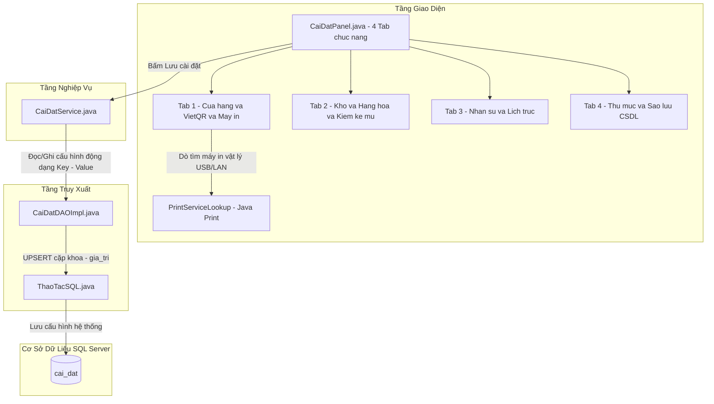

#### D. Mổ xẻ mã nguồn chi tiết
* **File Giao diện:** `src/main/java/com/petstation/gui/system/CaiDatPanel.java`.
* **File DAO:** `src/main/java/com/petstation/dao/impl/CaiDatDAOImpl.java`.
* **1. Mô hình CSDL Key - Value linh hoạt:**
  Bảng `cai_dat` gồm 2 cột chính: `khoa` (Key) và `gia_tri` (Value). Bất cứ cấu hình mới nào cũng được lưu dưới dạng Key-Value mà không cần phải chạy lệnh sửa cấu trúc bảng `ALTER TABLE`.
* **2. Tự động nhận diện máy in thực tế (`CaiDatPanel.java`, dòng 71 – 74):**
  ```java
  for (PrintService dichVu : PrintServiceLookup.lookupPrintServices(null, null)) {
      cboMayIn.addItem(dichVu.getName());
  }
  ```
  Sử dụng thư viện `PrintServiceLookup` của Java để quét toàn bộ máy in (máy in nhiệt K80, máy in laser Canon, máy in ảo PDF) đang cắm cáp USB hoặc kết nối qua mạng LAN với máy tính.

#### E. "Thầy hỏi - Chỉ tay vào đâu"
* **Thầy hỏi:** *"Chỗ nào dò tìm máy in đang cắm trong máy tính?"*
* **Bạn chỉ tay vào màn hình:** Mở `CaiDatPanel.java`, chỉ vào **dòng 71 – 74**.
* **Bạn trả lời:** *"Dạ thưa Thầy/Cô, nhóm em sử dụng thư viện Java Print Service: `PrintServiceLookup.lookupPrintServices(null, null)` để tự động quét toàn bộ danh sách máy in thực tế đang kết nối với hệ điều hành Windows và nạp vào ComboBox cho người dùng chọn mà không cần cài đặt phức tạp."*

#### F. Kịch bản nói mẫu đạt điểm 10
> *"Dạ thưa Thầy/Cô, màn hình Cài đặt được nhóm em thiết kế dạng TabbedPane 4 nhóm chức năng. Toàn bộ cấu hình được lưu trữ theo mô hình Key-Value trong bảng `cai_dat` của CSDL. Điều này giúp hệ thống có tính tùy biến cực kỳ cao: chủ tiệm có thể tự đổi số tài khoản nhận tiền VietQR, đổi tên cửa hàng in trên hóa đơn, hoặc chọn máy in nhiệt mà không cần phải can thiệp hay sửa lại một dòng mã nguồn nào."*

---

## IV. BẢNG TỔNG HỢP TRA CỨU SIÊU TỐC

*(In ra giấy hoặc mở sẵn trên máy tính khi bước vào phòng vấn đáp)*

| STT | Tên chức năng | File GUI chính | File Service / DAO | Dòng code đắt giá | Câu chốt khi trả lời Thầy/Cô |
| :---: | :--- | :--- | :--- | :--- | :--- |
| **1** | **Thống kê Doanh thu** | `ThongKeDoanhThuPanel.java` | `ThongKeDAOImpl.java` | Dòng 88 – 105 | *"Gom 3 nguồn bằng `WITH ledger AS`: hóa đơn bán hàng + cọc Pet Hotel - tiền hoàn trả đổi hàng."* |
| **2** | **Thống kê Hàng hóa** | `ThongKeHangHoaPanel.java` | `ThongKeDAOImpl.java` | Dòng 22 – 28 | *"Lọc hạn sử dụng theo từng Lô hàng bằng hàm `DATEADD` của SQL Server."* |
| **3** | **Kiểm kê tồn kho** | `KiemKePanel.java` | `KhoService.java` | Dòng 543 & dòng 76 | *"Lắng nghe súng quét Barcode tăng tồn thực tế, tô màu đỏ/xanh chênh lệch, hỗ trợ chế độ Kiểm kê mù."* |
| **4** | **Phân lịch nhân viên** | `PhanLichNhanVienPanel.java` | `LichTuanPanel.java` | Dòng 700 – 725 | *"Ma trận lưới tuần 2 ca x 7 ngày, tính năng Sao chép tuần trước giúp xếp lịch trong 1 giây."* |
| **5** | **Tìm kiếm Hóa đơn** | `TimKiemHoaDonPanel.java` | `NghiepVuDAOImpl.java` | Dòng 265 – 340 | *"Gom bộ lọc trên 1 hàng, dùng `RowFilter.andFilter()` lọc Regex đa tiêu chí, xem trước hóa đơn K80."* |
| **6** | **Lịch làm việc toàn tiệm** | `TraCuuLichLamViecPanel.java` | `LichTuanPanel.java` | Dòng 10 – 15 | *"Kế thừa `LichTuanPanel` với `CheDo.CHI_XEM`, khóa tính năng chỉnh sửa, lọc theo chức vụ và tên."* |
| **7** | **Lịch làm việc cá nhân** | `LichCaNhanPanel.java` | `LichTuanPanel.java` | Dòng 8 | *"Kế thừa `LichTuanPanel` với `CheDo.CA_NHAN`, chỉ hiện ca của tài khoản đăng nhập và có Đăng ký nghỉ phép."* |
| **8** | **Danh mục Sản phẩm** | `DanhSachSanPhamPanel.java` | `SanPhamDAOImpl.java` | Dòng 23 – 41 | *"Sinh mã vạch chuẩn GS1 EAN-13 đầu 893 và áp dụng Xóa mềm (Soft Delete) bảo vệ hóa đơn cũ."* |
| **9** | **Danh mục Nhân viên** | `DanhMucNhanVienPanel.java` | `NhanVienDAOImpl.java` | Dòng 47 – 64 | *"Bóc tách 12 số CCCD gắn chip tự động xác minh đủ 18 tuổi theo luật lao động."* |
| **10** | **Cài đặt hệ thống** | `CaiDatPanel.java` | `CaiDatDAOImpl.java` | Dòng 71 – 74 | *"Lưu trữ cấu hình động Key-Value, tự động quét máy in USB bằng thư viện `PrintServiceLookup`."* |

---

## V. BỘ CÂU HỎI BẪY PHẢN BIỆN THƯỜNG GẶP

1. **"Tại sao các em không xóa thẳng dòng dữ liệu trong database mà lại đổi trạng thái thành Ngừng hoạt động?"**
   * *Trả lời:* *"Dạ vì đó là kỹ thuật **Xóa mềm (Soft Delete)**. Nếu dùng lệnh `DELETE` xóa thẳng khỏi bảng `san_pham` hoặc `nhan_vien` thì toàn bộ hóa đơn bán hàng cũ tham chiếu đến khóa ngoại đó sẽ bị lỗi hoặc làm sai lệch sổ sách doanh thu kế toán trong quá khứ."*
2. **"Nếu đang thanh toán hóa đơn mà bị cúp điện đột ngột thì dữ liệu có bị lỗi không?"**
   * *Trả lời:* *"Dạ không bị lỗi vì nhóm em sử dụng **Database Transaction (`setAutoCommit(false)`)**. Quá trình lưu hóa đơn, lưu chi tiết hóa đơn và trừ tồn kho trong các lô hàng phải thành công 100% thì mới `commit()`. Nếu xảy ra sự cố giữa chừng, hệ thống tự động `rollback()` về trạng thái ban đầu, bảo đảm không bị mất mát hay sai lệch số liệu."*
3. **"Mã QR thanh toán trên hóa đơn được tạo ra như thế nào?"**
   * *Trả lời:* *"Dạ mã VietQR được sinh động theo chuẩn quốc tế EMVCo của Napas qua tiện ích `VietQRUtil`. Hệ thống đọc số tài khoản ngân hàng cấu hình trong màn hình Cài đặt, ghép cùng số tiền chính xác của hóa đơn và mã hóa đơn thành chuỗi mã QR chuẩn để khách mở app ngân hàng quét là chuyển khoản được ngay."*
