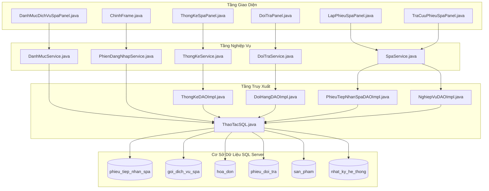
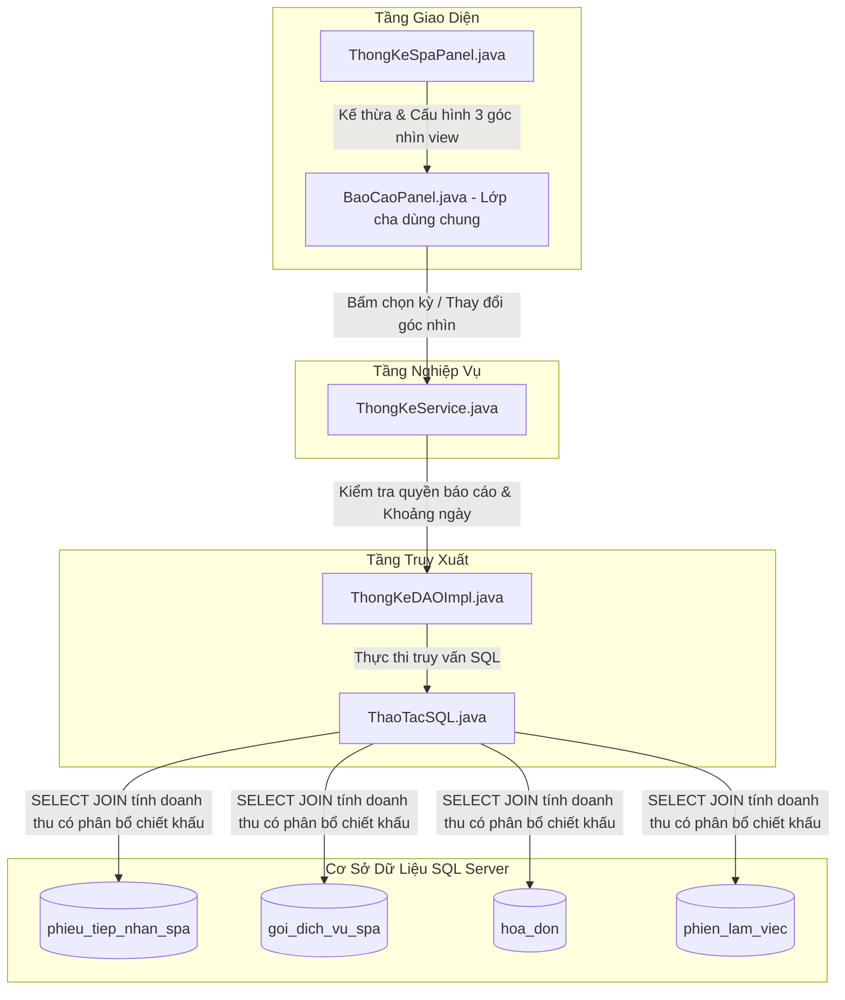
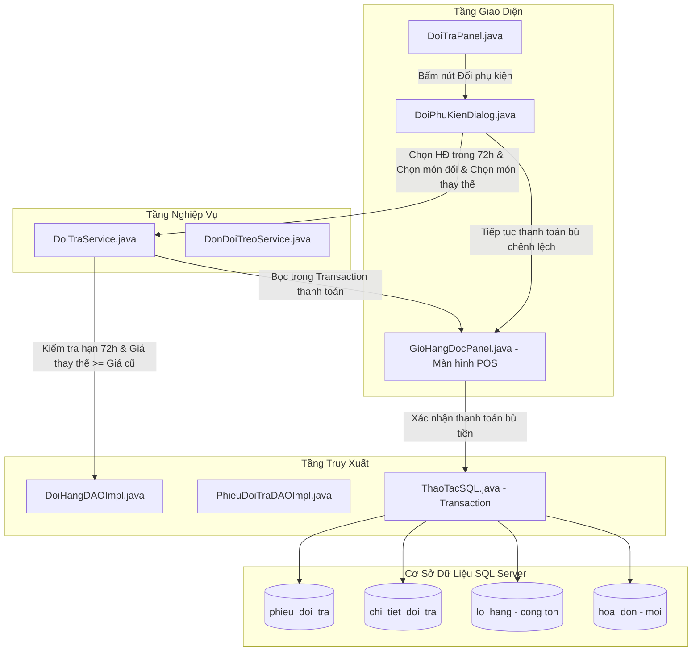
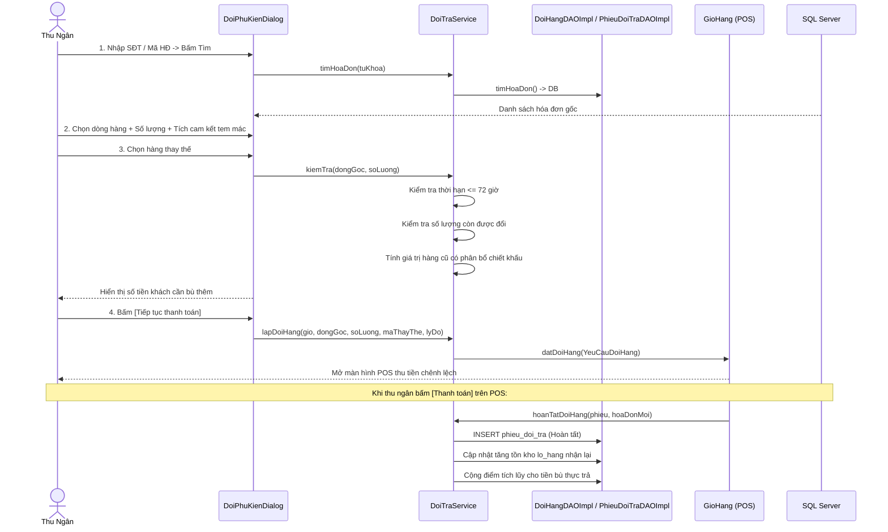
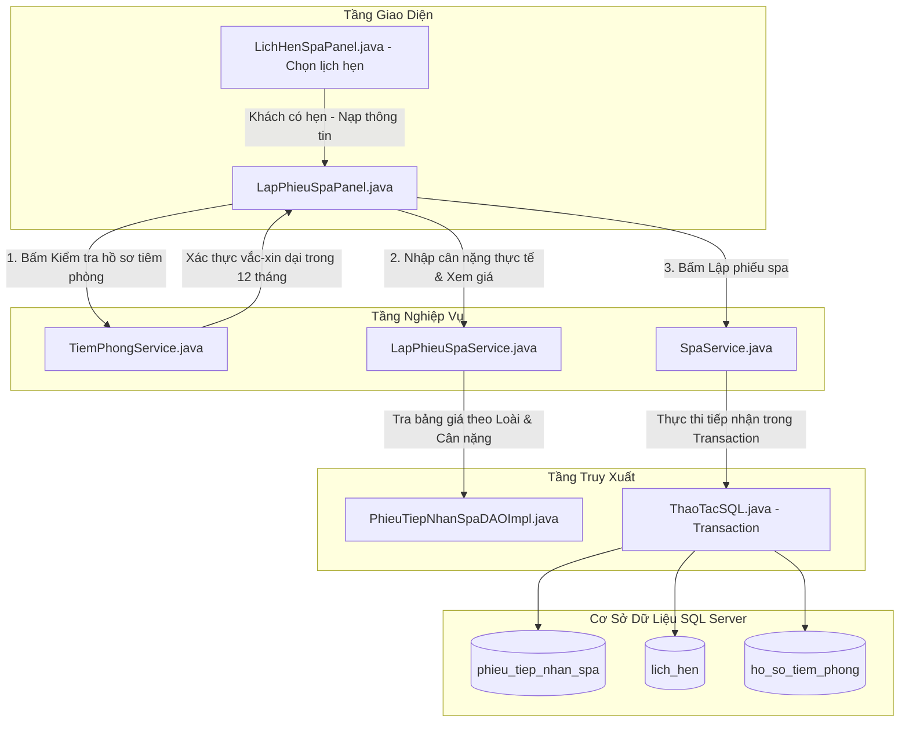
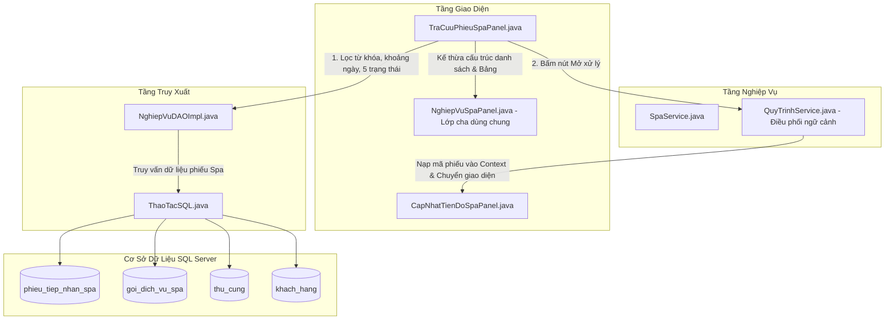
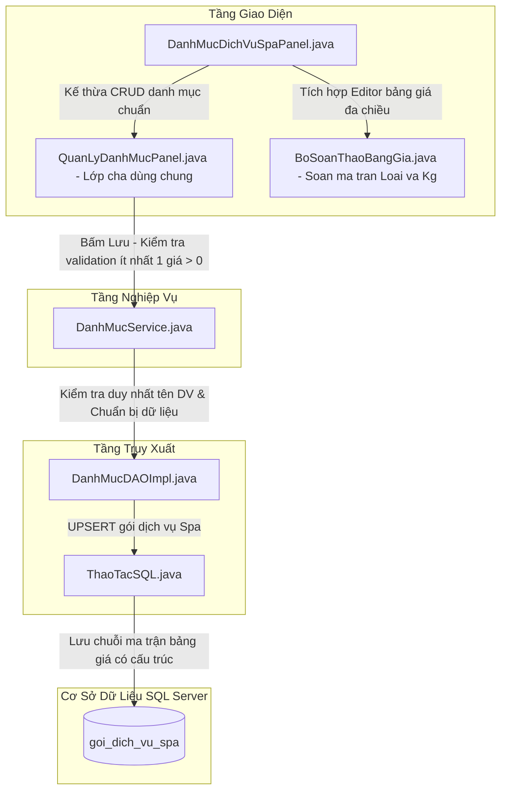
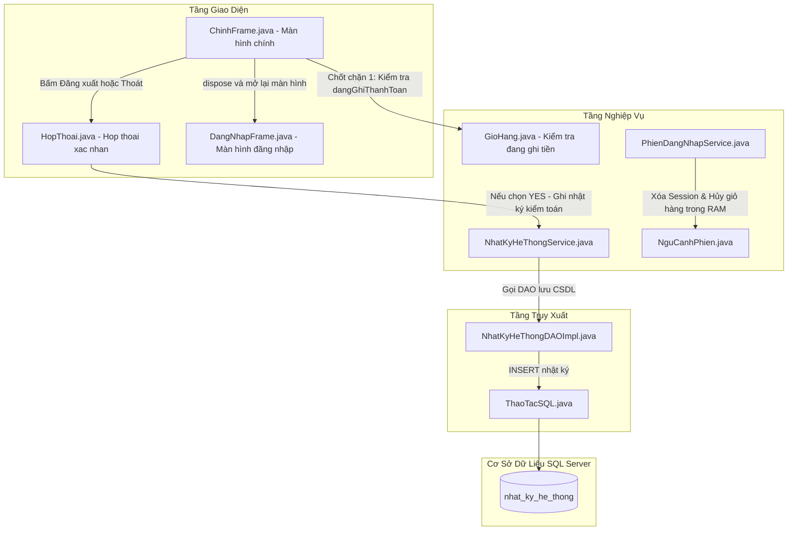

# TÀI LIỆU TOÀN DIỆN: CẨM NANG THUYẾT TRÌNH, PHÂN TÍCH CHUYÊN SÂU & HỎI ĐÁP BẢO VỆ ĐỒ ÁN (PHẦN 2)

> **Nhóm chức năng bao gồm:**  
> 1. **Thống kê:** Dịch vụ Spa (`ThongKeSpaPanel`)  
> 2. **Xử lý:** Đổi hàng phụ kiện (`DoiTraPanel` / `DoiPhuKienDialog`)  
> 3. **Xử lý:** Lập phiếu tiếp nhận Spa (`LapPhieuSpaPanel`)  
> 4. **Tìm kiếm:** Tra cứu phiếu Spa (`TraCuuPhieuSpaPanel`)  
> 5. **Danh mục:** Dịch vụ Spa & Ma trận giá theo loài / cân nặng (`DanhMucDichVuSpaPanel`)  
> 6. **Hệ thống:** Đăng xuất & Thoát ứng dụng an toàn (`ChinhFrame`)  
>  
> **Mục tiêu:**  
> * **Mỗi chức năng đều có SƠ ĐỒ MÔ TẢ LUỒNG XỬ LÝ NGHIỆP VỤ & CÁC FILE LIÊN QUAN** theo đúng chuẩn 3 tầng (Giao diện $\rightarrow$ Nghiệp vụ $\rightarrow$ Truy xuất DAO $\rightarrow$ SQL Server).  
> * Dành cho **người không chuyên code**: Bản chất đời thực cực kỳ dễ hiểu, quy trình bấm chuột từ A đến Z, kịch bản trả lời vấn đáp đạt điểm 10.  
> * Dành cho **yêu cầu kỹ thuật chuyên sâu**: Sequence Diagram, câu lệnh SQL chi tiết, chỉ rõ chính xác số dòng code trong dự án để "Thầy hỏi là chỉ tay vào được ngay".

---

## MỤC LỤC TỔNG QUAN

- [I. NGUYÊN TẮC BÀN TAY 3 TẦNG TRẢ LỜI MỌI CÂU HỎI](#i-nguyen-tac-ban-tay-3-tang)
- [II. KIẾN TRÚC TỔNG THỂ CỦA PHÂN HỆ SPA, ĐỔI HÀNG & HỆ THỐNG](#ii-kien-truc-tong-the)
- [III. PHÂN TÍCH CHI TIẾT TỪNG CHỨC NĂNG (KÈM SƠ ĐỒ LUỒNG CHO TỪNG CHỨC NĂNG)](#iii-phan-tich-chi-tiet-tung-chuc-nang)
  - [1. Thống kê Dịch vụ Spa (ThongKeSpaPanel)](#1-thong-ke-dich-vu-spa)
  - [2. Xử lý: Đổi hàng phụ kiện (DoiTraPanel & DoiPhuKienDialog)](#2-xu-ly-doi-hang-phu-kien)
  - [3. Xử lý: Lập phiếu tiếp nhận Spa (LapPhieuSpaPanel)](#3-xu-ly-lap-phieu-tiep-nhan-spa)
  - [4. Tìm kiếm: Tra cứu Phiếu Spa (TraCuuPhieuSpaPanel)](#4-tim-kiem-tra-cuu-phieu-spa)
  - [5. Danh mục: Dịch vụ Spa & Ma trận giá (DanhMucDichVuSpaPanel)](#5-danh-muc-dich-vu-spa)
  - [6. Hệ thống: Thoát & Đăng xuất an toàn (ChinhFrame)](#6-he-thong-thoat-va-dang-xuat)
- [IV. BẢNG TỔNG HỢP TRA CỨU SIÊU TỐC KHI ĐI THI](#iv-bang-tong-hop-tra-cuu-sieu-toc)
- [V. BỘ CÂU HỎI BẪY PHẢN BIỆN THƯỜNG GẶP VÀ CÁCH TRẢ LỜI](#v-bo-cau-hoi-bay-phan-bien)

---

## I. NGUYÊN TẮC BÀN TAY 3 TẦNG

Bất kể Giảng viên hỏi về chức năng nào trong phần này, bạn luôn trả lời theo 3 bước mạch lạc:

$$\text{Giao Diện (GUI)} \longrightarrow \text{Nghiệp Vụ (Service)} \longrightarrow \text{Dữ Liệu (DAO \& SQL Server)}$$

1. **Tầng Giao diện (Mắt thấy):** Người dùng nhập ô nào, tích chọn checkbox nào, bấm nút nào.
2. **Tầng Nghiệp vụ (Não xử lý):** Hệ thống kiểm tra điều kiện (đổi hàng trong 72 giờ không, thú cưng tiêm phòng chưa, cân nặng bao nhiêu kg để tính đúng giá ma trận, có đang kẹt thanh toán không).
3. **Tầng Dữ liệu (Sổ sách ghi chép):** Dữ liệu được thực thi trong Database Transaction (`commit`/`rollback`), cập nhật bảng CSDL và phản hồi kết quả trực quan lên màn hình.

---

## II. KIẾN TRÚC TỔNG THỂ



---

## III. PHÂN TÍCH CHI TIẾT TỪNG CHỨC NĂNG

---

### 1. THỐNG KÊ DỊCH VỤ SPA

#### A. Ý nghĩa thực tế ở tiệm thú cưng
Dịch vụ Spa (tắm, vệ sinh tai, cắt tỉa lông, nhuộm lông) là mảng mang lại tỷ suất lợi nhuận cao nhất cho tiệm thú cưng. Quản lý cần biết:
* Dịch vụ nào khách chuộng nhất (ví dụ: *Gói tắm vệ sinh toàn diện* hay *Cắt tỉa tạo kiểu*).
* Doanh thu thực tế của từng dịch vụ là bao nhiêu sau khi đã trừ đi các chương trình khuyến mãi/giảm giá trên hóa đơn.
* Tỷ lệ lịch hẹn khách đặt trước nhưng hủy hoặc không đến (`NO_SHOW`) để điều chỉnh nhân sự trực bồn tắm.

#### B. Quy trình thao tác trên phần mềm (Từ A đến Z)
1. Vào menu **Thống kê** $\rightarrow$ Chọn **Dịch vụ Spa**.
2. **Chọn kỳ thống kê:** Chọn khoảng ngày (Hôm nay, 7 ngày qua, Tháng này, hoặc tùy chỉnh).
3. **Chọn góc nhìn thống kê (Tab/Sub-view):**
   * **Dịch vụ đã thanh toán:** Hiển thị Mã DV, Tên dịch vụ, Số lượt làm, Giá trị dịch vụ $\rightarrow$ Kèm **biểu đồ cột trực quan** so sánh giữa các gói dịch vụ.
   * **Phiếu theo trạng thái:** Thống kê số lượng phiếu Đang tiếp nhận, Đang tắm, Đã hoàn thành, Đã thanh toán.
   * **Trạng thái lịch hẹn:** Thống kê số lượng lịch Hẹn mới, Đã đến (`CHECKED_IN`), Hủy hẹn (`CANCELLED`), hoặc Khách bùng hẹn.
4. Bấm nút **[Xuất Excel]** để lưu file báo cáo gửi chủ tiệm.

#### C. Sơ đồ luồng xử lý nghiệp vụ & Các file liên quan



#### D. Mổ xẻ mã nguồn chi tiết
* **File Giao diện:** `src/main/java/com/petstation/gui/reports/ThongKeSpaPanel.java`.
  * Kế thừa `BaoCaoPanel.java`, khai báo 3 kiểu hiển thị bằng hàm `taoKieuHienThi(...)`.
  * Chế độ *"Dịch vụ đã thanh toán"* bật cờ `coBieuDo = true` (dòng 30) để tự động vẽ biểu đồ cột.
* **File DAO & Câu lệnh SQL đắt giá:** `src/main/java/com/petstation/dao/impl/ThongKeDAOImpl.java`, tại **dòng 197 – 209** trong hàm `layDuLieuSpa()`:
```sql
SELECT g.ma_goi, g.ten_goi, SUM(t.so_luong) AS so_luot,
       -- Công thức phân bổ chiết khấu thông minh:
       SUM(CASE 
             WHEN h.tam_tinh > 0 THEN t.tong_tien * h.tong_tien / h.tam_tinh 
             ELSE t.tong_tien 
           END) AS gia_tri_thuc_te
FROM phieu_tiep_nhan_spa t 
JOIN goi_dich_vu_spa g ON g.id = t.goi_id 
JOIN hoa_don h ON h.id = t.hoa_don_id 
JOIN phien_lam_viec s ON s.id = h.phien_lam_viec_id
WHERE h.thanh_toan_luc >= ? AND h.thanh_toan_luc < ? 
  AND t.trang_thai = 'PAID'
  AND (? IS NULL OR s.tai_khoan_id = ?)
GROUP BY g.ma_goi, g.ten_goi 
ORDER BY SUM(t.so_luong) DESC;
```
* **Giải thích logic tính tiền kế toán:**  
  Nếu khách làm gói Spa 300.000đ nhưng áp voucher giảm giá toàn hóa đơn 10%, thì doanh thu thực tế ghi nhận cho gói Spa phải là $300.000 \times \frac{90\%}{100\%} = 270.000đ$. Phép tính `t.tong_tien * h.tong_tien / h.tam_tinh` bảo đảm doanh thu từng dịch vụ cộng lại luôn khớp 100% với số tiền thực thu vào két.

#### E. "Thầy hỏi - Chỉ tay vào đâu"
* **Thầy hỏi:** *"Chỗ nào tính doanh thu dịch vụ Spa và xử lý giảm giá?"*
* **Bạn mở file:** `src/main/java/com/petstation/dao/impl/ThongKeDAOImpl.java`.
* **Bạn chỉ tay:** Dòng **200 – 202**.
* **Bạn trả lời:** *"Dạ thưa Thầy/Cô, nằm ở đoạn SQL `SUM(CASE WHEN h.tam_tinh > 0 THEN t.tong_tien * h.tong_tien / h.tam_tinh ...)` này ạ. Nhóm em tính toán phân bổ giá trị chiết khấu của hóa đơn vào từng gói dịch vụ để doanh thu Spa phản ánh chuẩn dòng tiền thực tế."*

#### F. Kịch bản nói mẫu đạt điểm 10
> *"Dạ thưa Thầy/Cô, màn hình Thống kê dịch vụ Spa của nhóm em hỗ trợ 3 góc nhìn toàn diện: Số lượng phiếu theo trạng thái, Cơ cấu doanh thu theo từng gói dịch vụ kèm biểu đồ cột trực quan, và Tỷ lệ hoàn thành lịch hẹn. Đặc biệt, câu lệnh SQL tính doanh thu được lập trình theo công thức kế toán phân bổ chiết khấu, đảm bảo khi hóa đơn áp dụng mã giảm giá voucher thì doanh thu của dịch vụ Spa vẫn được hạch toán chính xác đến từng đồng."*

---

### 2. XỬ LÝ: ĐỔI HÀNG PHỤ KIỆN

#### A. Ý nghĩa thực tế ở tiệm thú cưng
Khách mua một cái vòng cổ hoặc chuồng nệm cho cún cưng nhưng về nhà mặc bị chật, hoặc thú cưng không chịu nằm. Khách đem đến tiệm xin đổi cái lớn hơn.  
Quy định kinh doanh chuẩn của tiệm thú cưng:
1. **Đổi trong vòng 72 giờ** kể từ khi mua.
2. **Hàng đổi phải nguyên tem mác, bao bì**, chưa qua sử dụng, không rách bẩn.
3. **Chỉ đổi hàng có giá bằng hoặc cao hơn** $\rightarrow$ **Không hoàn lại tiền mặt**, nếu món mới đắt hơn thì khách bù thêm tiền chênh lệch.
4. Hàng cũ nhận lại phải được nhập trả lại kho hàng.

#### B. Quy trình thao tác trên phần mềm (Từ A đến Z)
1. Vào menu **Xử lý** $\rightarrow$ Chọn **Đổi hàng** $\rightarrow$ Bấm nút **[+ Đổi phụ kiện]**.
2. Hộp thoại **"Đổi phụ kiện — không hoàn tiền"** mở ra gồm 3 bước:
   * **Bước 1: Tìm hóa đơn gốc:** Nhập Mã hóa đơn hoặc Số điện thoại của khách $\rightarrow$ Bấm [Tìm hóa đơn] $\rightarrow$ Chọn hóa đơn trong danh sách.
   * **Bước 2: Chọn món muốn đổi:** Bảng chi tiết hiện các món đã mua trong hóa đơn. Click chọn món hàng $\rightarrow$ Nhập số lượng đổi $\rightarrow$ Nhập lý do (ví dụ: "Cún mặc bị chật").  
     👉 Tích chọn 2 cam kết: `[x] Nguyên tem mác và bao bì` và `[x] Chưa qua sử dụng, không rách bẩn`.
   * **Bước 3: Chọn phụ kiện thay thế:** Gõ tên món mới muốn lấy $\rightarrow$ Chọn sản phẩm $\rightarrow$ Hệ thống tự động kiểm tra: Giá món mới phải $\ge$ Giá món cũ.
3. Hệ thống hiển thị dòng tổng kết:  
   `"Đổi 1x Vòng cổ S (100.000đ) lấy 1x Vòng cổ M (150.000đ). Khách cần thanh toán thêm: 50.000đ."`
4. Bấm nút **[Tiếp tục thanh toán]** $\rightarrow$ Hệ thống tự động chuyển sang màn hình Bán hàng (POS) với giỏ hàng gồm khoản cấn trừ và số tiền bù để thu ngân in hóa đơn đổi hàng.

#### C. Sơ đồ luồng xử lý nghiệp vụ & Các file liên quan



#### D. Sơ đồ tuần tự (Sequence Diagram) & Mổ xẻ mã nguồn



* **File Giao diện:** `src/main/java/com/petstation/gui/processing/sales/DoiPhuKienDialog.java`
  * Dòng 30 – 31: Khai báo 2 Checkbox kiểm tra điều kiện vật lý: `tem` ("Nguyên tem mác và bao bì") và `chuaDung` ("Chưa qua sử dụng").
  * Dòng 67: Hiển thị quy định nghiệp vụ: *"Đổi trong 72 giờ • Hàng thay thế có giá bằng hoặc cao hơn • Không hoàn tiền"*.
* **File Service kiểm tra nghiệp vụ:** `src/main/java/com/petstation/service/DoiTraService.java`
  * **Kiểm tra thời hạn 72 giờ (Dòng 37 – 45, hàm `kiemTraHanDoi`):**
    ```java
    static void kiemTraHanDoi(LocalDateTime ngayLap, LocalDateTime bayGio) {
        if (Duration.between(ngayLap, bayGio).toHours() > 72) {
            throw new IllegalArgumentException("Hóa đơn đã quá hạn đổi hàng (chỉ hỗ trợ trong vòng 72 giờ).");
        }
    }
    ```
  * **Chặn đổi dây chuyền (Dòng 74):**
    `if (doiHangDAO.laHoaDonThayThe(so(goc[0])))` $\rightarrow$ Không cho phép dùng hóa đơn đổi hàng để đi đổi tiếp lần 2, tránh gian lận.
  * **Kiểm tra số lượng còn được đổi (Dòng 80 – 81):**
    `if (daDoi + soLuong > so(goc[5]))` $\rightarrow$ Chặn không cho đổi vượt quá số lượng đã mua ban đầu.
  * **Tự động tăng tồn kho hàng nhận lại (Dòng 182 – 187):**
    Lô hàng nhận lại được cộng tăng `so_luong_ton` trong bảng `lo_hang` bên trong Transaction thanh toán.

#### E. "Thầy hỏi - Chỉ tay vào đâu"
* **Thầy hỏi:** *"Chỗ nào kiểm tra quy định đổi hàng trong 72 giờ và không cho đổi món rẻ hơn?"*
* **Bạn mở file:** `src/main/java/com/petstation/service/DoiTraService.java`.
* **Bạn chỉ tay:** Dòng **37 – 45** (kiểm tra 72 giờ) và dòng **135 – 145** (so sánh giá món thay thế).
* **Bạn trả lời:** *"Dạ thưa Thầy/Cô, hàm `kiemTraHanDoi()` dùng `Duration.between()` kiểm tra khoảng cách thời gian giữa lúc lập hóa đơn và hiện tại, nếu lớn hơn 72 giờ hệ thống sẽ quăng ngoại lệ chặn lại. Đồng thời ở dòng 140 hệ thống so sánh giá trị hàng thay thế phải lớn hơn hoặc bằng giá trị hàng cũ, nếu nhỏ hơn sẽ yêu cầu chọn sản phẩm khác vì cửa hàng không có chính sách hoàn tiền mặt ạ."*

#### F. Kịch bản nói mẫu đạt điểm 10
> *"Dạ thưa Thầy/Cô, quy trình Đổi hàng phụ kiện được thiết kế chặt chẽ theo đúng chính sách bán lẻ hiện đại: Hệ thống tự động kiểm tra thời hạn hóa đơn trong 72 giờ, chặn việc đổi hàng lặp vòng từ hóa đơn thay thế, và bắt buộc hàng mới phải có giá trị bằng hoặc cao hơn. Khi hoàn tất, hệ thống tự động sinh phiếu đổi trả, tăng lại tồn kho cho lô hàng trả về và chuyển sang giỏ hàng POS để thu khoản tiền chênh lệch một cách minh bạch."*

---

### 3. XỬ LÝ: LẬP PHIẾU TIẾP NHẬN SPA

#### A. Ý nghĩa thực tế ở tiệm thú cưng
Khi khách mang cún hoặc mèo đến tiệm để làm dịch vụ Spa, nhân viên tiếp tân bắt buộc phải làm các bước:
1. Nhận dạng thú cưng, kiểm tra xem **đã tiêm phòng vắc-xin dại chưa** (để bảo vệ an toàn cho nhân viên tắm rửa khỏi bị cắn lây bệnh).
2. **Kiểm tra sức khỏe thực tế**: thú cưng có bị nấm da, ve rận, sốt, hay vết thương hở không.
3. **Cân ký thực tế**: Giá dịch vụ Spa phụ thuộc trực tiếp vào Cân nặng và Loài (Chó lông xù 10kg giá khác Mèo 3kg).
4. Ghi chú vật dụng khách gửi lại (vòng cổ, chuồng xách tay) để lúc trả thú cưng không bị trả nhầm.

#### B. Quy trình thao tác trên phần mềm (Từ A đến Z)
1. Vào menu **Xử lý** $\rightarrow$ Chọn **Tiếp nhận Spa** (hoặc **Lập phiếu Spa**).
2. **Nguồn tiếp nhận:**
   * Nếu khách vãng lai: Nhập Số điện thoại $\rightarrow$ Bấm [Tìm khách] (nếu khách mới thì bấm [Thêm khách hàng]).
   * Nếu khách đã đặt lịch hẹn trước: Bấm nút **[Khách có hẹn — Chọn lịch hẹn]** $\rightarrow$ Hệ thống tự điền toàn bộ thông tin khách và thú cưng.
3. Chọn tên Thú cưng trong danh sách $\rightarrow$ Bấm nút **[Kiểm tra hồ sơ]**:
   * Hệ thống tự động kiểm tra lịch sử tiêm phòng. Nếu đạt, hiện thông báo xanh: *"Đạt điều kiện hồ sơ. Tiếp tục kiểm tra sức khỏe thực tế"*.
4. Nhân viên quan sát thú cưng $\rightarrow$ Tích chọn checkbox: `[x] Đã kiểm tra thực tế, đủ điều kiện tiếp nhận`.
5. **Nhập cân nặng thực tế:** Nhập số ký (ví dụ: `4.5` kg).
6. **Nhập tình trạng & Yêu cầu:**
   * Tình trạng khi nhận: *"Lông rối nhiều vùng đuôi, tai hơi bẩn"*.
   * Yêu cầu / Vật dụng gửi lại: *"Gửi kèm dây dắt màu đỏ, cắt ngắn lông bàn chân"*.
7. **Chọn gói dịch vụ:** Chọn dịch vụ trong ComboBox (ví dụ: *Tắm vệ sinh & Cắt tỉa*) $\rightarrow$ Bấm nút **[Xem giá]**:
   * Hệ thống tự động tính giá tiền chuẩn xác dựa trên Loài và Cân nặng vừa nhập.
8. Bấm nút **[Lập phiếu spa]** $\rightarrow$ Phiếu tiếp nhận được tạo với mã tự tăng (ví dụ: `SPA20261102-001`) ở trạng thái **Đã tiếp nhận (`RECEIVED`)** để chuyển sang khu vực kỹ thuật viên thực hiện.

#### C. Sơ đồ luồng xử lý nghiệp vụ & Các file liên quan



#### D. Mổ xẻ mã nguồn chi tiết
* **File Giao diện:** `src/main/java/com/petstation/gui/processing/spa/LapPhieuSpaPanel.java`.
  * Dòng 69 – 72: Sự kiện bấm nút kiểm tra tiêm phòng:
    ```java
    TiemPhongService.kiemTraNhanSpa(thuDaChon().giaTri());
    HopThoai.hienThiThongTin(this, "Đạt điều kiện hồ sơ. Tiếp tục kiểm tra sức khỏe thực tế.");
    ```
  * Dòng 73: Checkbox bắt buộc kiểm tra thể trạng: `chkSucKhoe`.
  * Dòng 90 – 95: Lắng nghe sự kiện thay đổi cân nặng trên `txtCanNang` để xóa giá cũ và nhắc người dùng bấm "Xem giá".
* **File Service xử lý logic & Báo giá:** `src/main/java/com/petstation/service/LapPhieuSpaService.java`
  * **Hàm báo giá theo ma trận cân nặng (Dòng 15 – 23):**
    ```java
    public static long baoGia(String maThu, String maGoi, double canNang) {
        PhienDangNhapService.yeuCau(Quyen.QUAN_LY_SPA);
        kiemTraCanNang(canNang);
        Object[] thu = HoTroNghiepVuService.layThuCung(maThu);
        List<Object[]> gia = dao.layGiaDichVuTheoCanNang(maGoi, thu[2], canNang);
        if (gia.isEmpty())
            throw new IllegalArgumentException("Chưa có giá phù hợp với loài và cân nặng này.");
        return ((Number) gia.get(0)[1]).longValue();
    }
    ```
  * **Ràng buộc cân nặng hợp lệ (Dòng 43 – 46):**
    `if (!Double.isFinite(canNang) || canNang <= 0 || canNang > 100)` $\rightarrow$ Chặn các giá trị âm hoặc lớn hơn 100kg.
  * **Lưu phiếu an toàn trong Transaction (Dòng 35 – 40):**
    Sử dụng `ThaoTacSQL.thucHienGiaoDich(...)` gọi `SpaService.tiepNhan(...)`, tự động chuyển trạng thái lịch hẹn cũ sang `CHECKED_IN` và ghi thông tin vào bảng `phieu_tiep_nhan_spa`.

#### E. "Thầy hỏi - Chỉ tay vào đâu"
* **Thầy hỏi:** *"Chỗ nào kiểm tra điều kiện an toàn tiêm phòng và tự động tra giá theo cân nặng?"*
* **Bạn mở file:** `LapPhieuSpaPanel.java` và `LapPhieuSpaService.java`.
* **Bạn chỉ tay:** Dòng **69 – 72** của `LapPhieuSpaPanel.java` và dòng **15 – 23** của `LapPhieuSpaService.java`.
* **Bạn trả lời:** *"Dạ thưa Thầy/Cô, khi lập phiếu tiếp nhận, hệ thống gọi `TiemPhongService.kiemTraNhanSpa()` để kiểm tra xem thú cưng đã có mũi vắc-xin hợp lệ trong 12 tháng qua hay chưa. Còn việc tính giá dịch vụ được thực hiện tại hàm `baoGia()`, hệ thống truyền mã loài thú cưng (Chó/Mèo) cùng số cân nặng thực tế vào để bóc tách đúng đơn giá trong ma trận bảng giá ạ."*

#### F. Kịch bản nói mẫu đạt điểm 10
> *"Dạ thưa Thầy/Cô, chức năng Lập phiếu Spa không đơn thuần là ghi nhận dịch vụ mà được chuẩn hóa theo quy trình phòng ngừa rủi ro thú y: Bắt buộc xác thực lịch sử tiêm phòng trước khi nhận, kiểm tra sức khỏe ngoài da, ghi nhận đồ đạc gửi kèm và tự động áp giá linh hoạt theo số ký thực tế của thú cưng. Toàn bộ thao tác đều được bọc trong Database Transaction để đảm bảo tính toàn vẹn dữ liệu."*

---

### 4. TÌM KIẾM: TRA CỨU PHIẾU SPA

#### A. Ý nghĩa thực tế ở tiệm thú cưng
Khách hàng gọi điện hỏi: *"Bé Corgi nhà tôi tắm xong chưa em để tôi qua đón?"*, hoặc Quản lý muốn xem hiện tại ở khu vực bồn tắm đang có bao nhiêu bé đang sấy lông, bao nhiêu bé đã xong chờ khách đến đón. Màn hình Tra cứu phiếu Spa giúp nhân viên tìm kiếm ngay tức khắc và mở trực tiếp màn hình cập nhật tiến độ.

#### B. Quy trình thao tác trên phần mềm
1. Vào menu **Tìm kiếm** $\rightarrow$ Chọn **Phiếu Spa**.
2. **Bộ lọc tìm kiếm:**
   * Gõ từ khóa vào ô tìm kiếm: tìm theo Mã phiếu (ví dụ: `SPA001`), Tên khách hàng, Số điện thoại, hoặc Tên thú cưng.
   * Tích chọn `[x] Lọc theo ngày` để xem phiếu tiếp nhận trong hôm nay hoặc tuần này.
   * Chọn ComboBox Trạng thái: *Tất cả trạng thái*, *Đã tiếp nhận*, *Đang thực hiện*, *Hoàn thành*, *Đã thanh toán*.
   * Bấm nút **[Tìm kiếm]**.
3. **Các thao tác trên phiếu tìm được:**
   * Bấm nút **[Chi tiết dịch vụ]**: Xem các bước cắt tỉa, ghi chú ban đầu của khách và tên kỹ thuật viên phụ trách.
   * Bấm nút **[Mở xử lý]**: Hệ thống tự động nạp phiếu này vào quy trình và nhảy sang màn hình **Cập nhật tiến độ Spa** để kỹ thuật viên bấm nút chuyển trạng thái: *Đang tắm* $\rightarrow$ *Sấy lông* $\rightarrow$ *Hoàn thành* $\rightarrow$ gửi tin nhắn báo khách qua đón bé.
   * Bấm nút **[In danh sách]**: In toàn bộ bảng danh sách phiếu Spa ra máy in.

#### C. Sơ đồ luồng xử lý nghiệp vụ & Các file liên quan



#### D. Mổ xẻ mã nguồn chi tiết
* **File chính:** `src/main/java/com/petstation/gui/search/TraCuuPhieuSpaPanel.java` (kế thừa `NghiepVuSpaPanel.java`).
* **Bố cục bộ lọc 2 hàng khoa học (Dòng 67 – 83):**
  * Hàng 1: Ô tìm kiếm nhanh, Checkbox `chkTheoNgay`, `khoangNgay` và ComboBox `cboTrangThai` với các mã enum chuẩn: `RECEIVED`, `IN_PROGRESS`, `COMPLETED`, `PAID`.
  * Hàng 2: Thanh công cụ riêng `pnlThaoTacPhieu` chứa các nút hành động nghiệp vụ.
* **Liên kết điều hướng sang Cập nhật tiến độ (Dòng 89 – 92):**
  ```java
  themNut(pnlThaoTacPhieu, "Mở xử lý", () -> {
      gio.layQuyTrinh().chonSpa(layDongChon());
      dieuHuong.accept(MaManHinh.CAP_NHAT_TIEN_DO_SPA);
  });
  ```
  **Giải thích:** Khi người dùng bấm "Mở xử lý", mã phiếu Spa đang chọn được đưa vào đối tượng quản lý trạng thái luồng làm việc `layQuyTrinh()`, sau đó gọi `dieuHuong.accept(...)` chuyển màn hình mượt mà mà không làm mất dữ liệu ngữ cảnh.

#### E. "Thầy hỏi - Chỉ tay vào đâu"
* **Thầy hỏi:** *"Chỗ nào lọc trạng thái phiếu Spa và chuyển tiếp sang màn hình cập nhật tiến độ?"*
* **Bạn mở file:** `src/main/java/com/petstation/gui/search/TraCuuPhieuSpaPanel.java`.
* **Bạn chỉ tay:** Dòng **38 – 40** (mảng mã trạng thái) và dòng **89 – 92** (nút Mở xử lý).
* **Bạn trả lời:** *"Dạ thưa Thầy/Cô, hệ thống định nghĩa bộ lọc trạng thái ánh xạ giữa tiếng Việt thân thiện và mã enum trong CSDL (`RECEIVED`, `IN_PROGRESS`, `COMPLETED`, `PAID`). Khi nhân viên bấm 'Mở xử lý', phương thức `gio.layQuyTrinh().chonSpa()` sẽ lưu phiếu được chọn vào context quy trình và điều hướng sang màn hình cập nhật tiến độ để nhân viên bấm chuyển trạng thái ạ."*

#### F. Kịch bản nói mẫu đạt điểm 10
> *"Dạ thưa Thầy/Cô, màn hình Tra cứu phiếu Spa đóng vai trò là bảng điều phối trung tâm giữa quầy tiếp tân và khu vực kỹ thuật. Không chỉ lọc đa tiêu chí theo ngày và trạng thái, màn hình còn tích hợp cơ chế điều hướng ngữ cảnh (Context Navigation), cho phép kỹ thuật viên click vào một phiếu và bấm 'Mở xử lý' để cập nhật ngay tiến độ làm đẹp cho thú cưng mà không cần gõ lại mã phiếu."*

---

### 5. DANH MỤC: DỊCH VỤ SPA & MA TRẬN GIÁ THEO LOÀI / CÂN NẶNG

#### A. Ý nghĩa thực tế ở tiệm thú cưng
Một dịch vụ Spa thú cưng (như tắm sấy hoặc cắt tỉa lông) **không bao giờ có giá cố định một mức**.
* Một bé mèo con 2kg tắm rất nhanh, chỉ tốn ít dầu tắm $\rightarrow$ Giá khoảng 150.000đ.
* Một chú chó Golden lông dài 30kg tắm mất 2 tiếng đồng hồ, tốn nửa chai sữa tắm và 2 thợ phụ trách $\rightarrow$ Giá phải là 450.000đ.  
👉 Vì vậy, danh mục dịch vụ Spa bắt buộc phải có **Bảng giá ma trận theo Loài (Chó/Mèo) và theo Khoảng cân nặng (kg)**.

#### B. Quy trình thao tác trên phần mềm
1. Vào menu **Danh mục** $\rightarrow$ Chọn **Dịch vụ Spa**.
2. Trên bảng hiển thị: Mã DV (ví dụ `SPA001`), Tên dịch vụ (ví dụ: *Tắm sấy vệ sinh toàn diện*), Thời gian dự kiến (phút), Bảng giá (hiển thị tóm tắt: *"Từ 150.000 đ"*), Trạng thái.
3. **Thêm hoặc sửa dịch vụ:**
   * Bấm **[+ Thêm]** hoặc chọn 1 dòng bấm **[Sửa]**.
   * Nhập Tên dịch vụ (bắt buộc, tự động kiểm tra không trùng lặp).
   * Nhập Thời gian dự kiến (phút) (ví dụ: `60`).
   * **Soạn thảo bảng giá ma trận:**  
     Trong ô *Bảng giá theo loài / cân nặng*, bấm vào trình soạn thảo chuyên dụng `BoSoanThaoBangGia`:
     * Chọn Loài: `Chó` hoặc `Mèo`.
     * Nhập khoảng cân nặng: từ `0` kg đến `5` kg $\rightarrow$ Giá: `150000`.
     * Bấm **[Thêm mức giá]**.
     * Nhập tiếp: từ `5` kg đến `10` kg $\rightarrow$ Giá: `220000`.
     * Nhập tiếp: từ `10` kg đến `20` kg $\rightarrow$ Giá: `320000`.
   * Bấm **[Lưu]** $\rightarrow$ Hệ thống kiểm tra: bảng giá phải có ít nhất 1 mức giá $> 0$ mới cho lưu.

#### C. Sơ đồ luồng xử lý nghiệp vụ & Các file liên quan



#### D. Mổ xẻ mã nguồn chi tiết
* **File chính:** `src/main/java/com/petstation/gui/catalog/DanhMucDichVuSpaPanel.java` (kế thừa `QuanLyDanhMucPanel.java`).
  * Tiền tố tự động sinh mã: `.datTienTo("SPA")` (Dòng 28).
  * Ràng buộc bảng giá hợp lệ:
    ```java
    .datBoKiemTra(d -> BoSoanThaoBangGia.layGiaNhoNhat(String.valueOf(d[4])) <= 0
            ? "Bảng giá cần ít nhất một mức giá lớn hơn 0."
            : null)
    ```
* **Bộ soạn thảo ma trận giá:** `src/main/java/com/petstation/gui/components/common/BoSoanThaoBangGia.java`
  * Thuật toán phân tách và tra giá theo cân nặng (Dòng 171 – 185, hàm `layGiaCho`):
    ```java
    public static long layGiaCho(String chuoiGia, String loai, double kg) {
        // Chuỗi bảng giá lưu định dạng: "Chó:0-5:150000;Chó:5-10:220000;Mèo:0-5:120000..."
        for (String muc : chuoiGia.split(";")) {
            String[] p = muc.split(":");
            if (p.length != 3 || !p[0].trim().equalsIgnoreCase(loai)) continue;
            String[] khoangKg = p[1].split("-");
            double minKg = Double.parseDouble(khoangKg[0]);
            double maxKg = Double.parseDouble(khoangKg[1]);
            if (kg >= minKg && kg <= maxKg) {
                return Long.parseLong(p[2]); // Khớp loài và cân nặng -> Trả về đơn giá chính xác
            }
        }
        return -1; // Không tìm thấy mức giá phù hợp
    }
    ```

#### E. "Thầy hỏi - Chỉ tay vào đâu"
* **Thầy hỏi:** *"Cấu trúc lưu trữ bảng giá Spa theo cân nặng như thế nào và hàm nào tìm giá?"*
* **Bạn mở file:** `DanhMucDichVuSpaPanel.java` và `BoSoanThaoBangGia.java`.
* **Bạn chỉ tay:** Dòng **44 – 51** của `DanhMucDichVuSpaPanel.java` và dòng **171 – 185** của `BoSoanThaoBangGia.java`.
* **Bạn trả lời:** *"Dạ thưa Thầy/Cô, để tránh việc tạo quá nhiều bảng phụ phức tạp trong CSDL, nhóm em thiết kế component `BoSoanThaoBangGia` tuần tự hóa ma trận giá thành chuỗi có cấu trúc `Loài:TừKg-ĐếnKg:ĐơnGiá`. Khi lập phiếu tiếp nhận, hàm `layGiaCho()` chỉ cần bóc tách chuỗi này theo loài thú cưng và số cân nặng thực tế để xác định đơn giá trong độ phức tạp $O(N)$ cực kỳ nhanh chóng."*

#### F. Kịch bản nói mẫu đạt điểm 10
> *"Dạ thưa Thầy/Cô, danh mục Dịch vụ Spa được nhóm em đầu tư rất kỹ lưỡng về mặt UX và kiến trúc dữ liệu: Thay vì áp một mức giá cố định thiếu thực tế, nhóm xây dựng bộ soạn thảo ma trận giá đa chiều theo Loài và Khoảng cân nặng. Màn hình tự động hiển thị mức giá sàn ('Từ 150.000 đ'), kiểm tra tính duy nhất của tên dịch vụ và ràng buộc bảng giá phải có giá trị hợp lệ trước khi lưu xuống cơ sở dữ liệu."*

---

### 6. HỆ THỐNG: THOÁT & ĐĂNG XUẤT AN TOÀN

#### A. Ý nghĩa thực tế ở tiệm thú cưng
Trong ca làm việc, một tiệm thú cưng có thể có nhiều nhân viên bán hàng và kỹ thuật viên thay phiên nhau sử dụng máy tính thu ngân.
* **Đăng xuất (Logout):** Nhân viên hết ca bấm Đăng xuất để bàn giao máy cho nhân viên ca sau đăng nhập tài khoản của họ.
* **Thoát (Exit):** Hết ngày làm việc, quản lý đóng cửa hàng bấm Thoát để tắt ứng dụng và tắt máy tính.  
⚠️ **Nguy cơ lớn nhất:** Nếu nhân viên đang bấm in hóa đơn hoặc CSDL đang ghi thanh toán tiền mà có người lỡ tay bấm nút Thoát/Đăng xuất thì dữ liệu sẽ bị đứt đoạn, mất tiền hoặc hỏng CSDL! Vì vậy phần mềm bắt buộc phải có **Cơ chế chốt chặn giao dịch (Transaction Guard)**.

#### B. Quy trình thao tác trên phần mềm
1. **Thao tác Đăng xuất:**
   * Bấm vào nút **[Đăng xuất]** ở góc trên bên phải thanh tiêu đề (hoặc menu Hệ thống).
   * **Trường hợp an toàn:** Hiện hộp thoại xác nhận: *"Bạn có chắc muốn đăng xuất?"* (`YES_NO_OPTION`).
     * Nếu bấm `Có`: Hệ thống dọn dẹp sạch giỏ hàng trong bộ nhớ RAM, ghi nhật ký kiểm toán, đóng màn hình chính và hiển thị lại màn hình Đăng nhập `DangNhapFrame`.
     * Nếu bấm `Không`: Tiếp tục làm việc bình thường.
   * **Trường hợp nguy hiểm (Đang ghi tiền):** Nếu giỏ hàng đang trong tiến trình thanh toán ghi sổ CSDL, hệ thống **chặn ngay lập tức** và hiện thông báo: *"Đang ghi thanh toán, vui lòng chờ."*
2. **Thao tác Thoát ứng dụng:**
   * Bấm vào nút dấu **`X`** ở góc trên cùng cửa sổ hoặc nút **[Thoát]**.
   * Hệ thống kiểm tra giao dịch đang ghi dở $\rightarrow$ Hiện hộp thoại: *"Bạn có chắc muốn thoát Pet Station?"*.
   * Nếu chọn `Có` $\rightarrow$ Giải phóng toàn bộ tài nguyên đồ họa (`dispose()`) và kết thúc tiến trình an toàn bằng `System.exit(0)`.

#### C. Sơ đồ luồng xử lý nghiệp vụ & Các file liên quan



#### D. Mổ xẻ mã nguồn chi tiết
* **File chính:** `src/main/java/com/petstation/gui/main/ChinhFrame.java`, tại **dòng 444 – 485**:
```java
// 1. Logic Đăng xuất an toàn (Dòng 444 - 466)
private void dangXuat() {
    // Chốt chặn 1: Chống ngắt quãng giao dịch thanh toán
    if (manHinhBoDangKy.layGioHang().dangGhiThanhToan()) {
        HopThoai.hienThiCanhBao(this, "Đang ghi thanh toán, vui lòng chờ.");
        return;
    }

    int ketQua = HopThoai.hienThiXacNhanHopThoai(
            this, "Bạn có chắc muốn đăng xuất?", "Xác nhận đăng xuất",
            JOptionPane.YES_NO_OPTION, JOptionPane.QUESTION_MESSAGE);
            
    if (ketQua == JOptionPane.YES_OPTION) {
        // Chốt chặn 2: Ghi nhật ký kiểm toán (Audit Log)
        NhatKyHeThongService.ghiNhatKy("Đăng xuất", "Hệ thống");
        
        // Chốt chặn 3: Dọn dẹp sạch sẽ bộ nhớ RAM để tránh rò rỉ dữ liệu phiên cũ
        manHinhBoDangKy.layGioHang().xoa();
        manHinhBoDangKy.layGioHang().layQuyTrinh().xoa();
        nguCanh.layNguCanhPhien().xoa();
        PhienDangNhapService.datPhienDangNhap(null);
        
        // Chốt chặn 4: Đóng cửa sổ chính và mở màn hình Đăng nhập trên Event Dispatch Thread
        dispose();
        SwingUtilities.invokeLater(() -> new DangNhapFrame(nguCanh).setVisible(true));
    }
}

// 2. Logic Thoát ứng dụng an toàn (Dòng 468 - 485)
private void yeuCauThoat() {
    if (manHinhBoDangKy.layGioHang().dangGhiThanhToan()) {
        HopThoai.hienThiCanhBao(this, "Đang ghi thanh toán, vui lòng chờ.");
        return;
    }

    int ketQua = HopThoai.hienThiXacNhanHopThoai(
            this, "Bạn có chắc muốn thoát Pet Station?", "Xác nhận thoát",
            JOptionPane.YES_NO_OPTION, JOptionPane.QUESTION_MESSAGE);
            
    if (ketQua == JOptionPane.YES_OPTION) {
        dispose();
        System.exit(0); // Kết thúc an toàn tiến trình JVM
    }
}
```

#### E. "Thầy hỏi - Chỉ tay vào đâu"
* **Thầy hỏi:** *"Làm thế nào để phần mềm không bị mất dữ liệu khi người dùng lỡ tay bấm Thoát lúc đang thanh toán?"*
* **Bạn mở file:** `src/main/java/com/petstation/gui/main/ChinhFrame.java`.
* **Bạn chỉ tay:** Dòng **445 – 448** và dòng **469 – 472**.
* **Bạn trả lời:** *"Dạ thưa Thầy/Cô, nhóm em cài đặt biến cờ trạng thái `dangGhiThanhToan()` trên đối tượng `GioHang`. Cả hai phương thức `dangXuat()` và `yeuCauThoat()` đều kiểm tra cờ này đầu tiên: nếu hệ thống đang trong quá trình ghi dữ liệu xuống SQL Server thì lệnh đăng xuất/thoát sẽ bị vô hiệu hóa ngay và cảnh báo người dùng chờ hoàn tất giao dịch."*

#### F. Kịch bản nói mẫu đạt điểm 10
> *"Dạ thưa Thầy/Cô, tính năng Đăng xuất và Thoát tưởng chừng đơn giản nhưng là chốt chặn bảo mật và an toàn dữ liệu sống còn của hệ thống: Nhóm cài đặt cơ chế Transaction Guard ngăn chặn tuyệt đối việc thoát ngang khi đang ghi hóa đơn; cơ chế Audit Logging tự động ghi nhận nhật ký đăng xuất; và toàn bộ thông tin phiên làm việc, giỏ hàng tạm trong RAM đều được xóa sạch (`clear context`) trước khi chuyển giao quyền cho người dùng tiếp theo."*

---

## IV. BẢNG TỔNG HỢP TRA CỨU SIÊU TỐC

*(In ra giấy hoặc mở sẵn lúc vấn đáp để phản xạ trong 3 giây)*

| STT | Tên chức năng | File GUI chính | File Service / DAO | Dòng code đắt giá | Câu chốt hạ khi trả lời Thầy/Cô |
| :---: | :--- | :--- | :--- | :--- | :--- |
| **1** | **Thống kê Dịch vụ Spa** | `ThongKeSpaPanel.java` | `ThongKeDAOImpl.java` | Dòng 197 – 209 | *"Phân bổ chiết khấu hóa đơn vào từng gói dịch vụ bằng công thức `t.tong_tien * h.tong_tien / h.tam_tinh`."* |
| **2** | **Xử lý Đổi hàng phụ kiện** | `DoiPhuKienDialog.java` | `DoiTraService.java` | Dòng 37 – 45 & dòng 182 | *"Kiểm tra hạn đổi trong 72 giờ, hàng mới giá trị $\ge$ hàng cũ, tự động tăng tồn kho cho lô hàng trả về."* |
| **3** | **Xử lý Lập phiếu Spa** | `LapPhieuSpaPanel.java` | `LapPhieuSpaService.java` | Dòng 69 & dòng 15 – 23 | *"Xác thực hồ sơ tiêm phòng vắc-xin an toàn thú y và tính giá tự động theo ma trận loài & cân nặng."* |
| **4** | **Tìm kiếm Phiếu Spa** | `TraCuuPhieuSpaPanel.java` | `SpaService.java` | Dòng 38 & dòng 89 – 92 | *"Lọc 5 trạng thái enum và nút 'Mở xử lý' điều hướng ngữ cảnh sang cập nhật tiến độ tắm sấy."* |
| **5** | **Danh mục Dịch vụ Spa** | `DanhMucDichVuSpaPanel.java` | `BoSoanThaoBangGia.java` | Dòng 171 – 185 | *"Ma trận bảng giá tuần tự hóa đa chiều `Loài:TừKg-ĐếnKg:Giá`, hàm `layGiaCho` tra giá cực nhanh $O(N)$."* |
| **6** | **Hệ thống: Thoát & Đăng xuất** | `ChinhFrame.java` | `PhienDangNhapService.java` | Dòng 444 – 485 | *"Cơ chế Transaction Guard chặn thoát khi đang ghi tiền, ghi Audit Log và xóa sạch RAM phiên cũ."* |

---

## V. BỘ CÂU HỎI BẪY PHẢN BIỆN THƯỜNG GẶP

1. **"Tại sao đổi hàng lại không cho hoàn lại tiền thừa nếu khách chọn món rẻ hơn?"**
   * *Trả lời:* *"Dạ thưa Thầy/Cô, đây là chính sách kinh doanh thực tế của hầu hết các chuỗi cửa hàng bán lẻ (Retail Policy) để bảo toàn doanh thu và tránh tình trạng khách hàng trục lợi giảm giá. Nếu khách muốn lấy món rẻ hơn, nhân viên sẽ tư vấn khách chọn thêm các phụ kiện nhỏ (như bánh thưởng, đồ chơi) để giá trị đơn hàng mới bằng hoặc lớn hơn đơn cũ rồi bù thêm tiền chênh lệch."*
2. **"Nếu một thú cưng chưa tiêm phòng vắc-xin dại thì phần mềm có cho nhận Spa không?"**
   * *Trả lời:* *"Dạ thưa Thầy/Cô, ở bước tiếp nhận, khi nhân viên bấm 'Kiểm tra hồ sơ', phương thức `TiemPhongService.kiemTraNhanSpa()` sẽ kiểm tra ngày tiêm chủng trong bảng `ho_so_tiem_phong`. Nếu thú cưng chưa tiêm hoặc mũi tiêm đã quá hạn 12 tháng, hệ thống sẽ cảnh báo không đủ điều kiện an toàn để bảo vệ tính mạng cho nhân viên tắm sấy khỏi nguy cơ lây nhiễm bệnh dại."*
3. **"Tại sao chuỗi ma trận bảng giá Spa lại lưu dạng text trong 1 cột thay vì tách ra làm 1 bảng riêng `bang_gia_chi_tiet`?"**
   * *Trả lời:* *"Dạ thưa Thầy/Cô, việc tuần tự hóa ma trận giá thành chuỗi có cấu trúc `Loài:TừKg-ĐếnKg:ĐơnGiá` giúp giảm thiểu các phép kết nối bảng (JOIN) phức tạp khi truy vấn danh mục, tăng tốc độ nạp dữ liệu lên bảng. Khi cần tính giá, hàm tĩnh `BoSoanThaoBangGia.layGiaCho()` chỉ mất vài phần nghìn giây để bóc tách trong bộ nhớ RAM, vừa đảm bảo hiệu năng cao vừa giúp code giao diện linh hoạt."*
