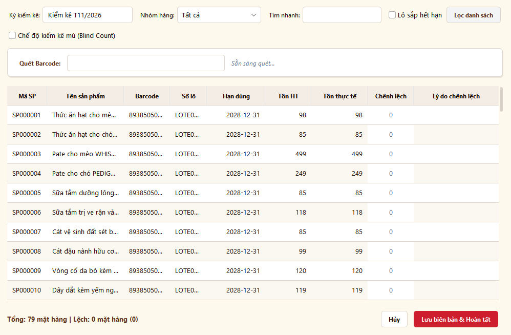
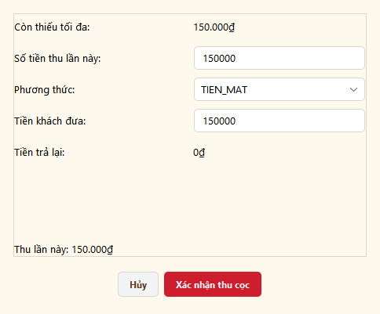

# Đánh giá mã nguồn và giao diện Pet Station

## Kết quả sau chỉnh sửa ngày 26/11/2026

Xem [Nghiệm thu sau chỉnh sửa](NGHIEM_THU_SAU_CHINH_SUA.md) để tra thay đổi, bằng chứng và giới hạn kiểm tra.

- Giữ thông tin đăng nhập điền sẵn theo yêu cầu demo.
- Đã sửa các lỗi kiểm kê và nhập kho, bổ sung kiểm tra tồn thay đổi trước khi lập biên bản, sửa phân quyền mặc định, điều hướng và hợp đồng so sánh nhân viên.
- Đã tách tổng hợp báo cáo khỏi nhãn, sửa phạm vi top 10 và voucher, sửa tổng thu ca, nhãn Excel, cùng các nhóm câu chữ và bố cục đã liệt kê trong báo cáo nghiệm thu.
- Lần kiểm thử và đóng gói đầy đủ cuối đạt **135 bài, không thất bại, không lỗi và không bỏ qua**, gồm cả ba bộ SQL. Có tình huống 11 sản phẩm, hóa đơn dùng đồng thời khuyến mãi/voucher, bảng lọc trống và chặn kết ca thiếu dữ liệu.
- Đã dựng 47 mã điều hướng ở hai kích thước, tải đủ 29 chế độ báo cáo có số liệu. Đã xem ảnh tổng hợp và thử một số thao tác trên cửa sổ thật. Chưa chứng nhận toàn bộ từng ô bằng bàn phím vật lý, thiết bị in/quét thật hoặc mọi mức DPI Windows.

## Ghi nhận ban đầu trước khi sửa

Ngày 25/11/2026 · Nhánh `develop` · Bản mã `f97c021`

**Chưa nên dùng bản này để chốt kiểm kê thực tế.** Hai lỗi tái hiện được làm thay đổi số lượng hoặc danh sách lô ngay trước khi lập biên bản. Cửa sổ đăng nhập còn điền sẵn thông tin quản trị. Đây là ba việc cần xử lý trước khi dành thời gian đồng bộ biểu tượng, màu hay font.

Để tra một trang cụ thể, xem [Đánh giá từng màn hình, bảng và nút](DANH_GIA_TUNG_MAN_HINH.md). Phụ lục ghi nhãn đang có, các tab, bảng, nút theo trạng thái và câu chữ đề nghị cho từng nghiệp vụ, gồm cả 29 chế độ của bảy báo cáo.

## Các phát hiện cần xử lý trước

| Ưu tiên | Phát hiện và bằng chứng | Hậu quả | Sửa và điều kiện nghiệm thu |
| --- | --- | --- | --- |
| P1 · Tái hiện | **Bộ lọc làm mất dòng khỏi dữ liệu chuẩn bị lưu.** Đếm lô A và B, nhập lý do cho cả hai, lọc chỉ còn B. Hàm thu thập dòng chỉ trả về B. `banGhiDaDem` có giữ dữ liệu vừa nhập, nhưng vòng lặp lúc lưu chỉ đi qua mô hình bảng đang lọc. [Khâu lọc và điền bảng](../src/main/java/com/petstation/gui/kho/KiemKePanel.java#L707) · [Khâu thu thập dòng](../src/main/java/com/petstation/gui/kho/KiemKePanel.java#L881) | Người kiểm kho có thể gửi biên bản thiếu cả một lô đã đếm, dù trước đó đã nhập đầy đủ. | Lưu bản nháp theo mã lô cho toàn đợt, lọc riêng phần hiển thị. Đếm A và B, lọc B rồi lập biên bản phải giữ cả hai. Nếu cho phép lập riêng phần đã lọc, cần thao tác chọn phạm vi và hiển thị số lô sắp gửi. |
| P1 · Tái hiện | **Lần quét đầu cộng vào số sổ sách.** Với tồn sổ 10 và chế độ đếm thường, “Tồn thực tế” khởi tạo là 10. Quét một đơn vị cho kết quả **11**. Chuyển từ đếm thường sang đếm mù chỉ chỉnh độ rộng cột nên các số điền sẵn có thể còn nguyên. Chân bảng vẫn tính chênh lệch. [Khởi tạo số đếm](../src/main/java/com/petstation/gui/kho/KiemKePanel.java#L730) · [Ẩn cột và xử lý quét](../src/main/java/com/petstation/gui/kho/KiemKePanel.java#L751) | Nhãn “Tồn thực tế” khiến người dùng tin đây là số hàng đã kiểm. Hàng chưa kiểm có thể trông như đã khớp. | Khởi tạo “Chưa đếm”, lần quét đầu phải ghi 1. Nếu hỗ trợ lấy số sổ sách làm số đếm thì cần thao tác riêng. Đổi chế độ phải bảo toàn số nhập tay và phân biệt được dòng chưa đếm. Khi đếm mù, chỉ hiển thị tiến độ đếm. |
| P1 · Mã và ảnh | **Tên đăng nhập quản trị và mật khẩu mẫu được gán thẳng trong cửa sổ đăng nhập.** Chúng xuất hiện ngay lúc mở form, trước khi người dùng nhập gì. BCrypt khi xác thực và lớp che mật khẩu trên màn hình không xử lý được bí mật đã đóng gói trong ứng dụng. [Khởi tạo form](../src/main/java/com/petstation/gui/hethong/DangNhapFrame.java#L69) · [Xác thực](../src/main/java/com/petstation/service/hethong/XacThucService.java#L71) | Máy quầy dùng bộ dữ liệu còn mật khẩu mẫu có thể mở phiên sai người. Kể cả khi đã thay mật khẩu, form vẫn gợi ý dùng chung tài khoản quản trị. | Để trống hai trường ở bản phát hành, cấp tài khoản riêng, thay thông tin mẫu ở nơi đã triển khai. Nghiệm thu bằng cách mở mới ứng dụng và kiểm tra hai trường trống, đăng nhập bằng tài khoản nhân viên vẫn chạy. |
| P1 · Mã và ảnh | **Phiếu nhập tự đề xuất số lô theo ngày và hạn dùng đúng một năm sau ngày nhập.** Hai lô thực tế của cùng sản phẩm nhập cùng ngày nhận cùng giá trị gợi ý. Service tìm lô cũ và cộng số lượng khi thông tin khớp. [Biểu mẫu nhập](../src/main/java/com/petstation/gui/kho/NghiepVuKhoPanel.java#L73) · [Ghi lô](../src/main/java/com/petstation/service/kho/NhapXuatKhoService.java) | Nếu nhân viên chấp nhận hai giá trị gợi ý, sổ có thể gộp hai lô khác nhau hoặc cảnh báo hết hạn sai. Đây là rủi ro suy ra từ luồng ghi. | Yêu cầu quét hoặc nhập số lô và hạn in trên bao bì đối với sản phẩm quản lý hạn dùng. Nghiệm thu bằng hai lô cùng sản phẩm, cùng ngày nhập, khác số lô và hạn. |
| P2 · Mã và ảnh | **Thẻ “Tổng doanh thu” trong “Sản phẩm bán chạy” chỉ cộng tối đa 10 sản phẩm.** SQL lấy 10 dòng theo doanh thu giảm dần, sau đó mới xét số lượng. Trang lại gọi là “bán chạy”. [Truy vấn](../src/main/java/com/petstation/dao/thongke/impl/ThongKeDAOImpl.java#L255) · [Nhãn báo cáo](../src/main/java/com/petstation/gui/thongke/ThongKeHangHoaPanel.java#L35) | Quản lý có thể đọc nhầm thành doanh thu toàn cửa hàng hoặc tưởng sản phẩm đứng đầu bán nhiều đơn vị nhất. | Nếu giữ phép tính, đặt “10 sản phẩm có doanh thu cao nhất” và “Doanh thu nhóm hiển thị”. Kiểm tra với 11 sản phẩm và một sản phẩm bán ít nhưng đơn giá cao. |
| P2 · Mã | **Báo cáo sử dụng voucher lấy tổng giảm của cả hóa đơn.** SQL cộng `h.giam_gia`. Khi bán hàng, trường này nhận tổng giảm giá, có thể gồm cả khuyến mãi và điểm. Nhãn “Giảm giá” trong báo cáo voucher thiếu phạm vi. [SQL thống kê](../src/main/java/com/petstation/dao/thongke/impl/ThongKeDAOImpl.java#L622) · [Tính giảm giá](../src/main/java/com/petstation/dto/GioHang.java#L684) · [Ghi hóa đơn](../src/main/java/com/petstation/service/banhang/BanHangService.java#L168) | Dễ quy toàn bộ chi phí giảm giá cho voucher. | Đổi nhãn thành “Tổng giảm trên hóa đơn dùng voucher”, hoặc lưu riêng số tiền giảm do voucher nếu cần đánh giá hiệu quả chương trình. Kiểm tra hóa đơn đồng thời có voucher và khuyến mãi. |
| P2 · Mã | **Ma trận quyền thực hiện 23 × 4 = 92 lượt tra quyền theo vai trò mỗi lần tải.** Cùng bộ quyền bị đọc lại cho từng ô. DAO còn chọn một tài khoản có danh sách quyền bằng `TOP 1`, không có thứ tự xác định. [Vòng lặp](../src/main/java/com/petstation/gui/hethong/MaTranQuyenPanel.java#L88) · [Truy vấn](../src/main/java/com/petstation/dao/hethong/impl/TaiKhoanDAOImpl.java#L152) | Tăng số chuyến tới SQL Server. Nếu hai tài khoản cùng vai trò lưu quyền khác nhau, ma trận mang tên “mặc định” có thể phụ thuộc bản ghi được chọn. | Đọc bộ quyền một lần cho mỗi vai trò hoặc bằng một truy vấn. Xác định nguồn quyền chuẩn của vai trò và phân biệt với quyền cá nhân. Kiểm thử với hai tài khoản cùng vai trò nhưng có cấu hình khác nhau. |
| P2 · Mã và ảnh | **Cột và điều khiển cho nhân viên vẫn lộ mã kỹ thuật.** Hộp thu cọc hiện `TIEN_MAT`, bảng xuất kho hiện `XUAT_HUY` và `SU_DUNG_NOI_BO`. Trên màn hình tồn theo lô, tiêu đề cột đã đổi thành “Mã sản phẩm” nhưng bộ xuất Excel lấy tên cũ “Sản phẩm”. [Thu cọc](../src/main/java/com/petstation/gui/banhang/ThuTienDialog.java#L62) · [Tiêu đề bảng](../src/main/java/com/petstation/gui/kho/TimKiemTonTheoLoPanel.java#L121) · [Bộ xuất](../src/main/java/com/petstation/gui/chung/thanhphan/XuatExcelDialog.java#L61) | Nhân viên phải học mã hệ thống và đối chiếu hai cách gọi của cùng một trường. | Dùng bộ chuyển đổi mã sang nhãn tiếng Việt ở lớp trình bày. Kiểm tra cột thứ nhất trên giao diện và Excel cùng là “Mã sản phẩm”, dữ liệu mã vẫn giữ nguyên. |

**Mức ưu tiên.** P1 ảnh hưởng dữ liệu vận hành hoặc tài khoản ngay trong thao tác thường ngày. P2 ảnh hưởng cách ra quyết định, độ tin cậy hoặc chi phí bảo trì. Các đề xuất về diễn đạt và bố cục trong phụ lục có thể làm sau các lỗi trên.

**Một lỗi truy vết lô ở trang nhập kho.** DAO đọc đủ mã nội bộ và số lô của nhà sản xuất. Khi lập dòng chi tiết, service dùng `getMaLo()` cho cột mang tên “Số lô”. Với lô có hai định danh khác nhau, nhân viên không thể đối chiếu trực tiếp giá trị trong cột với nhãn bao bì. Dùng `getSoLo()` cho “Số lô”. Nếu cần tra mã nội bộ, thêm cột “Mã lô” riêng. Nghiệm thu trên một phiếu có hai giá trị khác nhau. [Ánh xạ từ SQL](../src/main/java/com/petstation/dao/kho/impl/NhapXuatKhoDAOImpl.java#L137) · [Dòng trả về cho giao diện](../src/main/java/com/petstation/service/kho/NhapXuatKhoService.java#L109)

## Chất lượng mã nguồn

| Khía cạnh | Đánh giá | Quyết định kỹ thuật |
| --- | --- | --- |
| Giao dịch bán hàng | Có transaction, rollback và khóa cập nhật ở các điểm nhạy cảm như lô hàng, voucher và ca bán. Đây là phần đáng giữ khi sửa UI. [Giao dịch](../src/main/java/com/petstation/database/QuanLyGiaoDich.java) · [DAO hóa đơn](../src/main/java/com/petstation/dao/banhang/impl/HoaDonDAOImpl.java#L180) | Giữ các ràng buộc nghiệp vụ ở service/DAO. Thêm kiểm thử theo kết quả người dùng nhận được, như tập dòng gửi từ form kiểm kê. |
| Ranh giới giữa câu chữ và tính toán | Service báo cáo nhận diện “Lợi nhuận gộp” theo tiêu đề và vị trí cột, nhận diện “Số đơn” bằng so khớp chuỗi và chèn một cột tổng thu khi chuỗi đầu cột khớp. Một lần sửa câu chữ có thể đổi cách tính hoặc làm lệch hàng dữ liệu. [Tạo dữ liệu báo cáo](../src/main/java/com/petstation/service/thongke/DuLieuBaoCaoService.java#L96) | Dùng mã cột và loại chỉ số ổn định, tách riêng nhãn hiển thị. Đổi tên và đảo vị trí cột trong bài kiểm thử, tổng tiền và số đơn phải giữ đúng. |
| Mô hình nhân viên | Hai đối tượng `new NhanVien()` chưa có mã so sánh bằng nhau. Mã còn sửa được sau khi đối tượng đã làm khóa tập hợp. Đây là vấn đề hợp đồng `equals/hashCode` đã tái hiện, chưa có bằng chứng nó làm mất hồ sơ trong luồng hiện tại. [NhanVien](../src/main/java/com/petstation/model/nhansu/NhanVien.java#L102) | Chỉ so bằng mã khi cả hai thực thể đã có mã. Quy định thời điểm gán mã trước khi đưa vào tập hợp băm, hoặc dùng khóa bất biến. |
| Điều hướng khi mở trang lỗi | `ChinhFrame.hienThi` đẩy lịch sử và gán `hienTai` trước khi tạo panel. Nếu constructor lỗi, khối bắt bên ngoài báo lỗi trong khi card cũ vẫn hiển thị. Hai panel có thể lỗi ngay ở constructor khi thiếu kết nối. [Điều hướng](../src/main/java/com/petstation/gui/chung/ChinhFrame.java#L237) | Chỉ cập nhật màn hình hiện tại và lịch sử sau khi tạo card thành công. Kiểm tra tình huống mất SQL sau khi đã đăng nhập, sau đó bấm Quay lại hoặc F5. |
| Dữ liệu bất đồng bộ | `TacVuNen.chayCoPhien` kiểm tra phiên và cho phép loại kết quả cũ. Ở hộp kiểm kê, tải theo bộ lọc chỉ kiểm tra hộp còn hiển thị. Hai lần lọc trả về ngược thứ tự có thể đưa dữ liệu cũ trở lại. [Tác vụ nền](../src/main/java/com/petstation/gui/chung/TacVuNen.java#L49) · [Tải lô](../src/main/java/com/petstation/gui/kho/KiemKePanel.java#L687) | Gắn số thứ tự cho lần tải như một số panel khác đã làm. Kiểm tra hai bộ lọc liên tiếp với lần đầu trả về sau. |
| Tách trách nhiệm | `QuanLyDanhMucPanel` 2.416 dòng, `LapPhieuSpaPanel` 1.918 dòng, `LichTuanPanel` 1.726 dòng. Vấn đề cụ thể là form, trạng thái sửa, thao tác bảng và quyết định nghiệp vụ cùng nằm trong lớp Swing. [Danh mục](../src/main/java/com/petstation/gui/chung/QuanLyDanhMucPanel.java) · [Phiếu spa](../src/main/java/com/petstation/gui/spa/LapPhieuSpaPanel.java) · [Lịch tuần](../src/main/java/com/petstation/gui/nhansu/LichTuanPanel.java) | Ưu tiên tách trạng thái đợt kiểm kê và cấu trúc chỉ số báo cáo trước. Có thể kiểm tra hai phần này bằng dữ liệu nhỏ mà không cần mở cửa sổ hoặc truy cập SQL. |

## Những điểm nhìn thấy khi dùng giao diện

- **Bán hàng có cấu trúc tốt nhất.** Trên đơn mẫu, người dùng thấy tiền hàng 120.000 ₫, khoản giảm 12.000 ₫ và số phải thu 108.000 ₫ cùng lúc. “Sang thanh toán” ở bước lập đơn và “Xác nhận thanh toán” ở bước thu tiền sẽ làm rõ thời điểm ghi giao dịch. Giữ cách đặt số phải thu gần nút xác nhận.
- **Bảng danh mục khó đọc ở những ô cần nhận diện nhất.** Trong vùng nội dung 1.146 × 700, bảng sản phẩm, khuyến mãi và voucher dành chiều ngang cho cả danh sách và mẫu chi tiết. Tên hàng, tên chương trình và mã voucher xuất hiện dưới dạng dấu ba chấm. Cho danh sách rộng hơn khi chưa chọn dòng, đặt cột nhận diện trước và chuyển thuộc tính phụ vào khung chi tiết. Ưu tiên cột tiền, mã và hạn dùng ở màn hình cần đối chiếu chứng từ.
- **Từ ngữ thay đổi ngay trong một luồng.** POS lưu “đơn tạm”, màn hình điều hướng ghi “đơn nháp”, danh sách ghi “đơn đang treo”. Trang đổi hàng có “Đổi trả hàng” trong khi form tạo mới chỉ cho đổi phụ kiện. Nút “Xóa” ở danh mục lại cập nhật trạng thái và ghi nhật ký “Xóa”. Dùng một tên cho cùng đối tượng và gọi nút theo hậu quả thật. [Xử lý ngừng hoạt động](../src/main/java/com/petstation/gui/chung/QuanLyDanhMucPanel.java#L1883)
- **Các báo cáo dùng tiêu đề biểu đồ quá chung.** “BIỂU ĐỒ DIỄN BIẾN” phù hợp với ngày hoặc giờ. Ở báo cáo spa, khách hàng và lưu trú, trục ngang lại là trạng thái hay nhóm khách. Hai biểu đồ cùng mô tả một tập số trong khi bảng chứng từ nằm thấp. Gọi tên đại lượng và đối tượng so sánh, cho bảng chiếm chỗ trước ở màn đối soát. Số thập phân trên một số thẻ hiện “2.6”, “12.5” bên cạnh tiền dùng dấu chấm phân cách hàng nghìn. Dùng định dạng số tiếng Việt nhất quán. [Tạo thẻ chỉ số](../src/main/java/com/petstation/service/thongke/DuLieuBaoCaoService.java#L256)
- **Phản hồi tốt khi nêu được việc tiếp theo.** Màn xem hóa đơn trống giải thích hóa đơn sẽ xuất hiện sau thanh toán. Danh sách đơn nháp chỉ hiện “Chưa có dữ liệu để hiển thị”. Viết riêng trạng thái chưa từng tạo, lọc không có kết quả và lỗi tải. Nút đã khóa do thiếu dòng chọn nên có gợi ý “Chọn một phiếu để tiếp tục”. Bảng ma trận quyền và chú giải lịch cần có chữ đọc được cho trạng thái dùng biểu tượng hoặc màu.

## Bằng chứng và phạm vi

- Kiểm kê 296 file Java chính và 25 file Java kiểm thử. Đối chiếu 47 mã điều hướng với registry. 39 mục được dựng trực tiếp, tám mã còn lại dùng lại hai panel spa và lưu trú. Phụ lục nêu hết tám mã và bề mặt tương ứng. [Danh sách mã](../src/main/java/com/petstation/model/chung/MaManHinh.java) · [Registry](../src/main/java/com/petstation/gui/chung/DangKyManHinh.java)
- Dựng 61 ảnh bằng Swing/FlatLaf với dữ liệu mẫu trên `PetStationIntegrationTest_Review`, gồm trang, tab, form và trạng thái có/không có dữ liệu. Kích thước panel 1.146 × 700, khung chính 1.100 × 680, hộp thoại theo kích thước của ứng dụng. Dùng phiên kiểm thử đủ quyền để thấy các thao tác quản lý. Một số nhánh theo quyền, thiết bị và trạng thái chứng từ chỉ được đối chiếu qua mã. Đặc biệt, chưa kiểm thử bàn phím qua mọi form, máy quét vật lý, máy in thật, chuyển tiền thật hay các mức DPI của Windows.
- Bộ Maven mặc định chạy 84 bài và bỏ qua 34 bài SQL. Chạy lại trên cơ sở dữ liệu kiểm thử đúng phiên bản, bật cả ba bộ tích hợp, **118 đạt, 0 thất bại, 0 lỗi, 0 bỏ qua**. Số 136 test và 60 tình huống SQL trong tài liệu kiểm thử không khớp lần chạy ở commit này. [Tài liệu kiểm thử hiện có](KIEM_THU_VA_YEU_CAU.md)
- Hai trường hợp kiểm kê được kiểm tra bằng chính các hàm điền bảng, xử lý quét và thu thập dòng của panel Swing với hai lô giả lập. Kết quả là dữ liệu chuẩn bị truyền vào service. Bộ dò dừng trước khi ghi biên bản. Ảnh dưới minh họa trạng thái ban đầu của form đếm thường và lựa chọn phương thức ở hộp thu cọc.

## Thứ tự nghiệm thu

1. **Trước khi chạy tại quầy**, xử lý hai lỗi kiểm kê, bỏ thông tin đăng nhập mẫu và bỏ hạn dùng được suy đoán. Bổ sung các tình huống ở bảng P1 vào bộ hồi quy.
2. **Trước khi dùng báo cáo để đối soát**, kiểm tra bộ dữ liệu có hơn 10 sản phẩm, hóa đơn dùng nhiều loại giảm giá, dữ liệu lọc theo ca và số liệu tính đến hiện tại. Xác nhận số liệu với truy vấn độc lập, sau đó đối chiếu màn hình và Excel.
3. **Trước khi chốt giao diện**, đi từ lập đơn đến thu tiền, từ nhận phòng đến thu cọc, từ nhập đến kiểm kê bằng tài khoản tương ứng. Ở mỗi bước, người dùng cần chỉ ra được đối tượng đang chọn, số tiền hoặc số lượng sắp ghi, trạng thái sau khi bấm và cách quay lại. Dùng [phụ lục từng màn hình](DANH_GIA_TUNG_MAN_HINH.md) để thay nhãn và nghiệm thu theo trang.
