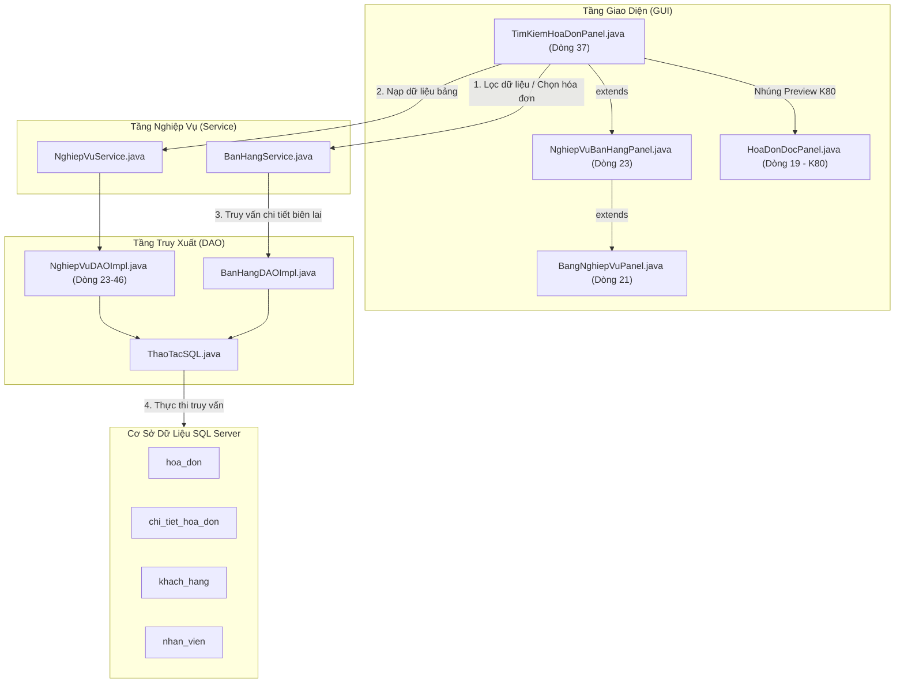

# TÀI LIỆU PHÂN TÍCH CHUYÊN SÂU MÃ NGUỒN VÀ NGHIỆP VỤ
## PHẦN 3: TÌM KIẾM HÓA ĐƠN, TRA CỨU LỊCH TOÀN CỬA HÀNG & LỊCH CÁ NHÂN (XIN NGHỈ / ĐỔI CA)

> **Hệ thống**: Quản lý Cửa hàng Thú cưng PetStation  
> **Kiến trúc**: Mô hình 3 lớp (UI - Service - DAO - Database SQL Server)  
> **Cam kết độ chính xác**: 100% số dòng code, tên hàm, câu lệnh SQL được trích xuất trực tiếp từ mã nguồn thực tế của dự án.  
> **Khả năng hiển thị**: Tích hợp sơ đồ dạng **Hộp chữ nhật Văn bản (Text/ASCII Art)** hiển thị mượt mà trên mọi trình xem Markdown (kể cả IntelliJ IDEA mặc định không cài plugin Mermaid) kèm sơ đồ Mermaid chuẩn.

---

## MỤC LỤC
1. [Chức năng 5: Tìm kiếm Hóa đơn (TimKiemHoaDonPanel)](#1-chức-năng-5-tìm-kiếm-hóa-đơn-timkiemhoadonpanel)
   - [1.1 Sơ đồ cấu trúc file và luồng nghiệp vụ](#11-sơ-đồ-cấu-trúc-file-và-luồng-nghiệp-vụ)
   - [1.2 Bảng kê chi tiết các file liên quan và vị trí dòng code](#12-bảng-kê-chi-tiết-các-file-liên-quan-và-vị-trí-dòng-code)
   - [1.3 Phân tích chi tiết quy trình nghiệp vụ & Code thực thi](#13-phân-tích-chi-tiết-quy-trình-nghiệp-vụ--code-thực-thi)
   - [1.4 Các điểm sáng kỹ thuật độc đáo (K80 Preview, In ấn Printable, Multi-filter)](#14-các-điểm-sáng-kỹ-thuật-độc-đáo)
   - [1.5 Bộ câu hỏi vấn đáp bảo vệ đồ án & Chỉ tay vào dòng code](#15-bộ-câu-hỏi-vấn-đáp-bảo-vệ-đồ-án--chỉ-tay-vào-dòng-code)
2. [Chức năng 6: Tra cứu Lịch làm việc toàn cửa hàng (TraCuuLichLamViecPanel)](#2-chức-năng-6-tra-cứu-lịch-làm-việc-toàn-cửa-hàng-tracuulichlamviecpanel)
   - [2.1 Sơ đồ cấu trúc file và luồng nghiệp vụ](#21-sơ-đồ-cấu-trúc-file-và-luồng-nghiệp-vụ)
   - [2.2 Bảng kê chi tiết các file liên quan và vị trí dòng code](#22-bảng-kê-chi-tiết-các-file-liên-quan-và-vị-trí-dòng-code)
   - [2.3 Phân tích chi tiết quy trình nghiệp vụ & Code thực thi](#23-phân-tích-chi-tiết-quy-trình-nghiệp-vụ--code-thực-thi)
   - [2.4 Điểm sáng kỹ thuật & Bộ câu hỏi vấn đáp bảo vệ đồ án](#24-điểm-sáng-kỹ-thuật--bộ-câu-hỏi-vấn-đáp-bảo-vệ-đồ-án)
3. [Chức năng 7: Lịch làm việc cá nhân & Xin nghỉ / Đổi ca (LichCaNhanPanel)](#3-chức-năng-7-lịch-làm-việc-cá-nhân--xin-nghỉ--đổi-ca-lichcanhanpanel)
   - [3.1 Sơ đồ cấu trúc file và luồng nghiệp vụ](#31-sơ-đồ-cấu-trúc-file-và-luồng-nghiệp-vụ)
   - [3.2 Bảng kê chi tiết các file liên quan và vị trí dòng code](#32-bảng-kê-chi-tiết-các-file-liên-quan-và-vị-trí-dòng-code)
   - [3.3 Phân tích chi tiết quy trình nghiệp vụ & Code thực thi](#33-phân-tích-chi-tiết-quy-trình-nghiệp-vụ--code-thực-thi)
   - [3.4 Các điểm sáng kỹ thuật độc đáo (Báo trước 12h, Gửi duyệt phân quyền)](#34-các-điểm-sáng-kỹ-thuật-độc-đáo-của-lịch-cá-nhân)
   - [3.5 Bộ câu hỏi vấn đáp bảo vệ đồ án & Chỉ tay vào dòng code](#35-bộ-câu-hỏi-vấn-đáp-bảo-vệ-đồ-án--chỉ-tay-vào-dòng-code-1)

---

# 1. CHỨC NĂNG 5: TÌM KIẾM HÓA ĐƠN (TimKiemHoaDonPanel)

### 1.1 Sơ đồ cấu trúc file và luồng nghiệp vụ

#### Sơ đồ Hộp chữ nhật Trực quan (Xem được trực tiếp trên IntelliJ IDEA)
```
+---------------------------------------------------------------------------------------------------+
|                                      TẦNG GIAO DIỆN (GUI)                                         |
|                                                                                                   |
|   +-------------------------------------------------------------------------------------------+   |
|   | TimKiemHoaDonPanel.java [L37 extends NghiepVuBanHangPanel]                                |   |
|   |  - Master-Detail SplitPane: Bảng hóa đơn (tblBang) & Khung xem trước hóa đơn K80 (pnlHoaDon)|   |
|   |  - Thanh công cụ đa tiêu chí: Từ ngày, Đến ngày, Phương thức, Trạng thái, Tìm từ khóa     |   |
|   |  - Bộ lắng nghe chọn dòng (ListSelectionListener) nạp dữ liệu xem trước thời gian thực    |   |
|   |  - Nút "In lại hóa đơn" (xuLyInHoaDon) & "Xuất file HTML/PDF" (xuLyXuatHoaDon)            |   |
|   +---------------------------------------------+---------------------------------------------+   |
|                                                 | Kế thừa layout và khung bảng chuẩn              |
|                                                 v                                                 |
|   +-------------------------------------------------------------------------------------------+   |
|   | NghiepVuBanHangPanel.java [L23 extends BangNghiepVuPanel]                                 |   |
|   | BangNghiepVuPanel.java [L21 extends CoSoPanel implements HoTroThanhCongCu]                |   |
|   +---------------------------------------------+---------------------------------------------+   |
|                                                 | Nhúng thành phần hiển thị K80                   |
|                                                 v                                                 |
|   +-------------------------------------------------------------------------------------------+   |
|   | HoaDonDocPanel.java [L19 extends JComponent implements Printable, Scrollable]             |   |
|   |  - Layout chuẩn máy in nhiệt 80mm (RONG_GIAY = 80.0 / 25.4 * 72 points)                   |   |
|   |  - Vẽ Header, Logo, Chi tiết mặt hàng, Thuế VAT, Chiết khấu, Điểm thưởng, QR chuyển khoản  |   |
|   +---------------------------------------------+---------------------------------------------+   |
+-------------------------------------------------|-------------------------------------------------+
                                                  | Gọi lấy biên lai & dữ liệu in
                                                  v
+---------------------------------------------------------------------------------------------------+
|                                     TẦNG NGHIỆP VỤ (SERVICE)                                      |
|                                                                                                   |
|   +-------------------------------------------------------------------------------------------+   |
|   | BanHangService.java                                                                       |   |
|   |  - layBienLai(soHoaDon)         [L251-270] : Đọc thông tin hóa đơn & các mặt hàng         |   |
|   |  - layChiTietBienLai(soHoaDon)  [L433-445] : Đóng gói đầy đủ DTO ChiTietBienLai in ấn     |   |
|   | NghiepVuService.java                                                                      |   |
|   |  - layDinhNghia(LoaiNghiepVu.HOA_DON)      : Lấy cấu hình cột và câu lệnh nạp ban đầu     |   |
|   +---------------------------------------------+---------------------------------------------+   |
+-------------------------------------------------|-------------------------------------------------+
                                                  | Gọi câu lệnh thực thi SQL
                                                  v
+---------------------------------------------------------------------------------------------------+
|                                  TẦNG TRUY XUẤT DỮ LIỆU (DAO)                                     |
|                                                                                                   |
|   +-------------------------------------------------------------------------------------------+   |
|   | NghiepVuDAOImpl.java [L23-46]                                                             |   |
|   |  - Truy vấn nạp danh sách: SELECT h.id, h.so_hoa_don, k.ho_ten, n.ho_ten, h.thanh_toan_luc|   |
|   |    h.tong_tien, h.hinh_thuc_thanh_toan, h.trang_thai FROM hoa_don h ...                   |   |
|   | BanHangDAOImpl.java                                                                       |   |
|   |  - timBienLai(soHoaDon)   [L377-386] : Lấy thông tin đầu phiếu, giảm giá, điểm thưởng     |   |
|   |  - layThongTinIn(soHoaDon)[L460-475] : Lấy thông tin cửa hàng, hotline, địa chỉ in hóa đơn|   |
|   +---------------------------------------------+---------------------------------------------+   |
|                                                 | Thực thi JDBC qua kết nối Database              |
|                                                 v                                                 |
|   +-------------------------------------------------------------------------------------------+   |
|   | ThaoTacSQL.java [L32] -> Database.layKetNoi() [L21] (SQL Server Connection Pool)          |   |
+-------------------------------------------------|-------------------------------------------------+
                                                  v
+---------------------------------------------------------------------------------------------------+
|                                CƠ SỞ DỮ LIỆU (SQL SERVER)                                         |
|    [hoa_don] <---> [chi_tiet_hoa_don] <---> [khach_hang] <---> [nhan_vien] <---> [tai_khoan]     |
+---------------------------------------------------------------------------------------------------+
```

#### Sơ đồ Mermaid (Dành cho trình xem hỗ trợ Mermaid)


---

### 1.2 Bảng kê chi tiết các file liên quan và vị trí dòng code

| Package | Tên File | Vai trò | Kế thừa / Dùng chung & Vị trí dòng code chính xác |
| :--- | :--- | :--- | :--- |
| `com.petstation.gui.search` | `TimKiemHoaDonPanel.java` | Màn hình tra cứu & in hóa đơn | **Dòng 37**: `extends NghiepVuBanHangPanel`<br>**Dòng 54-131**: Gom cụm bộ lọc đa tiêu chí (Từ ngày, Đến ngày, Phương thức, Trạng thái)<br>**Dòng 172-182**: Tái cấu trúc Center thành `JSplitPane.HORIZONTAL_SPLIT`<br>**Dòng 185-198**: Lắng nghe sự kiện chọn dòng trên bảng `tblBang`<br>**Dòng 236-260**: `capNhatXemTruocHoaDon()` nạp dữ liệu vào mẫu in K80<br>**Dòng 262-340**: `apDungBoLocNangCao()` cơ chế lọc động kết hợp `TableRowSorter`<br>**Dòng 342-355**: `xuLyInHoaDon()` gửi lệnh in trực tiếp ra máy in nhiệt K80<br>**Dòng 357-372**: `xuLyXuatHoaDon()` xuất hóa đơn ra file HTML/PDF |
| `com.petstation.gui.processing.sales` | `NghiepVuBanHangPanel.java` | Lớp cha nghiệp vụ bán hàng | **Dòng 23**: `extends BangNghiepVuPanel`<br>Chứa các hàm dùng chung về xử lý nghiệp vụ bán hàng, đổi trả |
| `com.petstation.gui.components` | `BangNghiepVuPanel.java` | Khung bảng nghiệp vụ chuẩn | **Dòng 21**: `extends CoSoPanel implements HoTroThanhCongCu`<br>Cung cấp bảng `tblBang`, `moHinh`, ô tìm kiếm `txtTimKiem`, nút `Làm mới`, `Xuất Excel` |
| `com.petstation.gui.components.common` | `HoaDonDocPanel.java` | Panel biên nhận in nhiệt K80 | **Dòng 19**: `extends JComponent implements Scrollable, Printable`<br>**Dòng 20**: `RONG_GIAY = 80.0 / 25.4 * 72` (chuẩn chiều ngang 80mm tính theo Point)<br>**Dòng 36-150**: Hàm `datDuLieu(ChiTietBienLai)` dựng các khối in (Logo, Tên shop, Danh sách món, Tổng tiền, QR Code) |
| `com.petstation.service` | `BanHangService.java` | Nghiệp vụ bán hàng & biên lai | **Dòng 251-270**: `layBienLai(soHoaDon)` nạp hóa đơn và chi tiết giỏ hàng<br>**Dòng 433-445**: `layChiTietBienLai(soHoaDon)` đóng gói `ChiTietBienLai` |
| `com.petstation.dao.impl` | `NghiepVuDAOImpl.java` | Cấu hình câu SQL nạp bảng | **Dòng 23-46**: Định nghĩa `case HOA_DON ->` với câu lệnh SQL `SELECT ... FROM hoa_don h LEFT JOIN ...` |
| `com.petstation.dao.impl` | `BanHangDAOImpl.java` | Truy xuất dữ liệu bán hàng | **Dòng 377-386**: `timBienLai(soHoaDon)`<br>**Dòng 460-475**: `layThongTinIn(soHoaDon)` |
| `com.petstation.model` | `ChiTietBienLai.java` | DTO dữ liệu in ấn | Đóng gói toàn bộ thông tin: Hóa đơn, Nhân viên, Khách hàng, Tên cửa hàng, Địa chỉ, SĐT, Danh sách sản phẩm |

---

### 1.3 Phân tích chi tiết quy trình nghiệp vụ & Code thực thi

#### Giai đoạn 1: Khởi tạo và Nạp dữ liệu bảng
1. Khi màn hình mở ra, `super(LoaiNghiepVu.HOA_DON, ...)` kích hoạt `BangNghiepVuPanel`.
2. Hệ thống gọi `NghiepVuDAOImpl.java` (dòng 23-46) để thực thi câu SQL lấy toàn bộ hóa đơn bán hàng:
   ```sql
   SELECT h.id, h.so_hoa_don, COALESCE(k.ho_ten, N'Khách lẻ'), COALESCE(n.ho_ten, N'Thu ngân'),
          h.thanh_toan_luc, h.tong_tien,
          CASE h.hinh_thuc_thanh_toan 
               WHEN 'TIEN_MAT' THEN N'Tiền mặt' WHEN 'CASH' THEN N'Tiền mặt'
               WHEN 'CHUYEN_KHOAN' THEN N'Chuyển khoản' WHEN 'TRANSFER' THEN N'Chuyển khoản'
               WHEN 'THE' THEN N'Thẻ' WHEN 'CARD' THEN N'Thẻ' WHEN 'QUET_THE' THEN N'Thẻ'
               ELSE COALESCE(h.hinh_thuc_thanh_toan, N'Tiền mặt') END,
          CASE h.trang_thai 
               WHEN 'PAID' THEN N'Đã thanh toán' WHEN 'DA_THANH_TOAN' THEN N'Đã thanh toán'
               WHEN 'CANCELLED' THEN N'Đã hủy' WHEN 'VOIDED' THEN N'Đã hủy'
               WHEN 'REFUNDED' THEN N'Đã hoàn' WHEN 'DA_HOAN' THEN N'Đã hoàn'
               ELSE COALESCE(h.trang_thai, N'Đã thanh toán') END
   FROM hoa_don h 
   LEFT JOIN phien_lam_viec s ON s.id = h.phien_lam_viec_id 
   LEFT JOIN tai_khoan a ON a.id = COALESCE(h.tai_khoan_id, s.tai_khoan_id) 
   LEFT JOIN nhan_vien n ON n.id = a.nhan_vien_id 
   LEFT JOIN khach_hang k ON k.id = h.khach_hang_id 
   WHERE h.trang_thai <> 'GIO_TREO' 
   ORDER BY h.thanh_toan_luc DESC, h.id DESC
   ```
3. Dữ liệu được đổ vào `tblBang`. Cột 0 (ID) được ẩn đi, chỉ hiển thị Số hóa đơn, Tên khách hàng, Thu ngân, Thời gian, Tổng tiền, Hình thức thanh toán và Trạng thái.

---

#### Giai đoạn 2: Cơ chế Lọc đa tiêu chí kết hợp (Multi-Criteria Realtime Filtering)
1. Trên thanh công cụ gom cụm (`TimKiemHoaDonPanel.java`, dòng 100-128):
   - Ô nhập tìm kiếm từ khóa chung `txtTimKiem`.
   - Chọn khoảng ngày `txtTuNgay` và `txtDenNgay` (mặc định lấy 60 ngày gần nhất, dòng 55-59).
   - Chọn phương thức thanh toán `cboPhuongThuc` (Tất cả, Tiền mặt, Chuyển khoản, Thẻ).
   - Chọn trạng thái `cboTrangThai` (Tất cả, Đã thanh toán, Đã hủy, Đã hoàn).
2. Khi người dùng thay đổi bất kỳ ô nào (gõ phím, chọn ngày, đổi combobox), hàm `apDungBoLocNangCao()` (`TimKiemHoaDonPanel.java`, dòng 262) được kích hoạt:
   - Sử dụng `TableRowSorter<DefaultTableModel>` kết hợp `RowFilter.andFilter(cacBoLoc)` (dòng 338).
   - **Lọc từ khóa** (dòng 272-275): Dùng Regular Expression không phân biệt hoa thường `(?iu)...` tìm trên mọi cột.
   - **Lọc phương thức thanh toán** (dòng 278-288): Regex khớp chuẩn cột 6 (`CASH|TIEN_MAT|Tiền mặt...`).
   - **Lọc trạng thái** (dòng 291-300): Regex khớp chuẩn cột 7 (`PAID|COMPLETED|DA_THANH_TOAN...`).
   - **Lọc ngày tháng** (dòng 302-333): Đọc chuỗi thời gian thanh toán tại cột 4, ép kiểu thành `LocalDate`, kiểm tra điều kiện `!d.isBefore(tu)` và `!d.isAfter(den)`.
   - *Ưu điểm vượt trội*: Lọc trực tiếp trên Model ở Client, tốc độ phản hồi tức thì (dưới 5ms), không phải gửi liên tục hàng chục request về SQL Server khi người dùng đang gõ phím.

---

#### Giai đoạn 3: Xem trước Hóa đơn K80 & In ấn / Xuất file
1. Khi bấm chọn một dòng trên bảng (`tblBang.getSelectedRow() >= 0`), `ListSelectionListener` gọi `capNhatXemTruocHoaDon()` (`TimKiemHoaDonPanel.java`, dòng 236):
   - Lấy Số hóa đơn (`soHoaDon = tblBang.getValueAt(row, 0).toString()`).
   - Gọi `BanHangService.layBienLai(soHoaDon)` (dòng 249) và `BanHangService.layChiTietBienLai(soHoaDon)` (dòng 250).
   - Truyền dữ liệu vào `pnlHoaDon.datDuLieu(chiTiet)` (`HoaDonDocPanel.java`, dòng 36).
   - Bảng xem trước bên phải tự động render hóa đơn y hệt như trên giấy in bill nhiệt K80 (80mm). Kích hoạt sáng 2 nút: **"In lại hóa đơn"** và **"Xuất file HTML/PDF"**.
2. **Thao tác in lại hóa đơn (`xuLyInHoaDon`, dòng 342-355)**:
   - Sử dụng Java Print Service API:
     ```java
     PrinterJob job = PrinterJob.getPrinterJob();
     job.setPrintable(pnlHoaDon); // HoaDonDocPanel implements Printable
     if (job.printDialog()) {
         job.print();
         HopThoai.hienThiThanhCong(this, "Đã gửi lệnh in hóa đơn " + bienLaiDangChon.soHoaDon());
     }
     ```
   - Nhờ `HoaDonDocPanel` hiện thực hóa interface `Printable` và tính toán kích thước theo đơn vị chuẩn `Point` (`80mm = 80.0 / 25.4 * 72 points`), lệnh in gửi trực tiếp tới máy in nhiệt (Xprinter, Epson K80) mà không bị lệch lề hay vỡ chữ.
3. **Thao tác xuất file HTML/PDF (`xuLyXuatHoaDon`, dòng 357-372)**:
   - Mở `JFileChooser` để người dùng chọn vị trí lưu.
   - Gọi `InHoaDonPanel.hienThiHTML(bienLaiDangChon)` tạo mã HTML chuẩn CSS `@media print` rồi ghi ra file với định dạng `UTF-8`.

---

### 1.4 Các điểm sáng kỹ thuật độc đáo

1. **Bố cục Master-Detail Horizontal Split-Pane (`L172-182`)**:
   - Trực quan hóa dữ liệu: Bảng danh sách bên trái chiếm trọn không gian tra cứu (`splitPane.setResizeWeight(1.0)`), biên nhận K80 bên phải có chiều rộng cố định 380px (`pnlRightDetail.setPreferredSize(new Dimension(380, 0))`). Nhân viên chỉ cần nhấp chuột vào từng dòng là hóa đơn bên phải cập nhật ngay tức khắc.
2. **Thiết kế hóa đơn theo chuẩn máy in nhiệt K80 (`HoaDonDocPanel.java`)**:
   - Tự động chia các phần tử thành danh sách các `Khoi` (dòng 27). Tự động ngắt trang nếu hóa đơn quá dài, tự tính toán tọa độ vẽ chuỗi ký tự (`vanBan`, `Font`, `căn lề`), vẽ đường gạch đứt phân đoạn, vẽ mã QR và logo cửa hàng.

---

### 1.5 Bộ câu hỏi vấn đáp bảo vệ đồ án & Chỉ tay vào dòng code

#### Câu 1: Em cài đặt chức năng lọc tìm kiếm hóa đơn theo nhiều tiêu chí (từ khóa, khoảng ngày, phương thức, trạng thái) như thế nào?
- **Trả lời**: Em sử dụng `TableRowSorter` kết hợp danh sách `List<RowFilter>` và gộp lại bằng `RowFilter.andFilter(cacBoLoc)`. Các tiêu chí về phương thức thanh toán và trạng thái được lọc bằng Regular Expression, còn tiêu chí ngày tháng được ép kiểu sang `LocalDate` để so sánh khoảng thời gian. Cơ chế này chạy trực tiếp trên bộ nhớ Client nên phản hồi cực nhanh, không gây nghẽn Server.
- **Chỉ tay vào code**: `TimKiemHoaDonPanel.java` (dòng 262-340), đặc biệt là hàm `RowFilter.andFilter(cacBoLoc)` tại dòng 338.

#### Câu 2: Làm sao hệ thống của em có thể in lại hóa đơn ra máy in bill nhiệt K80 đúng kích thước mà không bị tràn giấy hay vỡ khung?
- **Trả lời**: Em xây dựng lớp `HoaDonDocPanel` hiện thực hóa interface `Printable` của thư viện `java.awt.print`. Kích thước chiều rộng của trang in được tính toán chính xác theo đơn vị Point đồ họa của máy in nhiệt 80mm thông qua công thức `80.0 / 25.4 * 72` (khoảng 226 points). Khi gọi lệnh in, đối tượng `HoaDonDocPanel` được truyền trực tiếp vào `PrinterJob.setPrintable()`.
- **Chỉ tay vào code**: 
  - `HoaDonDocPanel.java` (dòng 19-21): `implements Printable` và hằng số `RONG_GIAY = 80.0 / 25.4 * 72`.
  - `TimKiemHoaDonPanel.java` (dòng 344-348): `job.setPrintable(pnlHoaDon); job.print();`.

---
---

# 2. CHỨC NĂNG 6: TRA CỨU LỊCH TOÀN CỬA HÀNG (TraCuuLichLamViecPanel)

### 2.1 Sơ đồ cấu trúc file và luồng nghiệp vụ

#### Sơ đồ Hộp chữ nhật Trực quan (Xem được trực tiếp trên IntelliJ IDEA)
```
+---------------------------------------------------------------------------------------------------+
|                                      TẦNG GIAO DIỆN (GUI)                                         |
|                                                                                                   |
|   +-------------------------------------------------------------------------------------------+   |
|   | TraCuuLichLamViecPanel.java [L6-10 extends LichTuanPanel] (Khởi tạo CheDo.HIEN_THI_TAT_CA)|   |
|   +---------------------------------------------+---------------------------------------------+   |
|                                                 | Kế thừa giao diện lưới tuần ở chế độ Xem        |
|                                                 v                                                 |
|   +-------------------------------------------------------------------------------------------+   |
|   | LichTuanPanel.java [L61-1134]                                                             |   |
|   |  - Tiêu đề: "Lịch làm việc theo tuần" [L142]                                              |   |
|   |  - Thanh công cụ: Lọc NV / Chức vụ (txtLocNhanVien), Bộ lọc ca/nghỉ, Chọn ngày, In lịch   |   |
|   |  - Dựng lưới 7 ngày x 2 ca hiển thị đầy đủ thẻ nhân viên toàn cửa hàng [L304-342]         |   |
|   |  - KHÔNG có quyền thêm/xóa/sửa hay hoán đổi ca (bảo vệ toàn vẹn lịch phân công)           |   |
|   +---------------------------------------------+---------------------------------------------+   |
+-------------------------------------------------|-------------------------------------------------+
                                                  | Gọi nạp dữ liệu lịch
                                                  v
+---------------------------------------------------------------------------------------------------+
|                                     TẦNG NGHIỆP VỤ (SERVICE)                                      |
|                                                                                                   |
|   +-------------------------------------------------------------------------------------------+   |
|   | LichLamViecService.java                                                                   |   |
|   |  - layThuHaiCuaTuan(LocalDate)  [L64-66] : Chuẩn hóa ngày về Thứ Hai đầu tuần             |   |
|   |  - layLichTrongTuan(thuHai)     [L91-93] : Lấy toàn bộ ca từ Thứ Hai đến Chủ Nhật         |   |
|   |  - layO(ngay, caLamViec)        [L95-99] : Lọc ra danh sách nhân sự trong 1 ô ca cụ thể   |   |
|   | DanhMucService.java                                                                       |   |
|   |  - layNhanVien()                [L518]   : Lấy danh sách hồ sơ nhân viên để map tên & màu |   |
|   +---------------------------------------------+---------------------------------------------+   |
+-------------------------------------------------|-------------------------------------------------+
                                                  | Gọi câu lệnh SQL
                                                  v
+---------------------------------------------------------------------------------------------------+
|                                  TẦNG TRUY XUẤT DỮ LIỆU (DAO)                                     |
|                                                                                                   |
|   +-------------------------------------------------------------------------------------------+   |
|   | LichLamViecDAOImpl.java [L22-30]                                                          |   |
|   |  - timKhoang(tu, den) : SELECT l.ngay_lam, c.ma_ca, n.ma_nhan_vien, l.loai                |   |
|   |    FROM lich_lam_viec l JOIN ca_lam_viec c ON c.id=l.ca_lam_viec_id                       |   |
|   |    JOIN nhan_vien n ON n.id=l.nhan_vien_id WHERE l.ngay_lam>=? AND l.ngay_lam<? ...       |   |
|   +---------------------------------------------+---------------------------------------------+   |
|                                                 | Thực thi JDBC qua kết nối Database              |
|                                                 v                                                 |
|   +-------------------------------------------------------------------------------------------+   |
|   | ThaoTacSQL.java [L32] -> Database.layKetNoi() [L21] (SQL Server Connection Pool)          |   |
+-------------------------------------------------|-------------------------------------------------+
                                                  v
+---------------------------------------------------------------------------------------------------+
|                                CƠ SỞ DỮ LIỆU (SQL SERVER)                                         |
|                       [lich_lam_viec] <---> [ca_lam_viec] <---> [nhan_vien]                       |
+---------------------------------------------------------------------------------------------------+
```

---

### 2.2 Bảng kê chi tiết các file liên quan và vị trí dòng code

| Package | Tên File | Vai trò | Kế thừa / Dùng chung & Vị trí dòng code chính xác |
| :--- | :--- | :--- | :--- |
| `com.petstation.gui.search` | `TraCuuLichLamViecPanel.java` | Màn hình tra cứu lịch | **Dòng 6-10**: `extends LichTuanPanel`<br>Gọi `super(CheDo.HIEN_THI_TAT_CA, maNhanVien)` để kích hoạt chế độ chỉ đọc toàn cửa hàng |
| `com.petstation.gui.components` | `LichTuanPanel.java` | Lớp cha dựng giao diện lưới tuần | **Dòng 61**: `extends CoSoPanel implements HoTroThanhCongCu`<br>**Dòng 142**: Hiển thị tiêu đề `"Lịch làm việc theo tuần"`<br>**Dòng 185-205**: Thanh lọc nhanh theo tên/mã NV hoặc chức vụ (`txtLocNhanVien`)<br>**Dòng 225-226**: Nút `"In lịch"` ra giấy A4/bản in<br>**Dòng 382-398**: `kiemTraHienThi(suKien)` logic lọc thời gian thực trên ô lịch<br>**Dòng 460-516**: `layThe(suKien)` tô màu thẻ phân biệt chức vụ (Spa màu xanh lá, Kho màu xanh dương, Quản lý màu vàng, Bán hàng màu xám xanh, Nghỉ phép màu đỏ) |
| `com.petstation.service` | `LichLamViecService.java` | Nghiệp vụ lịch làm việc | **Dòng 20-25**: Cấu hình ca (`CA01`: 07:30 - 14:30, `CA02`: 14:30 - 21:30)<br>**Dòng 64-66**: `layThuHaiCuaTuan()`<br>**Dòng 91-99**: `layLichTrongTuan()`, `layO()` |
| `com.petstation.dao.impl` | `LichLamViecDAOImpl.java` | Truy vấn lịch từ SQL Server | **Dòng 22-30**: `timKhoang(tu, den)` |
| `com.petstation.service` | `DanhMucService.java` | Danh mục nhân viên | **Dòng 518-522**: `layNhanVien()` |

---

### 2.3 Phân tích chi tiết quy trình nghiệp vụ & Code thực thi

1. **Khởi tạo chế độ Tra cứu toàn cửa hàng**:
   - `TraCuuLichLamViecPanel` khởi tạo với `CheDo.HIEN_THI_TAT_CA` (`TraCuuLichLamViecPanel.java`, dòng 8).
   - Hệ thống tự động ẩn tất cả các nút chỉnh sửa của Cửa hàng trưởng (như "Sao chép tuần trước", "Đổi ca", "Khóa lịch" - `LichTuanPanel.java`, dòng 244-259) và ẩn các nút cá nhân (như "Đăng ký nghỉ phép", "Yêu cầu đổi ca" - dòng 260-270).
   - Trên ô ca **không xuất hiện** nút "+ Thêm nhân viên", nhấp vào thẻ nhân viên **không kích hoạt** sự kiện xóa (`LichTuanPanel.java`, dòng 442, 504). Đảm bảo tính bảo mật và toàn vẹn dữ liệu cho mọi nhân viên khi tra cứu.

2. **Dựng ma trận tuần và Phối màu thẻ nhận diện chức vụ**:
   - Hàm `dungLai()` (`LichTuanPanel.java`, dòng 304-342) vẽ bảng 7 ngày từ Thứ Hai đến Chủ Nhật.
   - Thẻ nhân viên `layThe(Muc suKien)` (dòng 460-516) tự động đổi màu nền dựa trên chức vụ nhân viên:
     * **Bán hàng**: Nền màu xám xanh `#E6EAEE` (dòng 89).
     * **Spa / Hotel**: Nền màu xanh lá nổi bật `#72D12F` (dòng 92).
     * **Kho**: Nền màu xanh dương dịu `#92D2F6` (dòng 95).
     * **Cửa hàng trưởng / Quản lý**: Nền màu vàng nhạt `#FFF28C` (dòng 98).
     * **Nghỉ phép**: Nền màu đỏ `#E04B3A` chữ trắng in đậm `"Nghỉ phép"` (dòng 101, 471-478).
   - Dưới chân màn hình có thanh chú giải màu sắc rõ ràng (`taoChuGiai()`, dòng 274-287).

3. **Lọc tìm kiếm tức thì theo Nhân viên & Chức vụ**:
   - Ô nhập `txtLocNhanVien` (`LichTuanPanel.java`, dòng 185-205) gắn `DocumentListener`.
   - Mỗi khi người dùng gõ ký tự (ví dụ: gõ "Spa" hoặc tên "An"), hàm `kiemTraHienThi(Muc suKien)` (dòng 382-398) kiểm tra:
     ```java
     String tuKhoa = txtLocNhanVien.getText().trim().toLowerCase();
     if (!tuKhoa.isEmpty()) {
         Object[] nv = layNhanVienCua(suKien.maNhanVien);
         if (nv == null) return false;
         String ma = String.valueOf(nv[0]).toLowerCase();
         String ten = String.valueOf(nv[1]).toLowerCase();
         String cv = String.valueOf(nv[4]).toLowerCase();
         if (!ma.contains(tuKhoa) && !ten.contains(tuKhoa) && !cv.contains(tuKhoa)) return false;
     }
     ```
   - Các thẻ không khớp sẽ lập tức ẩn đi, giúp nhân viên tìm thấy ca của đồng nghiệp hoặc kiểm tra ca trực của bộ phận mình chỉ trong tích tắc.

---

### 2.4 Điểm sáng kỹ thuật & Bộ câu hỏi vấn đáp bảo vệ đồ án

- **Điểm sáng tái sử dụng mã nguồn (Component Reusability)**:
  Cả 3 màn hình nghiệp vụ phức tạp (`PhanLichNhanVienPanel`, `TraCuuLichLamViecPanel`, `LichCaNhanPanel`) đều kế thừa từ một lớp cha duy nhất là `LichTuanPanel.java`. Việc phân tách hành vi dựa trên `enum CheDo` giúp tiết kiệm hơn 2.000 dòng code trùng lặp, tập trung toàn bộ logic render lưới và lắng nghe cập nhật tại một nơi duy nhất.

#### Câu hỏi vấn đáp:
- **Giảng viên hỏi**: Màn hình tra cứu lịch của em có đảm bảo rằng nhân viên thông thường vào xem sẽ không thể nghịch bấm xóa hoặc tự ý sửa ca của người khác hay không?
- **Trả lời**: Dạ hoàn toàn đảm bảo. Khi khởi tạo `TraCuuLichLamViecPanel`, lớp con truyền hằng số `CheDo.HIEN_THI_TAT_CA` lên constructor của `LichTuanPanel`. Trong mã nguồn, toàn bộ các nút thao tác nghiệp vụ chỉnh sửa đều được bảo vệ bởi điều kiện `if (cheDo == CheDo.SUA)`. Do đó ở chế độ tra cứu, các nút "+ Thêm nhân viên", "Sao chép", "Đổi ca", "Khóa lịch" và sự kiện click chuột vào thẻ để xóa hoàn toàn không được khởi tạo.
- **Chỉ tay vào code**: 
  - `TraCuuLichLamViecPanel.java` (dòng 8): `super(CheDo.HIEN_THI_TAT_CA, maNhanVien);`.
  - `LichTuanPanel.java` (dòng 244): `if (cheDo == CheDo.SUA) { ... }`.
  - `LichTuanPanel.java` (dòng 442): `if (cheDo == CheDo.SUA) { JLabel lblThem = ... }`.
  - `LichTuanPanel.java` (dòng 504): `if (cheDo == CheDo.SUA) { pnlThe.addMouseListener(...); }`.

---
---

# 3. CHỨC NĂNG 7: LỊCH CÁ NHÂN & XIN NGHỈ / ĐỔI CA (LichCaNhanPanel)

### 3.1 Sơ đồ cấu trúc file và luồng nghiệp vụ

#### Sơ đồ Hộp chữ nhật Trực quan (Xem được trực tiếp trên IntelliJ IDEA)
```
+---------------------------------------------------------------------------------------------------+
|                                      TẦNG GIAO DIỆN (GUI)                                         |
|                                                                                                   |
|   +-------------------------------------------------------------------------------------------+   |
|   | LichCaNhanPanel.java [L6-10 extends LichTuanPanel] (Khởi tạo CheDo.CA_NHAN)               |   |
|   +---------------------------------------------+---------------------------------------------+   |
|                                                 | Kế thừa giao diện lịch cá nhân                  |
|                                                 v                                                 |
|   +-------------------------------------------------------------------------------------------+   |
|   | LichTuanPanel.java [L61-1134]                                                             |   |
|   |  - Tiêu đề: "Lịch làm việc cá nhân theo tuần" [L143]                                      |   |
|   |  - Tự động lọc chỉ hiển thị các ca của chính mình (kiemTraHienThi) [L385]                 |   |
|   |  - Nút "Đăng ký nghỉ phép" -> ThaoTacNhanh.layNghiPhep(this) [L261-264]                   |   |
|   |  - Nút "Yêu cầu đổi ca" -> guiYeuCauDoiCaCaNhan() [L266-269, L946-1027]                   |   |
|   |  - Kiểm tra điều kiện báo trước 12h (Duration.between < SO_GIO_BAO_TRUOC_DOI_CA) [L1005]  |   |
|   +---------------------------------------------+---------------------------------------------+   |
+-------------------------------------------------|-------------------------------------------------+
                                                  | Gửi yêu cầu phê duyệt / Đánh dấu lịch
                                                  v
+---------------------------------------------------------------------------------------------------+
|                                     TẦNG NGHIỆP VỤ (SERVICE)                                      |
|                                                                                                   |
|   +-------------------------------------------------------------------------------------------+   |
|   | PheDuyetService.java                                                                      |   |
|   |  - guiThaoTac(Loai.NGHI_PHEP, lyDo, myShift, targetStaff, "SHIFT_SWAP", idNV, ...) [L1015]|   |
|   |  - guiThaoTac(Loai.NGHI_PHEP, lyDo, thoiGian, "Nghỉ phép", "LEAVE", idNV, ngay) [TTN L37] |   |
|   | LichLamViecService.java                                                                   |   |
|   |  - danhDauNghiPhepDaDuyet(nhanVienId, ngay) [L129-140] (Khi CHT phê duyệt đơn)            |   |
|   |  - layKhoang(), layO(), tinhGioTrongTuan()                                                |   |
|   | CaiDatService.java                                                                        |   |
|   |  - layTuyChonHoacMacDinh("SO_GIO_BAO_TRUOC_DOI_CA", "12") [L995]                          |   |
|   +---------------------------------------------+---------------------------------------------+   |
+-------------------------------------------------|-------------------------------------------------+
                                                  | Gọi câu lệnh SQL
                                                  v
+---------------------------------------------------------------------------------------------------+
|                                  TẦNG TRUY XUẤT DỮ LIỆU (DAO)                                     |
|                                                                                                   |
|   +-------------------------------------------------------------------------------------------+   |
|   | LichLamViecDAOImpl.java                                                                   |   |
|   |  - themLichNghiPhep(nhanVienId, ngay) [L71-80] : INSERT ca_lam_viec_id, loai='LEAVE'     |   |
|   |  - capNhatDanhDauNghiPhepDaDuyet(...) [L64-70] : UPDATE loai='LEAVE'                      |   |
|   |  - timKhoang(...)                     [L22-30] : Truy vấn danh sách lịch                  |   |
|   +---------------------------------------------+---------------------------------------------+   |
|                                                 | Thực thi JDBC qua kết nối Database              |
|                                                 v                                                 |
|   +-------------------------------------------------------------------------------------------+   |
|   | ThaoTacSQL.java [L32] -> Database.layKetNoi() [L21] (SQL Server Connection Pool)          |   |
+-------------------------------------------------|-------------------------------------------------+
                                                  v
+---------------------------------------------------------------------------------------------------+
|                                CƠ SỞ DỮ LIỆU (SQL SERVER)                                         |
|              [phe_duyet] <---> [lich_lam_viec] <---> [ca_lam_viec] <---> [nhan_vien]              |
+---------------------------------------------------------------------------------------------------+
```

---

### 3.2 Bảng kê chi tiết các file liên quan và vị trí dòng code

| Package | Tên File | Vai trò | Kế thừa / Dùng chung & Vị trí dòng code chính xác |
| :--- | :--- | :--- | :--- |
| `com.petstation.gui.search` | `LichCaNhanPanel.java` | Màn hình lịch cá nhân | **Dòng 6-10**: `extends LichTuanPanel`<br>Gọi `super(CheDo.CA_NHAN, maNhanVien)` để lọc ca của chính mình và hiển thị các nút xin nghỉ / đổi ca |
| `com.petstation.gui.components` | `LichTuanPanel.java` | Khung lưới tuần dùng chung | **Dòng 143**: Tiêu đề `"Lịch làm việc cá nhân theo tuần"`<br>**Dòng 261-270**: Khởi tạo nút `"Đăng ký nghỉ phép"` và `"Yêu cầu đổi ca"`<br>**Dòng 385**: Bộ lọc cá nhân `if (cheDo == CheDo.CA_NHAN) return suKien.maNhanVien.equals(hienTaiNguoiDung)`<br>**Dòng 946-1027**: `guiYeuCauDoiCaCaNhan()` kiểm tra điều kiện báo trước 12h và gửi duyệt |
| `com.petstation.gui.processing.staff` | `ThaoTacNhanh.java` | Hộp thoại tác vụ nhân sự | **Dòng 18-49**: `layNghiPhep(cha)` mở form nhập ngày nghỉ, lý do và gửi phê duyệt `PheDuyetService.guiThaoTac` |
| `com.petstation.service` | `PheDuyetService.java` | Quản lý quy trình phê duyệt | Nhận yêu cầu nghỉ phép (`LEAVE`) và yêu cầu đổi ca (`SHIFT_SWAP`) đưa vào danh sách chờ Quản lý duyệt |
| `com.petstation.service` | `LichLamViecService.java` | Nghiệp vụ lịch làm việc | **Dòng 129-140**: `danhDauNghiPhepDaDuyet()` chốt lịch nghỉ phép khi được duyệt<br>**Dòng 176-193**: `hoanDoiCa()` tráo đổi ca khi yêu cầu đổi ca được duyệt |
| `com.petstation.dao.impl` | `LichLamViecDAOImpl.java` | Thao tác dữ liệu lịch | **Dòng 71-80**: `themLichNghiPhep()` ghi nhận ca nghỉ phép `LEAVE` |

---

### 3.3 Phân tích chi tiết quy trình nghiệp vụ & Code thực thi

#### Quy trình 1: Hiển thị lịch cá nhân
1. Khi nhân viên mở màn hình Lịch cá nhân, `LichCaNhanPanel` truyền mã nhân viên hiện tại (`hienTaiNguoiDung`) vào lớp cha.
2. Hàm `kiemTraHienThi(Muc suKien)` (`LichTuanPanel.java`, dòng 385) thực hiện so sánh:
   ```java
   if (cheDo == CheDo.CA_NHAN) return suKien.maNhanVien.equals(hienTaiNguoiDung);
   ```
   Toàn bộ ca của các nhân viên khác đều bị loại bỏ, trên ma trận 7 ngày chỉ hiện duy nhất các ca làm hoặc ngày nghỉ phép của chính nhân viên đang đăng nhập.
3. Nhãn tóm tắt phía trên (`lblTomTat`, dòng 1030-1049) thống kê cụ thể: Tên nhân viên, chức vụ, tổng số ca làm việc và tổng số giờ công dự kiến đạt được trong tuần đó.

---

#### Quy trình 2: Đăng ký nghỉ phép (Xin nghỉ)
1. Nhân viên bấm nút **"Đăng ký nghỉ phép"** (`LichTuanPanel.java`, dòng 261-264).
2. Gọi `ThaoTacNhanh.layNghiPhep(this)` (`ThaoTacNhanh.java`, dòng 18-49):
   - Mở biểu mẫu yêu cầu nhập: Ngày nghỉ (định dạng `dd/MM/yyyy`) và Lý do nghỉ phép.
   - Kiểm tra định dạng ngày (`Strict ResolverStyle`, dòng 35-36).
   - Gọi `PheDuyetService.guiThaoTac(...)` (dòng 37-44) để tạo một bản ghi phê duyệt thuộc loại `PheDuyetService.Loai.NGHI_PHEP` với mã hành động `"LEAVE"`.
   - Thông báo: `"Đã gửi yêu cầu nghỉ phép."`
3. Khi Cửa hàng trưởng phê duyệt đơn nghỉ phép:
   - Hệ thống tự động kích hoạt `LichLamViecService.danhDauNghiPhepDaDuyet(nhanVienId, ngay)` (`LichLamViecService.java`, dòng 129).
   - Tầng DAO thực thi lệnh `themLichNghiPhep(...)` ghi một bản ghi vào bảng `lich_lam_viec` với `loai = 'LEAVE'` (`LichLamViecDAOImpl.java`, dòng 71-80).
   - Ô ca làm việc của ngày đó tự động chuyển sang thẻ **màu đỏ** với dòng chữ **Nghỉ phép**, và giờ làm việc hôm đó sẽ không tính vào tổng giờ phân ca thực tế.

---

#### Quy trình 3: Yêu cầu đổi ca làm việc (Quy tắc báo trước 12 giờ)
1. Nhân viên bấm nút **"Yêu cầu đổi ca"** (`LichTuanPanel.java`, dòng 266-269), kích hoạt hàm `guiYeuCauDoiCaCaNhan()` (dòng 946):
   - Kiểm tra xem tuần này nhân viên có ca làm việc nào hay không. Nếu chưa có ca nào thì cảnh báo không thể đổi (dòng 951-955).
   - Mở form cho nhân viên lựa chọn:
     * **Ca của bạn muốn đổi**: Danh sách các ca trong tuần của chính mình.
     * **Đồng nghiệp muốn đổi cùng**: Danh sách toàn bộ nhân viên khác trong cửa hàng (loại trừ chính mình, dòng 970-974).
     * **Lý do đổi ca**: Bắt buộc nhập.
2. **Kiểm tra nghiệp vụ ngặt nghèo - Báo trước tối thiểu 12 giờ (`LichTuanPanel.java`, dòng 988-1014)**:
   - Đọc cấu hình giờ báo trước từ `CaiDatService`: mặc định là 12 tiếng (`SO_GIO_BAO_TRUOC_DOI_CA`, dòng 995).
   - Tính thời điểm bắt đầu của ca muốn đổi:
     * Ca sáng bắt đầu lúc `07:30`.
     * Ca chiều bắt đầu lúc `14:30` (dòng 1003).
   - Tính khoảng cách thời gian từ hiện tại tới giờ bắt đầu ca:
     ```java
     LocalDateTime batDauCa = LocalDateTime.of(ngayCa, gioBatDau);
     long gioConLai = Duration.between(LocalDateTime.now(), batDauCa).toHours();
     if (gioConLai < soGioBaoTruoc) {
         HopThoai.hienThiCanhBao(this, "Yêu cầu đổi ca phải được gửi trước ít nhất " 
                                 + soGioBaoTruoc + " giờ so với giờ bắt đầu ca.");
         return;
     }
     ```
   - *Ý nghĩa thực tế*: Chống tình trạng nhân viên sát giờ đi làm mới báo đổi ca, khiến cửa hàng bị động không kịp sắp xếp nhân sự thay thế.
3. Sau khi thỏa mãn điều kiện thời gian, yêu cầu được đẩy sang màn hình duyệt của Quản lý thông qua `PheDuyetService.guiThaoTac(...)` với loại `"SHIFT_SWAP"` (dòng 1015-1022). Khi Quản lý bấm duyệt, hàm `LichLamViecService.hoanDoiCa(...)` sẽ tự động tráo đổi ca cho 2 người trong 1 transaction an toàn.

---

### 3.4 Các điểm sáng kỹ thuật độc đáo của Lịch cá nhân

1. **Ràng buộc thời gian thực theo cấu hình động (`SO_GIO_BAO_TRUOC_DOI_CA`)**:
   - Sử dụng thư viện `java.time.Duration.between()` tính chính xác số giờ còn lại trước khi ca làm việc bắt đầu. Số giờ tối thiểu (12h) không bị hardcode chết mà đọc từ cấu hình hệ thống `CaiDatService`, cho phép chủ cửa hàng tùy biến linh hoạt theo quy chế nội bộ.
2. **Quy trình Phê duyệt khép kín (Approval Workflow Integration)**:
   - Cả xin nghỉ phép lẫn đổi ca đều không tự ý cập nhật Database ngay mà chuyển thành các phiếu yêu cầu thuộc bảng `phe_duyet`. Việc phân quyền rành mạch giữa Nhân viên gửi yêu cầu và Quản lý phê duyệt phản ánh chính xác quy trình quản trị nhân sự thực tế tại các chuỗi cửa hàng bán lẻ.

---

### 3.5 Bộ câu hỏi vấn đáp bảo vệ đồ án & Chỉ tay vào dòng code

#### Câu 1: Em làm thế nào để ngăn chặn tình trạng nhân viên sát giờ vào làm mới gửi yêu cầu đổi ca làm đảo lộn hoạt động của shop?
- **Trả lời**: Hệ thống của em cài đặt luật nghiệp vụ: Yêu cầu đổi ca phải được gửi trước giờ bắt đầu ca ít nhất 12 tiếng (Ca sáng tính từ 07:30, Ca chiều tính từ 14:30). Em dùng hàm `Duration.between(LocalDateTime.now(), batDauCa).toHours()` để kiểm tra. Nếu khoảng thời gian còn lại nhỏ hơn 12 tiếng, hệ thống sẽ từ chối nhận yêu cầu và hiện thông báo nhắc nhở quy chế ngay lập tức.
- **Chỉ tay vào code**: `LichTuanPanel.java` (dòng 988-1014).

#### Câu 2: Khi một nhân viên gửi đơn xin nghỉ phép, hệ thống xử lý như thế nào từ lúc nhân viên gửi cho đến khi lịch làm việc được cập nhật?
- **Trả lời**: Khi nhân viên gửi đơn từ `ThaoTacNhanh.layNghiPhep`, hệ thống gọi `PheDuyetService.guiThaoTac` để lưu phiếu xin nghỉ ở trạng thái chờ duyệt. Lúc này lịch làm việc vẫn chưa thay đổi. Khi Cửa hàng trưởng vào duyệt đơn, hệ thống sẽ kích hoạt hàm `LichLamViecService.danhDauNghiPhepDaDuyet`. Hàm này bọc một Transaction để gọi `LichLamViecDAOImpl.themLichNghiPhep` gán trạng thái `loai = 'LEAVE'`. Ngay sau đó, cơ chế `thongBao()` sẽ phát tín hiệu cho giao diện vẽ lại ô ca làm việc thành màu đỏ với nhãn "Nghỉ phép" và tự động trừ khỏi tổng nhân sự thực làm của ca.
- **Chỉ tay vào code**:
  - `ThaoTacNhanh.java` (dòng 37-44): Gửi đơn vào `PheDuyetService`.
  - `LichLamViecService.java` (dòng 129-140): Hàm `danhDauNghiPhepDaDuyet`.
  - `LichLamViecDAOImpl.java` (dòng 71-80): Lệnh `INSERT INTO lich_lam_viec ... loai='LEAVE'`.

