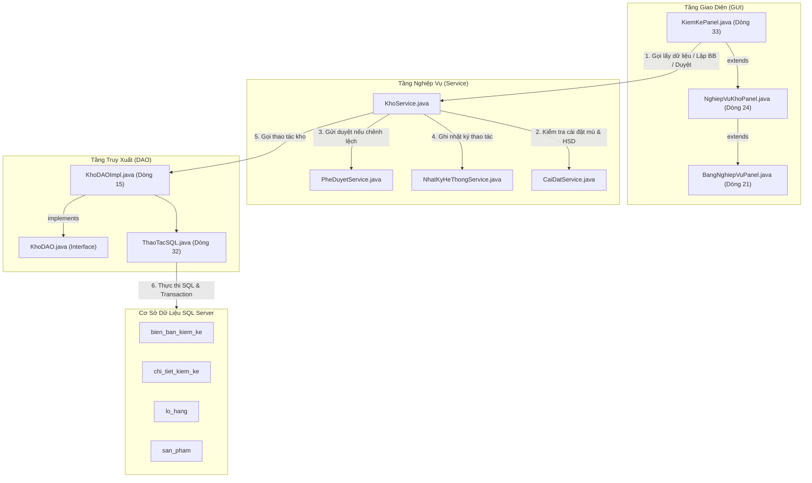
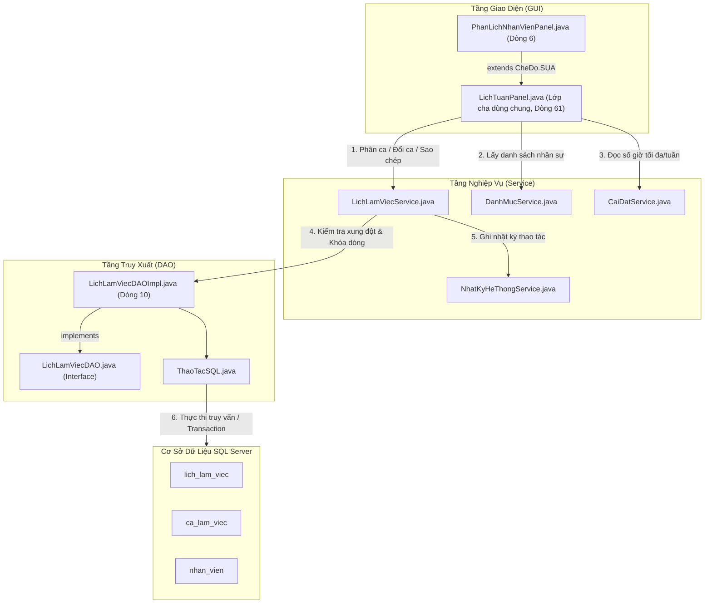

# TÀI LIỆU PHÂN TÍCH CHUYÊN SÂU MÃ NGUỒN VÀ NGHIỆP VỤ
## PHẦN 2: KIỂM KÊ TỒN KHO & PHÂN LỊCH NHÂN VIÊN

> **Hệ thống**: Quản lý Cửa hàng Thú cưng PetStation  
> **Kiến trúc**: Mô hình 3 lớp (UI - Service - DAO - Database SQL Server)  
> **Cam kết độ chính xác**: 100% số dòng code, tên hàm, câu lệnh SQL được trích xuất trực tiếp từ mã nguồn thực tế của dự án.  
> **Khả năng hiển thị**: Tích hợp sơ đồ dạng **Hộp chữ nhật Văn bản (Text/ASCII Art)** hiển thị mượt mà trên mọi trình xem Markdown (kể cả IntelliJ IDEA mặc định không cài plugin Mermaid) kèm sơ đồ Mermaid chuẩn.

---

## MỤC LỤC
1. [Chức năng 3: Kiểm kê tồn kho (KiemKePanel)](#1-chức-năng-3-kiểm-kê-tồn-kho-kiemkepanel)
   - [1.1 Sơ đồ cấu trúc file và luồng nghiệp vụ](#11-sơ-đồ-cấu-trúc-file-và-luồng-nghiệp-vụ)
   - [1.2 Bảng kê chi tiết các file liên quan và vị trí dòng code](#12-bảng-kê-chi-tiết-các-file-liên-quan-và-vị-trí-dòng-code)
   - [1.3 Phân tích chi tiết quy trình nghiệp vụ & Code thực thi](#13-phân-tích-chi-tiết-quy-trình-nghiệp-vụ--code-thực-thi)
   - [1.4 Các điểm sáng kỹ thuật độc đáo (Blind Count, Barcode, Concurrency)](#14-các-điểm-sáng-kỹ-thuật-độc-đáo)
   - [1.5 Bộ câu hỏi vấn đáp bảo vệ đồ án & Chỉ tay vào dòng code](#15-bộ-câu-hỏi-vấn-đáp-bảo-vệ-đồ-án--chỉ-tay-vào-dòng-code)
2. [Chức năng 4: Phân lịch nhân viên (PhanLichNhanVienPanel)](#2-chức-năng-4-phân-lịch-nhân-viên-phanlichnhanvienpanel)
   - [2.1 Sơ đồ cấu trúc file và luồng nghiệp vụ](#21-sơ-đồ-cấu-trúc-file-và-luồng-nghiệp-vụ)
   - [2.2 Bảng kê chi tiết các file liên quan và vị trí dòng code](#22-bảng-kê-chi-tiết-các-file-liên-quan-và-vị-trí-dòng-code)
   - [2.3 Phân tích chi tiết quy trình nghiệp vụ & Code thực thi](#23-phân-tích-chi-tiết-quy-trình-nghiệp-vụ--code-thực-thi)
   - [2.4 Các điểm sáng kỹ thuật độc đáo (Sao chép tuần, Đổi ca, Khóa lịch)](#24-các-điểm-sáng-kỹ-thuật-độc-đáo-của-phân-lịch)
   - [2.5 Bộ câu hỏi vấn đáp bảo vệ đồ án & Chỉ tay vào dòng code](#25-bộ-câu-hỏi-vấn-đáp-bảo-vệ-đồ-án--chỉ-tay-vào-dòng-code-1)

---

# 1. CHỨC NĂNG 3: KIỂM KÊ TỒN KHO (KiemKePanel)

### 1.1 Sơ đồ cấu trúc file và luồng nghiệp vụ

#### Sơ đồ Hộp chữ nhật Trực quan (Xem được trực tiếp trên IntelliJ IDEA)
```
+---------------------------------------------------------------------------------------------------+
|                                      TẦNG GIAO DIỆN (GUI)                                         |
|                                                                                                   |
|   +-------------------------------------------------------------------------------------------+   |
|   | KiemKePanel.java [L33 extends NghiepVuKhoPanel]                                           |   |
|   |  - Master-Detail SplitPane: Bảng biên bản (tblBang) & Bảng chi tiết lô (tblChiTiet)       |   |
|   |  - Modal Workspace Kiểm kê: Bộ lọc nhóm hàng, quét Barcode, Kiểm kê mù (Blind Count)      |   |
|   +---------------------------------------------+---------------------------------------------+   |
|                                                 | Kế thừa layout, bảng và các nút chung           |
|                                                 v                                                 |
|   +-------------------------------------------------------------------------------------------+   |
|   | NghiepVuKhoPanel.java [L24 extends BangNghiepVuPanel]                                     |   |
|   | BangNghiepVuPanel.java [L21 extends CoSoPanel implements HoTroThanhCongCu]                |   |
|   +---------------------------------------------+---------------------------------------------+   |
+-------------------------------------------------|-------------------------------------------------+
                                                  | Gọi kiểm tra quyền & xử lý nghiệp vụ
                                                  v
+---------------------------------------------------------------------------------------------------+
|                                     TẦNG NGHIỆP VỤ (SERVICE)                                      |
|                                                                                                   |
|   +-------------------------------------------------------------------------------------------+   |
|   | KhoService.java                                                                           |   |
|   |  - layDanhSachLoHangKiemKe(loaiSP, chiSapHetHan)  [L122-145]                              |   |
|   |  - layChiTietKiemKe(bienBanId)                    [L147-150]                              |   |
|   |  - lapBienBanKiemKe(kyKiemKe, danhSachDong)       [L152-223] (Transaction lưu BB & gửi duyệt) |
|   |  - duyetVaCanBangKho(bienBanId)                   [L225-234] (Transaction cân bằng kho)  |   |
|   |  - apDungKiemKe(bienBanId)                        [L268-276] (Optimistic Locking kiểm tra)|   |
|   +---------------------------------------------+---------------------------------------------+   |
+-------------------------------------------------|-------------------------------------------------+
                                                  | Gọi câu lệnh thực thi SQL
                                                  v
+---------------------------------------------------------------------------------------------------+
|                                  TẦNG TRUY XUẤT DỮ LIỆU (DAO)                                     |
|                                                                                                   |
|   +-------------------------------------------------------------------------------------------+   |
|   | KhoDAO.java (Interface)  <---  KhoDAOImpl.java [L15 implements KhoDAO]                    |   |
|   |  - layDanhSachLoHangKiemKe()    [L189-196]: SELECT l.id, p.ma_san_pham, l.so_luong_ton... |   |
|   |  - layChiTietKiemKe(bienBanId)  [L198-208]: SELECT c.id, c.ton_he_thong, c.ton_thuc_te... |   |
|   |  - themKiemKe()                 [L138-144]: INSERT INTO bien_ban_kiem_ke(...)             |   |
|   |  - capNhatKiemKe()              [L146-152]: INSERT INTO chi_tiet_kiem_ke(...)             |   |
|   |  - demApDungKiemKe()            [L154-159]: SELECT COUNT(*) WITH(UPDLOCK,HOLDLOCK)...     |   |
|   |  - timApDungKiemKe()            [L161-167]: SELECT lo_hang_id, ton_he_thong...            |   |
|   |  - capNhatApDungKiemKe()        [L36-39]  : UPDATE lo_hang SET so_luong_ton=? WHERE...    |   |
|   |  - danhDauKiemKeDaDuyet()       [L41-44]  : UPDATE bien_ban_kiem_ke SET trang_thai='APP'..|   |
|   +---------------------------------------------+---------------------------------------------+   |
|                                                 | Thực thi JDBC qua kết nối Database              |
|                                                 v                                                 |
|   +-------------------------------------------------------------------------------------------+   |
|   | ThaoTacSQL.java [L32] -> Database.layKetNoi() [L21] (SQL Server Connection Pool)          |   |
+-------------------------------------------------|-------------------------------------------------+
                                                  v
+---------------------------------------------------------------------------------------------------+
|                                CƠ SỞ DỮ LIỆU (SQL SERVER)                                         |
|    [bien_ban_kiem_ke] <---> [chi_tiet_kiem_ke] <---> [lo_hang] <---> [san_pham]                  |
+---------------------------------------------------------------------------------------------------+
```

#### Sơ đồ Mermaid (Dành cho trình xem hỗ trợ Mermaid)


---

### 1.2 Bảng kê chi tiết các file liên quan và vị trí dòng code

| Package | Tên File | Vai trò | Kế thừa / Dùng chung & Vị trí dòng code chính xác |
| :--- | :--- | :--- | :--- |
| `com.petstation.gui.processing.inventory` | `KiemKePanel.java` | Giao diện chính kiểm kê | **Dòng 33**: `extends NghiepVuKhoPanel`<br>**Dòng 41-150**: Dựng SplitPane Master-Detail, tô màu chênh lệch<br>**Dòng 191-233**: `thucHienCanBangKho()` kiểm tra quyền CHT & duyệt<br>**Dòng 247-655**: `moWorkspaceKiemKe()` Modal kiểm kê quét Barcode, kiểm kê mù |
| `com.petstation.gui.processing.inventory` | `NghiepVuKhoPanel.java` | Lớp cha nghiệp vụ kho | **Dòng 24**: `extends BangNghiepVuPanel`<br>Chứa các hàm chuẩn `nhapKho()`, `ghiHuy()`, `kiemKe()` |
| `com.petstation.gui.components` | `BangNghiepVuPanel.java` | Khung bảng nghiệp vụ chuẩn | **Dòng 21**: `extends CoSoPanel implements HoTroThanhCongCu`<br>Quản lý `tblBang`, `moHinh`, thanh tìm kiếm, phân trang và nút làm mới |
| `com.petstation.service` | `KhoService.java` | Xử lý logic kiểm kê & transaction | **Dòng 111-120**: `record DongKiemKe(...)`<br>**Dòng 122-145**: `layDanhSachLoHangKiemKe()` lọc nhóm hàng, HSD<br>**Dòng 152-223**: `lapBienBanKiemKe()` kiểm tra số liệu, lưu và gửi duyệt<br>**Dòng 225-234**: `duyetVaCanBangKho()` giao dịch phê duyệt của Quản lý<br>**Dòng 268-276**: `apDungKiemKe()` cơ chế Optimistic Concurrency Control |
| `com.petstation.dao` | `KhoDAO.java` | Interface truy xuất kho | Khai báo các hợp đồng phương thức kiểm kê |
| `com.petstation.dao.impl` | `KhoDAOImpl.java` | Hiện thực hóa truy vấn SQL | **Dòng 36-39**: `capNhatApDungKiemKe()` (UPDATE chống xung đột tồn kho)<br>**Dòng 41-44**: `danhDauKiemKeDaDuyet()` (chuyển trạng thái APPROVED)<br>**Dòng 138-144**: `themKiemKe()` (INSERT `bien_ban_kiem_ke`)<br>**Dòng 146-152**: `capNhatKiemKe()` (INSERT `chi_tiet_kiem_ke`)<br>**Dòng 154-159**: `demApDungKiemKe()` (SELECT COUNT có khóa `UPDLOCK,HOLDLOCK`)<br>**Dòng 189-196**: `layDanhSachLoHangKiemKe()` truy vấn tồn các lô hàng |
| `com.petstation.database` | `ThaoTacSQL.java` | Tiện ích bọc JDBC Transaction | **Dòng 32-150**: Quản lý `PreparedStatement`, Rollback khi gặp lỗi |
| `com.petstation.model` | `Quyen.java` | Phân quyền hệ thống | `Quyen.KIEM_KE_KHO`, `Quyen.XU_LY_PHE_DUYET` |

---

### 1.3 Phân tích chi tiết quy trình nghiệp vụ & Code thực thi

#### Giai đoạn 1: Lập đợt kiểm kê (Modal Workspace Kiểm kê)
1. Nhân viên bấm nút **"+ Lập đợt kiểm kê"** (`KiemKePanel.java`, dòng 45), hàm `moWorkspaceKiemKe()` mở một hộp thoại Modal toàn màn hình (`KiemKePanel.java`, dòng 247).
2. Tải danh sách lô hàng kiểm kê:
   - Gọi `KhoService.layDanhSachLoHangKiemKe(nhom, chiSapHetHan)` (`KiemKePanel.java`, dòng 486).
   - `KhoService.java` kiểm tra quyền `Quyen.KIEM_KE_KHO` (dòng 123). Gọi `khoDAO.layDanhSachLoHangKiemKe()` (dòng 124).
   - SQL lọc ra các lô hàng `AVAILABLE` và sản phẩm `ACTIVE` (`KhoDAOImpl.java`, dòng 191-193):
     ```sql
     SELECT l.id, p.ma_san_pham, p.ten, COALESCE(p.barcode, ''), l.so_lo, 
            l.han_su_dung, l.so_luong_ton, p.nhom_hang 
     FROM lo_hang l 
     JOIN san_pham p ON p.id = l.san_pham_id 
     WHERE l.trang_thai = 'AVAILABLE' AND p.trang_thai = 'ACTIVE' 
     ORDER BY p.nhom_hang, p.ten, l.han_su_dung
     ```
   - Stream API trong `KhoService.java` (dòng 127-144) tiến hành lọc theo danh mục hoặc chỉ lọc các mặt hàng sắp hết hạn (dựa theo cấu hình ngày cảnh báo lấy từ `CaiDatService.layHanSuDungCanhBaoSoNgay()`, dòng 125).

3. Đếm số lượng thực tế:
   - **Nhập tay**: Nhân viên sửa trực tiếp tại cột **"Tồn TT"** (cột số 7). TableModelListener bắt sự kiện (`KiemKePanel.java`, dòng 459-477), tính toán lại cột **"Chênh lệch" = Tồn TT - Tồn HT** (dòng 471). Nếu nhập số âm, hệ thống lập tức chặn và cảnh báo (dòng 465-468).
   - **Bắn mã vạch**: Lắng nghe phím `ENTER` trên ô Barcode (`KiemKePanel.java`, dòng 543-581). Khi máy quét đọc được mã, hệ thống tự duyệt tìm dòng sản phẩm tương ứng, tăng số lượng thực tế thêm 1 đơn vị (`tonHienTai + 1`, dòng 558), tự động cuộn bảng đến đúng dòng vừa quét và nháy trạng thái màu xanh lá (dòng 560-567).

4. Lưu biên bản kiểm kê:
   - Khi bấm **"Lưu đợt kiểm kê"** (`KiemKePanel.java`, dòng 584), hệ thống duyệt qua danh sách mặt hàng:
     - **Bắt buộc nhập lý do**: Nếu `tonTT != tonHT` mà cột **Lý do chênh lệch** để trống -> Hệ thống chặn lưu, cuộn bảng đến đúng dòng vi phạm và thông báo (`KiemKePanel.java`, dòng 614-626; `KhoService.java`, dòng 172-180).
   - Gọi `KhoService.lapBienBanKiemKe(ky, danhSach)` (`KhoService.java`, dòng 152).
   - Toàn bộ quá trình lưu được bọc trong một **Transaction duy nhất** (`KhoService.java`, dòng 186-222):
     ```java
     thucHienGiaoDich(ketNoi -> {
         String soBienBan = taoMa("KK");
         String trangThai = coChenhLechFinal ? "PENDING" : "APPROVED";
         long bienBanId = khoDAO.themKiemKe(soBienBan, layIdTaiKhoan(), kyKiemKeFinal, trangThai);
         for (DongKiemKe d : danhSachDong) {
             khoDAO.capNhatKiemKe(bienBanId, d.loHangId(), d.tonHeThong(), d.tonThucTe(), d.lyDo());
         }
         if (coChenhLechFinal) {
             PheDuyetService.guiThaoTac(PheDuyetService.Loai.KIEM_KE, ...);
         }
         NhatKyHeThongService.ghiNhatKy("Kiểm kê đợt", ...);
         return bienBanId;
     });
     ```
   - **Quy tắc trạng thái**: Nếu đợt kiểm kê **khớp 100% số lượng**, biên bản được đặt ngay là `APPROVED`. Nếu **có bất kỳ mặt hàng nào lệch**, biên bản tự động chuyển sang `PENDING` và đẩy thông báo duyệt sang màn hình của Cửa hàng trưởng (`PheDuyetService.guiThaoTac`, dòng 203-211).

---

#### Giai đoạn 2: Phê duyệt & Cân bằng kho (Dành cho Cửa hàng trưởng)
1. Chỉ người dùng có quyền `Quyen.XU_LY_PHE_DUYET` mới nhìn thấy nút **"Cân bằng kho (Duyệt)"** (`KiemKePanel.java`, dòng 46-48).
2. Khi bấm duyệt, hàm `thucHienCanBangKho()` (`KiemKePanel.java`, dòng 191) kiểm tra:
   - Biên bản đã được chọn chưa? (dòng 197).
   - Biên bản đã ở trạng thái `APPROVED` chưa? Nếu đã duyệt rồi thì thông báo không duyệt lại (dòng 206-209).
   - Bật hộp thoại xác nhận (dòng 212-221).
3. Gọi `KhoService.duyetVaCanBangKho(bienBanHienTaiId)` (`KhoService.java`, dòng 225-234).
4. Thực thi hàm lõi `apDungKiemKe(bienBanId)` (`KhoService.java`, dòng 268-276):
   - **Bước 4.1 (Khóa bi quan - Pessimistic Lock)**:
     ```sql
     SELECT COUNT(*) FROM bien_ban_kiem_ke WITH(UPDLOCK,HOLDLOCK) WHERE id=? AND trang_thai='PENDING'
     ```
     `KhoDAOImpl.java` (dòng 156) sử dụng gợi ý khóa `WITH(UPDLOCK,HOLDLOCK)` trên SQL Server để đảm bảo tại một thời điểm chỉ có duy nhất 1 giao dịch được quyền duyệt biên bản này, triệt tiêu hoàn toàn lỗi 2 quản lý cùng bấm nút duyệt đồng thời (Double Approval).
   - **Bước 4.2 (Khóa lạc quan - Optimistic Concurrency Check)**:
     Hệ thống duyệt qua từng dòng chi tiết kiểm kê (`KhoService.java`, dòng 271-274):
     ```sql
     UPDATE lo_hang SET so_luong_ton=? WHERE id=? AND so_luong_ton=?
     ```
     (`KhoDAOImpl.java`, dòng 38).
     Tham số truyền vào: `[ton_thuc_te, lo_hang_id, ton_he_thong_luc_kiem_ke]`.
     Nếu số lượng tồn thực tế trong kho tại thời điểm duyệt **không còn bằng** số tồn hệ thống ghi nhận lúc lập biên bản (ví dụ: trong lúc chờ duyệt, nhân viên đã bán hàng từ lô này), câu lệnh `UPDATE` sẽ trả về `0` dòng được cập nhật.
     Ngay lập tức, `KhoService.java` (dòng 272-274) ném lỗi:
     `throw new IllegalArgumentException("Tồn đã thay đổi sau kiểm kê. Cần lập lại biên bản.");`
     Giao dịch lập tức **ROLLBACK toàn bộ**, ngăn chặn triệt để tình trạng lệch kho dây chuyền!
   - **Bước 4.3**: Nếu toàn bộ các dòng cập nhật thành công, đánh dấu biên bản kiểm kê thành `APPROVED` (`KhoDAOImpl.java`, dòng 43) và ghi vết `NhatKyHeThongService` (dòng 230).

---

### 1.4 Các điểm sáng kỹ thuật độc đáo

1. **Chế độ kiểm kê mù (Blind Count)**:
   - `KiemKePanel.java` (dòng 521-540): Khi tích chọn checkbox "Kiểm kê mù", hệ thống ẩn hoàn toàn 2 cột "Tồn hệ thống" và "Chênh lệch" (đặt `width = 0`).
   - *Ý nghĩa nghiệp vụ thực tế*: Buộc nhân viên kiểm kê phải đếm thực tế từng sản phẩm trên kệ, không thể nhìn số tồn sẵn có trên máy để tick bừa hoặc gian lận hàng thất thoát. Cấu hình mặc định có bật kiểm kê mù hay không được đọc động từ bảng cấu hình hệ thống (`CaiDatService.MAC_DINH_KIEM_KE_MU`, dòng 296-302).
2. **Master-Detail Split-Pane & Renderer trực quan**:
   - Tái cấu trúc layout bằng `JSplitPane.VERTICAL_SPLIT` (`KiemKePanel.java`, dòng 134-138): Bảng trên xem danh sách biên bản, bảng dưới xem chi tiết các mặt hàng của biên bản được chọn.
   - Tô màu cột chênh lệch (`KiemKePanel.java`, dòng 76-107): Nếu chênh lệch âm (thất thoát), chữ số in đậm màu đỏ `#DC2626`; nếu chênh lệch dương (dư thừa), chữ số in đậm màu xanh dương `#2563EB`.

---

### 1.5 Bộ câu hỏi vấn đáp bảo vệ đồ án & Chỉ tay vào dòng code

#### Câu 1: Hệ thống xử lý thế nào nếu nhân viên kiểm kê phát hiện hàng hóa bị thiếu hụt?
- **Trả lời**: Hệ thống bắt buộc nhân viên phải ghi rõ nguyên nhân tại cột "Lý do chênh lệch". Sau khi lưu, biên bản không tự ý sửa số tồn ngay mà chuyển sang trạng thái `PENDING` và gửi yêu cầu phê duyệt đến Cửa hàng trưởng.
- **Chỉ tay vào code**: 
  - `KiemKePanel.java` (dòng 614-626): Kiểm tra validation `tonTT != tonHT && lyDo.isEmpty()`.
  - `KhoService.java` (dòng 189): Gán `trangThai = coChenhLech ? "PENDING" : "APPROVED"`.
  - `KhoService.java` (dòng 203-211): Gọi `PheDuyetService.guiThaoTac(...)`.

#### Câu 2: Trong lúc chờ Cửa hàng trưởng duyệt biên bản kiểm kê, nếu có nhân viên bán mất một món hàng trong lô đó thì khi duyệt sẽ xảy ra hiện tượng gì?
- **Trả lời**: Hệ thống áp dụng cơ chế **Optimistic Concurrency Control (Khóa lạc quan)**. Khi duyệt, câu lệnh SQL sẽ kiểm tra số lượng tồn hiện tại của lô hàng có còn đúng bằng số tồn lúc lập phiếu hay không (`WHERE id=? AND so_luong_ton=?`). Nếu số tồn đã bị thay đổi do bán hàng, câu lệnh trả về 0 dòng cập nhật, hệ thống lập tức ném ngoại lệ và Rollback toàn bộ giao dịch, yêu cầu nhân viên phải lập lại biên bản kiểm kê mới để đảm bảo tính toàn vẹn kho.
- **Chỉ tay vào code**:
  - `KhoDAOImpl.java` (dòng 38): `UPDATE lo_hang SET so_luong_ton=? WHERE id=? AND so_luong_ton=?`.
  - `KhoService.java` (dòng 272-274): `if (khoDAO.capNhatApDungKiemKe(...) != 1) throw new IllegalArgumentException("Tồn đã thay đổi sau kiểm kê. Cần lập lại biên bản.");`.

#### Câu 3: Làm sao ngăn chặn trường hợp 2 Quản lý cùng mở phần mềm và bấm Duyệt cân bằng kho cho cùng 1 biên bản tại cùng 1 giây?
- **Trả lời**: Tầng DAO sử dụng gợi ý khóa dòng của SQL Server là `WITH (UPDLOCK, HOLDLOCK)`. Giao dịch nào đến trước sẽ khóa độc quyền dòng biên bản kiểm kê đó, giao dịch đến sau sẽ thấy trạng thái không còn là `PENDING` nữa và bị từ chối ngay lập tức.
- **Chỉ tay vào code**:
  - `KhoDAOImpl.java` (dòng 156): `SELECT COUNT(*) FROM bien_ban_kiem_ke WITH(UPDLOCK,HOLDLOCK) WHERE id=? AND trang_thai='PENDING'`.
  - `KhoService.java` (dòng 269): `if (khoDAO.demApDungKiemKe(soLuong) == 0) throw new IllegalStateException("Biên bản đã xử lý.");`.

---
---

# 2. CHỨC NĂNG 4: PHÂN LỊCH NHÂN VIÊN (PhanLichNhanVienPanel)

### 2.1 Sơ đồ cấu trúc file và luồng nghiệp vụ

#### Sơ đồ Hộp chữ nhật Trực quan (Xem được trực tiếp trên IntelliJ IDEA)
```
+---------------------------------------------------------------------------------------------------+
|                                      TẦNG GIAO DIỆN (GUI)                                         |
|                                                                                                   |
|   +-------------------------------------------------------------------------------------------+   |
|   | PhanLichNhanVienPanel.java [L6-10 extends LichTuanPanel] (Khởi tạo CheDo.SUA)             |   |
|   +---------------------------------------------+---------------------------------------------+   |
|                                                 | Kế thừa toàn bộ giao diện lưới tuần đa năng     |
|                                                 v                                                 |
|   +-------------------------------------------------------------------------------------------+   |
|   | LichTuanPanel.java [L61 extends CoSoPanel implements HoTroThanhCongCu]                    |   |
|   |  - Dựng lưới 7 ngày x 2 ca với GridBagLayout (layOTieuDe, layNhanDong, layO) [L304-350]    |   |
|   |  - Cảnh báo viền đỏ ô thiếu nhân viên (< 2 người) [L414-441]                              |   |
|   |  - Dialog Phân ca nhân viên (moDialogPhanCa) [L551-791]                                   |   |
|   |  - Sao chép lịch tuần trước (saoChepLichTuan) [L793-805]                                  |   |
|   |  - Hoán đổi ca làm việc trực tiếp (hoanDoiCaNhanVien) [L807-932]                          |   |
|   |  - Khóa lịch tuần để chốt công bố (khoaLichTuan) [L934-944]                               |   |
|   +---------------------------------------------+---------------------------------------------+   |
+-------------------------------------------------|-------------------------------------------------+
                                                  | Gọi kiểm tra phân công & nghiệp vụ
                                                  v
+---------------------------------------------------------------------------------------------------+
|                                     TẦNG NGHIỆP VỤ (SERVICE)                                      |
|                                                                                                   |
|   +-------------------------------------------------------------------------------------------+   |
|   | LichLamViecService.java                                                                   |   |
|   |  - layKhoang(tuNgay, denNgay)           [L76-89] : Lấy danh sách ca làm việc              |   |
|   |  - layO(ngay, caLamViec)                [L95-99] : Lấy danh sách nhân viên trong 1 ô ca   |   |
|   |  - demCaLamViec(ngay, caLamViec)        [L101-103]: Đếm số nhân viên làm thực tế (trừ nghỉ)| 
|   |  - phanCong(ngay, caLamViec, maNV)      [L105-121]: Kiểm tra trùng ca/nghỉ việc & phân ca |   |
|   |  - xoa(Muc muc)                         [L123-127]: Bỏ nhân viên khỏi ca                  |   |
|   |  - saoChepLichTuan(tuTuan, denTuan)     [L154-174]: Copy toàn bộ phân ca tuần cũ sang mới |   |
|   |  - hoanDoiCa(...)                       [L176-193]: Transaction tráo đổi ca giữa 2 người  |   |
|   |  - khoaLichTuan(thuHai)                 [L195-200]: Đổi trạng thái lịch sang 'LOCKED'     |   |
|   +---------------------------------------------+---------------------------------------------+   |
+-------------------------------------------------|-------------------------------------------------+
                                                  | Gọi truy xuất dữ liệu & khóa bi quan
                                                  v
+---------------------------------------------------------------------------------------------------+
|                                  TẦNG TRUY XUẤT DỮ LIỆU (DAO)                                     |
|                                                                                                   |
|   +-------------------------------------------------------------------------------------------+   |
|   | LichLamViecDAO.java (Interface) <--- LichLamViecDAOImpl.java [L10 implements LLVDAO]      |   |
|   |  - demPhanCong(nhanVienId)       [L12-15]: SELECT id WITH(UPDLOCK,HOLDLOCK) FROM nhan_vien|   |
|   |  - demNhanVienDangLam(id)        [L17-20]: SELECT COUNT(*) WHERE dang_lam_viec=1          |   |
|   |  - timKhoang(tuNgay, denNgay)    [L22-30]: SELECT l.ngay_lam, c.ma_ca, n.ma_nhan_vien...  |   |
|   |  - demLichTrungNgayCa(...)       [L32-39]: SELECT COUNT(*) kiểm tra trùng ca hoặc nghỉ     |   |
|   |  - capNhatPhanCong(...)          [L41-47]: Xóa ca cũ đã bị hủy trước đó                   |   |
|   |  - themLichLamViec(...)          [L49-54]: INSERT INTO lich_lam_viec (nhan_vien, ca, ...)  |   |
|   |  - capNhatXoa(...)               [L56-62]: UPDATE lich_lam_viec SET trang_thai='CANCELLED'|   |
|   |  - khoaLichKhoang(...)           [L90-95]: UPDATE lich_lam_viec SET trang_thai='LOCKED'   |   |
|   +---------------------------------------------+---------------------------------------------+   |
|                                                 | Thực thi JDBC qua kết nối Database              |
|                                                 v                                                 |
|   +-------------------------------------------------------------------------------------------+   |
|   | ThaoTacSQL.java [L32] -> Database.layKetNoi() [L21] (SQL Server Connection Pool)          |   |
+-------------------------------------------------|-------------------------------------------------+
                                                  v
+---------------------------------------------------------------------------------------------------+
|                                CƠ SỞ DỮ LIỆU (SQL SERVER)                                         |
|             [lich_lam_viec] <---> [ca_lam_viec] <---> [nhan_vien]                                 |
+---------------------------------------------------------------------------------------------------+
```

#### Sơ đồ Mermaid (Dành cho trình xem hỗ trợ Mermaid)


---

### 2.2 Bảng kê chi tiết các file liên quan và vị trí dòng code

| Package | Tên File | Vai trò | Kế thừa / Dùng chung & Vị trí dòng code chính xác |
| :--- | :--- | :--- | :--- |
| `com.petstation.gui.processing.staff` | `PhanLichNhanVienPanel.java` | Màn hình phân lịch nhân viên | **Dòng 6-10**: `extends LichTuanPanel`<br>Gọi `super(CheDo.SUA, maNhanVien)` để kích hoạt toàn bộ tính năng chỉnh sửa phân ca |
| `com.petstation.gui.components` | `LichTuanPanel.java` | Thành phần giao diện Lưới tuần | **Dòng 61**: `extends CoSoPanel implements HoTroThanhCongCu`<br>**Dòng 63-67**: Khai báo `enum CheDo { HIEN_THI_TAT_CA, CA_NHAN, SUA }`<br>**Dòng 304-342**: `dungLai()` dựng giao diện dạng lưới 7 cột ngày x 2 hàng ca<br>**Dòng 400-458**: `layO()` hiển thị thẻ nhân viên, vẽ viền đỏ nếu thiếu nhân sự<br>**Dòng 551-791**: `moDialogPhanCa()` dialog chọn nhân viên vào ca, lọc chức vụ<br>**Dòng 793-805**: `saoChepLichTuan()` sao chép lịch từ tuần trước<br>**Dòng 807-932**: `hoanDoiCaNhanVien()` hoán đổi ca giữa 2 nhân viên<br>**Dòng 934-944**: `khoaLichTuan()` khóa lịch tuần không cho chỉnh sửa |
| `com.petstation.service` | `LichLamViecService.java` | Xử lý logic nghiệp vụ lịch | **Dòng 20-30**: Cấu hình ca làm việc (`CA01`: 07:30-14:30, `CA02`: 14:30-21:30, tối thiểu 2 người/ca)<br>**Dòng 37-62**: `class Muc` (đại diện 1 phân công ca hoặc nghỉ phép)<br>**Dòng 105-121**: `phanCong()` kiểm tra điều kiện & phân ca trong transaction<br>**Dòng 154-174**: `saoChepLichTuan()` nhân bản phân ca sang tuần mới<br>**Dòng 176-193**: `hoanDoiCa()` tráo đổi ca làm việc an toàn giữa 2 người |
| `com.petstation.dao` | `LichLamViecDAO.java` | Interface truy xuất lịch | Khai báo các hợp đồng truy vấn lịch làm việc |
| `com.petstation.dao.impl` | `LichLamViecDAOImpl.java` | Hiện thực hóa SQL lịch làm việc | **Dòng 12-15**: `demPhanCong()` (Khóa dòng nhân viên bằng `UPDLOCK,HOLDLOCK`)<br>**Dòng 17-20**: `demNhanVienDangLam()` (Kiểm tra `dang_lam_viec=1`)<br>**Dòng 22-30**: `timKhoang()` (Lấy lịch làm việc trong khoảng ngày)<br>**Dòng 32-39**: `demLichTrungNgayCa()` (Kiểm tra trùng ca hoặc đang nghỉ phép)<br>**Dòng 41-47**: `capNhatPhanCong()` (Xóa lịch cũ đã hủy)<br>**Dòng 49-54**: `themLichLamViec()` (INSERT ca làm việc mới)<br>**Dòng 56-62**: `capNhatXoa()` (Đánh dấu ca thành `CANCELLED`)<br>**Dòng 90-95**: `khoaLichKhoang()` (Đánh dấu ca thành `LOCKED`) |
| `com.petstation.service` | `DanhMucService.java` | Lấy danh mục nhân sự | **Dòng 518-522**: `layNhanVien()` lấy họ tên, chức vụ nhân viên |
| `com.petstation.service` | `CaiDatService.java` | Đọc cấu hình giờ làm | Đọc tùy chọn `SO_GIO_TOI_DA_MOI_TUAN` (mặc định 42h) |

---

### 2.3 Phân tích chi tiết quy trình nghiệp vụ & Code thực thi

#### Giai đoạn 1: Hiển thị lưới tuần & Cảnh báo thiếu nhân sự
1. `LichTuanPanel.java` sử dụng `GridBagLayout` để vẽ ma trận thời gian thực:
   - Cột 0: Tên ca làm việc (`Ca sáng: 07:30 - 14:30`, `Ca chiều: 14:30 - 21:30`).
   - Cột 1 đến Cột 7: 7 ngày trong tuần từ Thứ Hai đến Chủ Nhật (`LichTuanPanel.java`, dòng 318-336).
2. Kiểm tra định mức nhân sự tối thiểu trong mỗi ô ca:
   - Gọi `LichLamViecService.demCaLamViec(ngay, caLamViec)` (`LichLamViecService.java`, dòng 101-103) đếm số nhân viên đang làm (loại trừ các ca nghỉ phép).
   - So sánh với định mức `LichLamViecService.NHO_NHAT_NHAN_VIEN[caLamViec]` (= 2 nhân viên).
   - **Xử lý cảnh báo**: Nếu số lượng < 2, ô hiển thị được **viền đỏ đậm 2px** (`NGHI_PHEP`, dòng 422) kèm dòng chữ cảnh báo màu đỏ: `"Thiếu X người"` (`LichTuanPanel.java`, dòng 436-440).

---

#### Giai đoạn 2: Phân ca nhân viên (Hộp thoại Chọn ca)
1. Trong chế độ `CheDo.SUA`, ở mỗi ô ca xuất hiện nút **"+ Thêm nhân viên"** (`LichTuanPanel.java`, dòng 443).
2. Khi người dùng bấm nút, hệ thống mở `moDialogPhanCa(ngay, caLamViec)` (`LichTuanPanel.java`, dòng 551):
   - Đọc danh sách toàn bộ nhân viên từ `DanhMucService.layNhanVien()`. Bỏ qua các nhân viên đã nghỉ việc (`trangThai.equals("Nghỉ việc")`, dòng 606).
   - Tính tổng số giờ nhân viên đã làm trong tuần qua hàm `LichLamViecService.tinhGioTrongTuan(ma, thuHai)` (dòng 609).
   - Đọc giới hạn giờ làm việc tối đa mỗi tuần từ cài đặt (`CaiDatService`, dòng 579-581, mặc định 42 giờ).
   - Kiểm tra các xung đột để hiển thị cột **Trạng thái / Ghi chú** (dòng 612-636):
     * Nếu nhân viên có lịch nghỉ phép: Ghi `"[!] Đang nghỉ phép"`.
     * Nếu nhân viên đã được xếp vào ca khác trong cùng ngày hôm đó: Ghi `"[!] Đã có Ca sáng"` hoặc `"[!] Đã có Ca chiều"`.
     * Nếu số giờ làm trong tuần vượt mức: Ghi `"[!] Đã làm 49h/42h tuần này"`.
3. Khi bấm **"Lưu phân ca"** (`LichTuanPanel.java`, dòng 726):
   - Kiểm tra tổng số nhân viên được tích chọn. Nếu vẫn nhỏ hơn 2, hệ thống bật cảnh báo xác nhận xem quản lý có thực sự muốn lưu ca thiếu người hay không (dòng 743-753).
   - Duyệt danh sách các nhân viên mới được tích thêm, gọi `LichLamViecService.phanCong(ngay, caLamViec, ma)` (dòng 756).
   - Duyệt danh sách các nhân viên bị bỏ tích, gọi `LichLamViecService.xoa(m)` (dòng 767).

---

#### Giai đoạn 3: Logic kiểm tra an toàn trong Transaction khi phân ca (`phanCong`)
Mã nguồn hàm `phanCong` (`LichLamViecService.java`, dòng 105-121):
```java
public static String phanCong(LocalDate ngay, int caLamViec, String ma) {
    yeuCau(Quyen.QUAN_LY_LICH_LAM_VIEC);
    if (caLamViec < 0 || caLamViec >= CAC_MA.length) return "Ca không hợp lệ.";
    return thucHienGiaoDich(ketNoi -> {
        long nhanVien = DanhMucService.layId("nhan_vien", "ma_nhan_vien", ma);
        lichLamViecDAO.demPhanCong(nhanVien); // Khóa bi quan: WITH(UPDLOCK,HOLDLOCK)
        if (lichLamViecDAO.demNhanVienDangLam(nhanVien) == 0)
            return "Nhân viên đã nghỉ việc.";
        if (lichLamViecDAO.demLichTrungNgayCa(nhanVien, ngay, CAC_MA[caLamViec]) > 0)
            return "Nhân viên đã có ca hoặc nghỉ phép ngày này.";
        lichLamViecDAO.capNhatPhanCong(nhanVien, ngay, CAC_MA[caLamViec]);
        lichLamViecDAO.themLichLamViec(nhanVien, ngay, CAC_MA[caLamViec]);
        thongBao();
        return null;
    });
}
```
**3 tầng phòng ngự dữ liệu cực kỳ chặt chẽ**:
1. `lichLamViecDAO.demPhanCong(nhanVien)` (`LichLamViecDAOImpl.java`, dòng 14): Sử dụng câu lệnh `SELECT id FROM nhan_vien WITH(UPDLOCK,HOLDLOCK) WHERE id=?` để khóa record nhân viên trong suốt transaction, chống tình trạng 2 quản lý cùng xếp ca cho 1 người vào 2 chi nhánh hoặc 2 ca khác nhau cùng một thời điểm.
2. `lichLamViecDAO.demNhanVienDangLam(nhanVien)` (dòng 19): `SELECT COUNT(*) FROM nhan_vien WHERE id=? AND dang_lam_viec=1`. Nếu nhân viên vừa bị sa thải/nghỉ việc, transaction trả về thông báo lỗi ngay lập tức.
3. `lichLamViecDAO.demLichTrungNgayCa` (dòng 34-37):
   ```sql
   SELECT COUNT(*) FROM lich_lam_viec 
   WHERE nhan_vien_id=? AND ngay_lam=? AND trang_thai<>'CANCELLED' 
     AND (loai='LEAVE' OR ca_lam_viec_id=(SELECT id FROM ca_lam_viec WHERE ma_ca=?))
   ```
   Ngăn chặn 100% việc xếp ca cho nhân viên đã có ca hoặc đã đăng ký nghỉ phép được duyệt.

---

### 2.4 Các điểm sáng kỹ thuật độc đáo của Phân lịch

1. **Sao chép lịch tuần trước (Copy Schedule Automation)**:
   - `LichTuanPanel.java` (dòng 793-805) & `LichLamViecService.java` (dòng 154-174).
   - Quản lý không cần phải tạo lại lịch từ đầu mỗi tuần. Chỉ cần 1 nút bấm "Sao chép tuần trước", hệ thống tự động:
     - Đọc toàn bộ phân ca của tuần nguồn (`tuTuan = thuHai.minusWeeks(1)`).
     - Bỏ qua các ca `LEAVE` (nghỉ phép của tuần cũ không sao chép sang tuần mới, dòng 164).
     - Tính khoảng cách ngày tương ứng (`ChronoUnit.DAYS.between`, dòng 166) và tự động gọi `phanCong` cho tuần mới.
2. **Hoán đổi ca làm việc trực tiếp (Atomic Shift Swap)**:
   - `LichTuanPanel.java` (dòng 807-932) & `LichLamViecService.java` (dòng 176-193).
   - Cho phép chọn 2 ca làm việc của 2 nhân viên khác nhau để tráo đổi trực tiếp.
   - Thao tác tráo đổi được bọc trong một **Database Transaction nguyên tử**: Nếu việc gán người này sang ca người kia bị lỗi (do trùng lịch hoặc vướng nghỉ phép), toàn bộ lệnh hủy ca và tráo đổi sẽ bị Rollback hoàn toàn về nguyên trạng ban đầu (dòng 184-189).
3. **Khóa lịch tuần (Lock Weekly Schedule)**:
   - `LichTuanPanel.java` (dòng 934-944) & `LichLamViecService.java` (dòng 195-200).
   - Sau khi Cửa hàng trưởng chốt lịch tuần, bấm "Khóa lịch tuần" sẽ cập nhật toàn bộ trạng thái phân ca trong tuần từ `OPEN` sang `LOCKED` (`LichLamViecDAOImpl.java`, dòng 92). Lịch đã khóa sẽ trở thành lịch công bố chính thức, ngăn ngừa sửa đổi ngoài ý muốn.
4. **Cơ chế Reactive Observer Pattern (Cập nhật giao diện tự động)**:
   - `LichLamViecService.java` (dòng 201-203) cài đặt cơ chế đăng ký lắng nghe `CAC_BO_LANG_NGHE.add(boLangNghe)`.
   - Mỗi khi có bất kỳ hành động phân ca, xóa ca, đổi ca hay duyệt nghỉ phép thành công, hàm `thongBao()` (dòng 206) được gọi -> Lập tức kích hoạt `dungLai()` trên giao diện `LichTuanPanel.java` để vẽ lại toàn bộ lưới ca làm mà không cần người dùng phải bấm F5 hay tắt mở lại ứng dụng.

---

### 2.5 Bộ câu hỏi vấn đáp bảo vệ đồ án & Chỉ tay vào dòng code

#### Câu 1: Em giải quyết bài toán chống trùng ca và tránh phân lịch cho nhân viên đã nghỉ việc như thế nào?
- **Trả lời**: Toàn bộ logic kiểm tra được đặt trong một Transaction ở tầng Service kết hợp khóa bi quan ở tầng DAO. Hệ thống dùng `WITH(UPDLOCK,HOLDLOCK)` khóa bản ghi nhân viên, sau đó chạy 2 câu truy vấn kiểm tra: `dang_lam_viec = 1` và `demLichTrungNgayCa > 0`. Nếu nhân viên đã có ca làm hoặc đã có lịch nghỉ phép `LEAVE` trong ngày đó thì giao dịch sẽ trả về lỗi và chặn ngay.
- **Chỉ tay vào code**:
  - `LichLamViecService.java` (dòng 111-115): Kiểm tra `demNhanVienDangLam` và `demLichTrungNgayCa`.
  - `LichLamViecDAOImpl.java` (dòng 14): `SELECT id FROM nhan_vien WITH(UPDLOCK,HOLDLOCK) WHERE id=?`.
  - `LichLamViecDAOImpl.java` (dòng 34-37): Truy vấn kiểm tra trùng ngày và ca.

#### Câu 2: Chức năng Hoán đổi ca (Đổi ca) hoạt động như thế nào nếu 1 trong 2 người bị vướng lịch cá nhân vào ngày mới?
- **Trả lời**: Hàm `hoanDoiCa` trong `LichLamViecService` sử dụng cơ chế Transaction nguyên tử (`thucHienGiaoDich`). Hệ thống tạm thời xóa ca của 2 người, sau đó lần lượt gán chéo cho nhau. Nếu việc gán người thứ 2 bị lỗi (ví dụ người đó đã có lịch làm khác hoặc nghỉ phép), hệ thống sẽ ném `IllegalArgumentException`, ngay lập tức toàn bộ Transaction sẽ **Rollback**, phục hồi nguyên vẹn ca làm cũ cho cả 2 nhân viên mà không để lại dữ liệu rác.
- **Chỉ tay vào code**:
  - `LichLamViecService.java` (dòng 180-192): Khối `thucHienGiaoDich` bọc `lichLamViecDAO.capNhatXoa` và `phanCong`.

#### Câu 3: Làm thế nào để giao diện biết được một ca làm việc đang bị thiếu người để cảnh báo trực quan cho Quản lý?
- **Trả lời**: Trong quá trình vẽ từng ô ca (`layO`), hệ thống gọi hàm `demCaLamViec(ngay, caLamViec)` để đếm số nhân viên đang thực làm (đã lọc bỏ các nhân viên nghỉ phép). Sau đó so sánh với mảng hằng số định mức tối thiểu `NHO_NHAT_NHAN_VIEN[caLamViec]` (= 2 người). Nếu nhỏ hơn 2, ô ca sẽ được vẽ đường viền đỏ dày 2px và chèn thêm nhãn `JLabel("Thiếu X người")` in đậm màu đỏ.
- **Chỉ tay vào code**:
  - `LichLamViecService.java` (dòng 28): `public static final int[] NHO_NHAT_NHAN_VIEN = {2, 2};`.
  - `LichLamViecService.java` (dòng 101-102): `layO(ngay, caLamViec).stream().filter(suKien -> !suKien.kiemTraNghiPhep()).count()`.
  - `LichTuanPanel.java` (dòng 414-441): Logic kiểm tra `ngan1` và vẽ viền đỏ `BorderFactory.createLineBorder(NGHI_PHEP, 2)`.

