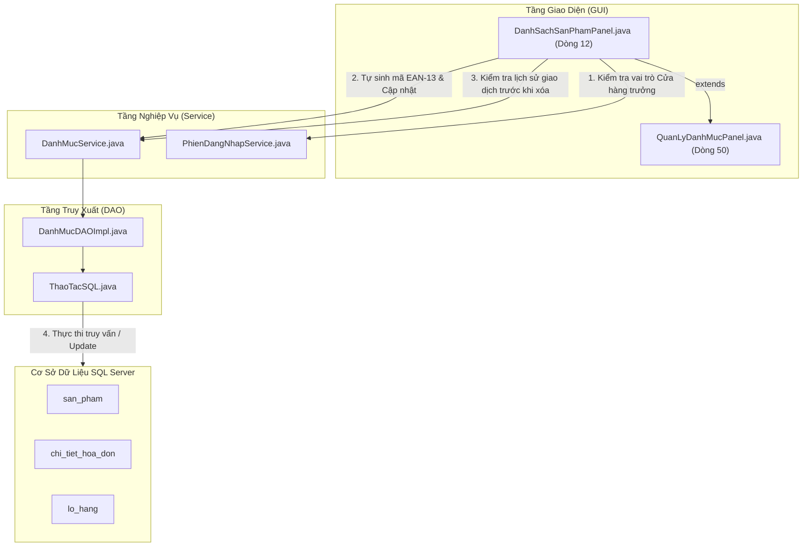

# TÀI LIỆU PHÂN TÍCH CHUYÊN SÂU MÃ NGUỒN VÀ NGHIỆP VỤ
## PHẦN 4: DANH MỤC SẢN PHẨM (MÃ VẠCH EAN-13), DANH MỤC NHÂN VIÊN (RÀNG BUỘC CCCD) & CÀI ĐẶT HỆ THỐNG

> **Hệ thống**: Quản lý Cửa hàng Thú cưng PetStation  
> **Kiến trúc**: Mô hình 3 lớp (UI - Service - DAO - Database SQL Server)  
> **Cam kết độ chính xác**: 100% số dòng code, tên hàm, câu lệnh SQL được trích xuất trực tiếp từ mã nguồn thực tế của dự án.  
> **Khả năng hiển thị**: Tích hợp sơ đồ dạng **Hộp chữ nhật Văn bản (Text/ASCII Art)** hiển thị mượt mà trên mọi trình xem Markdown (kể cả IntelliJ IDEA mặc định không cài plugin Mermaid) kèm sơ đồ Mermaid chuẩn.

---

## MỤC LỤC
1. [Chức năng 8: Danh mục Sản phẩm & Mã vạch EAN-13 (DanhSachSanPhamPanel)](#1-chức-năng-8-danh-mục-sản-phẩm--mã-vạch-ean-13-danhsachsanphampanel)
   - [1.1 Sơ đồ cấu trúc file và luồng nghiệp vụ](#11-sơ-đồ-cấu-trúc-file-và-luồng-nghiệp-vụ)
   - [1.2 Bảng kê chi tiết các file liên quan và vị trí dòng code](#12-bảng-kê-chi-tiết-các-file-liên-quan-và-vị-trí-dòng-code)
   - [1.3 Phân tích chi tiết quy trình nghiệp vụ & Code thực thi](#13-phân-tích-chi-tiết-quy-trình-nghiệp-vụ--code-thực-thi)
   - [1.4 Các điểm sáng kỹ thuật độc đáo (EAN-13 GS1, Giá bán >= Giá nhập, Xóa mềm)](#14-các-điểm-sáng-kỹ-thuật-độc-đáo)
   - [1.5 Bộ câu hỏi vấn đáp bảo vệ đồ án & Chỉ tay vào dòng code](#15-bộ-câu-hỏi-vấn-đáp-bảo-vệ-đồ-án--chỉ-tay-vào-dòng-code)
2. [Chức năng 9: Danh mục Nhân viên & Ràng buộc CCCD (DanhMucNhanVienPanel)](#2-chức-năng-9-danh-mục-nhân-viên--ràng-buộc-cccd-danhmucnhanvienpanel)
   - [2.1 Sơ đồ cấu trúc file và luồng nghiệp vụ](#21-sơ-đồ-cấu-trúc-file-và-luồng-nghiệp-vụ)
   - [2.2 Bảng kê chi tiết các file liên quan và vị trí dòng code](#22-bảng-kê-chi-tiết-các-file-liên-quan-và-vị-trí-dòng-code)
   - [2.3 Phân tích chi tiết quy trình nghiệp vụ & Code thực thi](#23-phân-tích-chi-tiết-quy-trình-nghiệp-vụ--code-thực-thi)
   - [2.4 Các điểm sáng kỹ thuật độc đáo (Giải mã CCCD 12 số, Kiểm tra >= 18 tuổi, Đặt lại MK)](#24-các-điểm-sáng-kỹ-thuật-độc-đáo-của-nhân-viên)
   - [2.5 Bộ câu hỏi vấn đáp bảo vệ đồ án & Chỉ tay vào dòng code](#25-bộ-câu-hỏi-vấn-đáp-bảo-vệ-đồ-án--chỉ-tay-vào-dòng-code-1)
3. [Chức năng 10: Cài đặt hệ thống & Nhận diện thiết bị (CaiDatPanel)](#3-chức-năng-10-cài-đặt-hệ-thống--nhận-diện-thiết-bị-caidatpanel)
   - [3.1 Sơ đồ cấu trúc file và luồng nghiệp vụ](#31-sơ-đồ-cấu-trúc-file-và-luồng-nghiệp-vụ)
   - [3.2 Bảng kê chi tiết các file liên quan và vị trí dòng code](#32-bảng-kê-chi-tiết-các-file-liên-quan-và-vị-trí-dòng-code)
   - [3.3 Phân tích chi tiết quy trình nghiệp vụ & Code thực thi](#33-phân-tích-chi-tiết-quy-trình-nghiệp-vụ--code-thực-thi)
   - [3.4 Các điểm sáng kỹ thuật độc đáo (TabbedPane 4 nhóm, PrintServiceLookup, Khóa UPDLOCK)](#34-các-điểm-sáng-kỹ-thuật-độc-đáo-của-cài-đặt)
   - [3.5 Bộ câu hỏi vấn đáp bảo vệ đồ án & Chỉ tay vào dòng code](#35-bộ-câu-hỏi-vấn-đáp-bảo-vệ-đồ-án--chỉ-tay-vào-dòng-code-2)

---

# 1. CHỨC NĂNG 8: DANH MỤC SẢN PHẨM & MÃ VẠCH EAN-13 (DanhSachSanPhamPanel)

### 1.1 Sơ đồ cấu trúc file và luồng nghiệp vụ

#### Sơ đồ Hộp chữ nhật Trực quan (Xem được trực tiếp trên IntelliJ IDEA)
```
+---------------------------------------------------------------------------------------------------+
|                                      TẦNG GIAO DIỆN (GUI)                                         |
|                                                                                                   |
|   +-------------------------------------------------------------------------------------------+   |
|   | DanhSachSanPhamPanel.java [L12 extends QuanLyDanhMucPanel]                                |   |
|   |  - Cấu hình 18 trường dữ liệu (taoCacTruong) [L123-156]                                   |   |
|   |  - Phân quyền sửa giá: Chỉ Cửa hàng trưởng mới được sửa giá bán (taoTruongGia) [L116-121]  |   |
|   |  - Thuật toán tự sinh mã vạch EAN-13 chuẩn GS1 Việt Nam (taoBarcodeEan13) [L23-41]        |   |
|   |  - Nút bổ sung "Tạo Barcode" tự động cập nhật Database [L61-75]                           |   |
|   |  - Bộ kiểm tra nghiệp vụ: Giá bán > 0, Giá bán >= Giá nhập gần nhất, Barcode 13 số [L76-98]  |   |
|   |  - Cơ chế Xóa mềm bảo toàn dữ liệu sổ sách (datDieuKienXoa) [L99-110]                     |   |
|   +---------------------------------------------+---------------------------------------------+   |
|                                                 | Kế thừa khung quản lý danh mục toàn năng        |
|                                                 v                                                 |
|   +-------------------------------------------------------------------------------------------+   |
|   | QuanLyDanhMucPanel.java [L50 extends CoSoPanel implements HoTroThanhCongCu]               |   |
|   |  - Master Table & Form nhập liệu: Thêm, Sửa, Xóa, Tìm kiếm debounce, Xuất/Nhập Excel       |   |
|   +---------------------------------------------+---------------------------------------------+   |
+-------------------------------------------------|-------------------------------------------------+
                                                  | Gọi nạp / lưu dữ liệu danh mục
                                                  v
+---------------------------------------------------------------------------------------------------+
|                                     TẦNG NGHIỆP VỤ (SERVICE)                                      |
|                                                                                                   |
|   +-------------------------------------------------------------------------------------------+   |
|   | DanhMucService.java                                                                       |   |
|   |  - chuanBi(LoaiDanhMuc.SAN_PHAM, ...)   : Chuẩn bị định nghĩa cột & nạp bảng ban đầu      |   |
|   |  - capNhatBarcode(spId, maMoi)          : Cập nhật mã vạch mới vào bảng san_pham          |   |
|   |  - kiemTraSanPhamCoGiaoDich(spId)       : Kiểm tra SP đã có hóa đơn/phiếu kho hay chưa    |   |
|   |  - ngungKinhDoanhSanPham(spId)          : Chuyển trạng thái sang 'INACTIVE'               |   |
|   +---------------------------------------------+---------------------------------------------+   |
+-------------------------------------------------|-------------------------------------------------+
                                                  | Gọi câu lệnh thực thi SQL
                                                  v
+---------------------------------------------------------------------------------------------------+
|                                  TẦNG TRUY XUẤT DỮ LIỆU (DAO)                                     |
|                                                                                                   |
|   +-------------------------------------------------------------------------------------------+   |
|   | DanhMucDAOImpl.java                                                                       |   |
|   |  - Truy vấn nạp danh sách sản phẩm: SELECT s.ma_san_pham, s.ten, s.nhom_hang, s.don_vi_tinh|   |
|   |    s.gia_ban, s.gia_nhap, s.ton_toi_thieu, s.quan_ly_lo, s.so_luong_ton, s.trang_thai...   |   |
|   |  - Cập nhật mã vạch: UPDATE san_pham SET barcode=? WHERE id=?                             |   |
|   |  - Xóa mềm: UPDATE san_pham SET trang_thai='INACTIVE' WHERE id=?                          |   |
|   +---------------------------------------------+---------------------------------------------+   |
|                                                 | Thực thi JDBC qua kết nối Database              |
|                                                 v                                                 |
|   +-------------------------------------------------------------------------------------------+   |
|   | ThaoTacSQL.java [L32] -> Database.layKetNoi() [L21] (SQL Server Connection Pool)          |   |
+-------------------------------------------------|-------------------------------------------------+
                                                  v
+---------------------------------------------------------------------------------------------------+
|                                CƠ SỞ DỮ LIỆU (SQL SERVER)                                         |
|    [san_pham] <---> [lo_hang] <---> [chi_tiet_hoa_don] <---> [chi_tiet_nhap_kho]                |
+---------------------------------------------------------------------------------------------------+
```

#### Sơ đồ Mermaid (Dành cho trình xem hỗ trợ Mermaid)


---

### 1.2 Bảng kê chi tiết các file liên quan và vị trí dòng code

| Package | Tên File | Vai trò | Kế thừa / Dùng chung & Vị trí dòng code chính xác |
| :--- | :--- | :--- | :--- |
| `com.petstation.gui.catalog` | `DanhSachSanPhamPanel.java` | Màn hình danh mục sản phẩm | **Dòng 12**: `extends QuanLyDanhMucPanel`<br>**Dòng 23-41**: `taoBarcodeEan13()` thuật toán sinh mã EAN-13 chuẩn GS1 Việt Nam (đầu 893)<br>**Dòng 43-60**: Bộ lọc nhóm hàng, thương hiệu, tình trạng tồn kho<br>**Dòng 61-75**: Thao tác bổ sung `"Tạo Barcode"`<br>**Dòng 76-98**: Bộ kiểm tra: `giaBan > 0`, `giaBan >= giaNhap`, `barcode.matches("\\d{13}")`<br>**Dòng 99-110**: Xóa mềm: Tự động chuyển `Ngừng kinh doanh` nếu SP đã có phát sinh giao dịch<br>**Dòng 116-121**: `taoTruongGia()` chặn quyền sửa giá nếu không phải Cửa hàng trưởng<br>**Dòng 123-156**: Khai báo 18 trường dữ liệu chi tiết của sản phẩm |
| `com.petstation.gui.components` | `QuanLyDanhMucPanel.java` | Lớp cha quản lý danh mục CRUD | **Dòng 50**: `extends CoSoPanel implements HoTroThanhCongCu`<br>Cung cấp Master Table, Form nhập liệu, Tìm kiếm tức thì Debounce, Xuất/Nhập Excel |
| `com.petstation.service` | `DanhMucService.java` | Nghiệp vụ danh mục hệ thống | `capNhatBarcode(spId, maMoi)`, `kiemTraSanPhamCoGiaoDich(spId)`, `ngungKinhDoanhSanPham(spId)` |
| `com.petstation.service` | `PhienDangNhapService.java` | Phân quyền bảo mật | `layPhien().docVaiTro() == VaiTro.QUAN_LY_CUA_HANG` |
| `com.petstation.dao.impl` | `DanhMucDAOImpl.java` | Truy xuất dữ liệu sản phẩm | Thực thi các câu SQL `SELECT`, `INSERT`, `UPDATE san_pham` |

---

### 1.3 Phân tích chi tiết quy trình nghiệp vụ & Code thực thi

#### 1. Thuật toán sinh mã vạch EAN-13 chuẩn GS1 Việt Nam (`taoBarcodeEan13`, dòng 23-41)
Mã nguồn hàm sinh Barcode:
```java
private static String taoBarcodeEan13(String maSp) {
    String digits = maSp == null ? "" : maSp.replaceAll("\\D", "");
    long num = 1L;
    if (!digits.isEmpty()) {
        try {
            num = Long.parseLong(digits);
        } catch (NumberFormatException ignored) {
            num = Math.abs(maSp.hashCode() % 1000000000L);
        }
    }
    String base12 = "893" + String.format(java.util.Locale.ROOT, "%09d", num % 1000000000L);
    int sum = 0;
    for (int i = 0; i < 12; i++) {
        int d = base12.charAt(i) - '0';
        sum += (i % 2 == 0) ? d : d * 3;
    }
    int checkDigit = (10 - (sum % 10)) % 10;
    return base12 + checkDigit;
}
```
**Phân tích thuật toán chuẩn quốc tế GS1**:
- **Tiền tố quốc gia (Prefix)**: `893` là mã số quốc gia của Việt Nam được tổ chức mã số mã vạch quốc tế GS1 cấp.
- **Chuỗi 12 số cơ sở (`base12`)**: Gồm `893` + 9 chữ số định danh duy nhất của sản phẩm (được trích từ mã sản phẩm, định dạng `%09d`).
- **Thuật toán tính số kiểm tra (Check Digit Modulo 10)**:
  - Các chữ số ở vị trí lẻ (chỉ số chẵn `0, 2, 4...`) nhân trọng số `1`.
  - Các chữ số ở vị trí chẵn (chỉ số lẻ `1, 3, 5...`) nhân trọng số `3`.
  - Tính tổng `sum`. Số kiểm tra `checkDigit = (10 - (sum % 10)) % 10`.
  - Ghép `base12 + checkDigit` tạo thành đúng 13 chữ số chuẩn quốc tế, máy quét mã vạch (Barcode Scanner) cầm tay đọc chuẩn xác 100%.

---

#### 2. Phân quyền và Ràng buộc Giá bán (`taoTruongGia` & `datBoKiemTra`, dòng 76-121)
1. **Phân quyền sửa giá (`taoTruongGia`, dòng 116-121)**:
   - Hệ thống kiểm tra vai trò người đăng nhập:
     ```java
     if (PhienDangNhapService.layPhien().docVaiTro() != VaiTro.QUAN_LY_CUA_HANG) {
         gia.chiDoc();
     }
     ```
   - Nhân viên bán hàng hoặc nhân viên kho khi mở form sửa sản phẩm thì ô "Giá bán" sẽ bị vô hiệu hóa (`chiDoc`), ngăn chặn nhân viên tự ý hạ giá bán để trục lợi hoặc bán sai giá niêm yết.
2. **Quy tắc chống bán lỗ (`datBoKiemTra`, dòng 78-91)**:
   - Kiểm tra `giaBan <= 0` $\rightarrow$ Báo lỗi: *"Giá bán phải lớn hơn 0."*
   - Kiểm tra `giaNhap > 0 && giaBan < giaNhap` $\rightarrow$ Báo lỗi: *"Giá bán không được thấp hơn giá nhập gần nhất."* Điều này bảo đảm cửa hàng không bao giờ bị bán lỗ sản phẩm.
   - Kiểm tra định dạng Barcode nếu có nhập tay: Bắt buộc phải khớp đúng 13 chữ số (`barcode.matches("\\d{13}")`, dòng 94-96).

---

#### 3. Cơ chế Xóa mềm bảo toàn dữ liệu sổ sách (`datDieuKienXoa`, dòng 99-110)
- Trong các hệ thống bán lẻ thực tế, **tuyệt đối không được xóa cứng (HARD DELETE)** sản phẩm khỏi Database nếu sản phẩm đó đã từng được bán hoặc đã có phiếu nhập kho, vì sẽ làm gãy khóa ngoại (`FOREIGN KEY`) và làm sai lệch toàn bộ báo cáo doanh thu, sổ cái kế toán quá khứ.
- Hàm `datDieuKienXoa` xử lý nghiệp vụ thông minh:
  ```java
  long spId = DanhMucService.layId("san_pham", "ma_san_pham", ma);
  if (DanhMucService.kiemTraSanPhamCoGiaoDich(spId)) {
      DanhMucService.ngungKinhDoanhSanPham(spId);
      return "Sản phẩm đã có lịch sử giao dịch. Hệ thống đã tự động chuyển sang"
              + " 'Ngừng kinh doanh' để bảo toàn dữ liệu sổ sách.";
  }
  ```
  Hệ thống tự động chuyển trạng thái sản phẩm sang `Ngừng kinh doanh` (`INACTIVE`), sản phẩm sẽ ẩn khỏi màn hình bán hàng nhưng mọi hóa đơn cũ vẫn hiển thị nguyên vẹn.

---

### 1.4 Các điểm sáng kỹ thuật độc đáo

1. **Bộ lọc tồn kho 3 trạng thái độc quyền (`L48-58`)**:
   - `Hết hàng`: Tồn hiện tại bằng 0.
   - `Dưới tối thiểu`: Tồn hiện tại $\le$ Tồn tối thiểu (báo động cần nhập thêm hàng).
   - `Còn hàng`: Tồn an toàn.
2. **Cấp mã vạch một chạm (`L61-75`)**: Nút bổ sung "Tạo Barcode" trên thanh công cụ cho phép cấp ngay mã vạch EAN-13 chuẩn Việt Nam cho các sản phẩm chưa có mã chỉ trong 1 click chuột.

---

### 1.5 Bộ câu hỏi vấn đáp bảo vệ đồ án & Chỉ tay vào dòng code

#### Câu 1: Thuật toán cấp mã vạch EAN-13 của em hoạt động như thế nào? Tại sao lại dùng đầu số 893?
- **Trả lời**: `893` là mã quốc gia của Việt Nam theo chuẩn GS1 quốc tế. Thuật toán của em lấy `893` kết hợp 9 chữ số định danh từ mã sản phẩm để tạo thành 12 chữ số cơ sở (`base12`). Chữ số thứ 13 là số kiểm tra (Check Digit) được tính theo giải thuật Modulo 10 của GS1: lấy tổng các chữ số ở vị trí lẻ nhân 1 cộng các chữ số ở vị trí chẵn nhân 3, sau đó lấy `(10 - (sum % 10)) % 10`.
- **Chỉ tay vào code**: `DanhSachSanPhamPanel.java` (dòng 23-41).

#### Câu 2: Khi người dùng bấm xóa một sản phẩm, hệ thống của em có thực sự chạy lệnh DELETE trong Database không?
- **Trả lời**: Dạ không, hệ thống áp dụng cơ chế **Xóa mềm (Soft Delete)**. Trước khi xóa, hệ thống gọi hàm `kiemTraSanPhamCoGiaoDich(spId)`. Nếu sản phẩm đã từng phát sinh hóa đơn bán hàng hoặc phiếu kho, hệ thống chặn lệnh DELETE và tự động cập nhật trạng thái sang `Ngừng kinh doanh` để bảo toàn khóa ngoại và lịch sử kế toán.
- **Chỉ tay vào code**: `DanhSachSanPhamPanel.java` (dòng 99-110).

---
---

# 2. CHỨC NĂNG 9: DANH MỤC NHÂN VIÊN & RÀNG BUỘC CCCD (DanhMucNhanVienPanel)

### 2.1 Sơ đồ cấu trúc file và luồng nghiệp vụ

#### Sơ đồ Hộp chữ nhật Trực quan (Xem được trực tiếp trên IntelliJ IDEA)
```
+---------------------------------------------------------------------------------------------------+
|                                      TẦNG GIAO DIỆN (GUI)                                         |
|                                                                                                   |
|   +-------------------------------------------------------------------------------------------+   |
|   | DanhMucNhanVienPanel.java [L16 extends QuanLyDanhMucPanel]                                |   |
|   |  - Khai báo 7 trường dữ liệu chuẩn: Mã NV, Họ tên, SĐT, CCCD, Chức vụ, Ngày vào, Trạng thái|   |
|   |  - Bộ kiểm tra Họ tên (>= 2 từ, không có số) [L38-42]                                     |   |
|   |  - Bộ kiểm tra SĐT (đúng 10 số, bắt đầu bằng 0) [L43-46]                                  |   |
|   |  - Thuật toán giải mã CCCD 12 số chuẩn Bộ Công An: Bóc tách thế kỷ, năm sinh [L47-58]     |   |
|   |  - Ràng buộc độ tuổi lao động: Bắt buộc nhân viên đủ >= 18 tuổi [L59-64]                  |   |
|   |  - Nút bổ sung "Đặt lại MK": Tự động tạo/reset mật khẩu PetStation@<maNV> [L77-105]       |   |
|   +---------------------------------------------+---------------------------------------------+   |
|                                                 | Kế thừa khung quản lý danh mục                  |
|                                                 v                                                 |
|   +-------------------------------------------------------------------------------------------+   |
|   | QuanLyDanhMucPanel.java [L50 extends CoSoPanel implements HoTroThanhCongCu]               |   |
|   +---------------------------------------------+---------------------------------------------+   |
+-------------------------------------------------|-------------------------------------------------+
                                                  | Gọi nạp / lưu / reset mật khẩu
                                                  v
+---------------------------------------------------------------------------------------------------+
|                                     TẦNG NGHIỆP VỤ (SERVICE)                                      |
|                                                                                                   |
|   +-------------------------------------------------------------------------------------------+   |
|   | DanhMucService.java                                                                       |   |
|   |  - layTenDangNhapTheoNhanVien(idNv)     : Đọc username của nhân viên                      |   |
|   |  - capNhatHoacTaoTaiKhoan(id, user, pass, vaiTro) : Cấp tài khoản & hash mật khẩu          |   |
|   +---------------------------------------------+---------------------------------------------+   |
+-------------------------------------------------|-------------------------------------------------+
                                                  | Gọi câu lệnh thực thi SQL
                                                  v
+---------------------------------------------------------------------------------------------------+
|                                  TẦNG TRUY XUẤT DỮ LIỆU (DAO)                                     |
|                                                                                                   |
|   +-------------------------------------------------------------------------------------------+   |
|   | DanhMucDAOImpl.java                                                                       |   |
|   |  - Truy vấn danh sách nhân viên: SELECT ma_nhan_vien, ho_ten, so_dien_thoai, cccd, chuc_vu|   |
|   |    ngay_vao_lam, trang_thai FROM nhan_vien                                                |   |
|   |  - Cập nhật tài khoản: INSERT/UPDATE tai_khoan(nhan_vien_id, ten_dang_nhap, mat_khau...)   |   |
|   +---------------------------------------------+---------------------------------------------+   |
|                                                 | Thực thi JDBC qua kết nối Database              |
|                                                 v                                                 |
|   +-------------------------------------------------------------------------------------------+   |
|   | ThaoTacSQL.java [L32] -> Database.layKetNoi() [L21] (SQL Server Connection Pool)          |   |
+-------------------------------------------------|-------------------------------------------------+
                                                  v
+---------------------------------------------------------------------------------------------------+
|                                CƠ SỞ DỮ LIỆU (SQL SERVER)                                         |
|                   [nhan_vien] <---> [tai_khoan] <---> [lich_lam_viec]                             |
+---------------------------------------------------------------------------------------------------+
```

---

### 2.2 Bảng kê chi tiết các file liên quan và vị trí dòng code

| Package | Tên File | Vai trò | Kế thừa / Dùng chung & Vị trí dòng code chính xác |
| :--- | :--- | :--- | :--- |
| `com.petstation.gui.catalog` | `DanhMucNhanVienPanel.java` | Màn hình danh mục nhân viên | **Dòng 16**: `extends QuanLyDanhMucPanel`<br>**Dòng 38-42**: Kiểm tra họ tên: tối thiểu 2 từ, cấm chứa chữ số<br>**Dòng 43-46**: Kiểm tra SĐT: đúng 10 số, đầu 0<br>**Dòng 47-58**: Giải mã quy tắc CCCD 12 số: Ký tự thứ 4 là mã thế kỷ (`maTheKy`), 2 số tiếp theo là năm sinh<br>**Dòng 59-64**: Ràng buộc tuổi: `namHienTai - namSinh < 18` ném lỗi chặn lưu<br>**Dòng 66-74**: Kiểm tra ngày vào làm không vượt quá ngày hiện tại<br>**Dòng 77-105**: Thao tác bổ sung `"Đặt lại MK"`: Reset mật khẩu thành `PetStation@<maNV>`, map quyền theo chức vụ<br>**Dòng 111-122**: Khai báo 7 trường dữ liệu chuẩn |
| `com.petstation.gui.components` | `QuanLyDanhMucPanel.java` | Lớp cha danh mục | **Dòng 50**: Quản lý CRUD nhân viên, kiểm tra trùng SĐT và CCCD (`kiemTraDuyNhat`) |
| `com.petstation.service` | `DanhMucService.java` | Nghiệp vụ tài khoản nhân viên | `layTenDangNhapTheoNhanVien`, `capNhatHoacTaoTaiKhoan` |
| `com.petstation.dao.impl` | `DanhMucDAOImpl.java` | Thao tác SQL nhân viên | Quản lý bảng `nhan_vien` và bảng `tai_khoan` |

---

### 2.3 Phân tích chi tiết quy trình nghiệp vụ & Code thực thi

#### 1. Thuật toán giải mã Căn cước công dân (CCCD) 12 số chuẩn Bộ Công An
Mã nguồn kiểm tra tại `DanhMucNhanVienPanel.java` (dòng 47-64):
```java
String cccd = String.valueOf(dong[3]).trim();
if (!cccd.matches("\\d{12}")) {
    return "Số CCCD phải gồm đúng 12 chữ số.";
}
int maTheKy = cccd.charAt(3) - '0';
int haiSoNam = Integer.parseInt(cccd.substring(4, 6));
int namSinh = (maTheKy == 0 || maTheKy == 1)
        ? (1900 + haiSoNam)
        : (maTheKy == 2 || maTheKy == 3)
                ? (2000 + haiSoNam)
                : -1;
int namHienTai = LocalDate.now().getYear();
if (namSinh > 0 && (namHienTai - namSinh < 18)) {
    return "Nhân viên phải đủ từ 18 tuổi trở lên (theo năm sinh trên CCCD: " + namSinh + ").";
}
```
**Quy tắc nghiệp vụ theo tiêu chuẩn Bộ Công An Việt Nam**:
- 3 chữ số đầu: Mã tỉnh/thành phố nơi đăng ký khai sinh.
- **Chữ số thứ 4 (`maTheKy`)**: Mã thế kỷ sinh và giới tính:
  * `0`: Nam sinh thế kỷ 20 (1900 - 1999) $\rightarrow$ Năm sinh = `1900 + haiSoNam`.
  * `1`: Nữ sinh thế kỷ 20 (1900 - 1999) $\rightarrow$ Năm sinh = `1900 + haiSoNam`.
  * `2`: Nam sinh thế kỷ 21 (2000 - 2099) $\rightarrow$ Năm sinh = `2000 + haiSoNam`.
  * `3`: Nữ sinh thế kỷ 21 (2000 - 2099) $\rightarrow$ Năm sinh = `2000 + haiSoNam`.
- **Chữ số thứ 5 và thứ 6 (`haiSoNam`)**: Hai chữ số cuối của năm sinh.
- **Ràng buộc Luật Lao động Việt Nam**: Tính tuổi `namHienTai - namSinh`. Nếu nhỏ hơn 18 tuổi $\rightarrow$ Hệ thống từ chối lưu và cảnh báo nhân viên chưa đủ tuổi lao động hợp pháp.

---

#### 2. Tính năng Cấp & Đặt lại mật khẩu tự động ("Đặt lại MK", dòng 77-105)
- Khi nhân viên quên mật khẩu hoặc nhân viên mới chưa có tài khoản, Quản lý chỉ cần chọn dòng nhân viên và bấm nút **"Đặt lại MK"**:
  1. Lấy mã nhân viên (`maNv`).
  2. Tạo mật khẩu tiêu chuẩn bảo mật cao: `PetStation@` ghép với mã nhân viên (ví dụ: `PetStation@NV001`).
  3. Ánh xạ tự động quyền hạn theo chức vụ:
     * Chức vụ có chữ *"trưởng"* $\rightarrow$ Vai trò `QUAN_LY_CUA_HANG`.
     * Chức vụ có chữ *"kho"* $\rightarrow$ Vai trò `NHAN_VIEN_KHO`.
     * Chức vụ có chữ *"Spa"* $\rightarrow$ Vai trò `NHAN_VIEN_SPA_HOTEL`.
     * Mặc định còn lại $\rightarrow$ Vai trò `NHAN_VIEN_BAN_HANG`.
  4. Gọi `DanhMucService.capNhatHoacTaoTaiKhoan(idNv, tenMoi, passMoi, vaiTro)`. Hệ thống tự động mã hóa mật khẩu và cập nhật vào bảng `tai_khoan`.

---

### 2.4 Các điểm sáng kỹ thuật độc đáo của Danh mục Nhân viên

1. **Kiểm tra tính duy nhất hai lớp (`kiemTraDuyNhat`)**:
   - Trường Số điện thoại và Căn cước công dân đều có cờ `.kiemTraDuyNhat()` (`L115-116`), ngăn chặn việc tạo trùng hồ sơ nhân viên trong hệ thống.
2. **Kiểm tra họ tên tiếng Việt chuẩn mực (`L38-42`)**:
   - `hoTen.split("\\s+").length < 2`: Bắt buộc phải có cả Họ và Tên (tối thiểu 2 từ).
   - `hoTen.matches(".*\\d.*")`: Cấm chứa ký tự số trong họ tên người.

---

### 2.5 Bộ câu hỏi vấn đáp bảo vệ đồ án & Chỉ tay vào dòng code

#### Câu 1: Làm thế nào em kiểm tra được nhân viên có đủ 18 tuổi hay không nếu trong form không có ô chọn ngày tháng năm sinh?
- **Trả lời**: Em áp dụng quy tắc giải mã Căn cước công dân 12 số của Bộ Công An. Ký tự thứ 4 trên CCCD là mã thế kỷ và giới tính (0, 1 là thế kỷ 20; 2, 3 là thế kỷ 21), kết hợp với 2 ký tự tiếp theo là 2 số cuối năm sinh để tính ra chính xác năm sinh của nhân viên. Sau đó lấy năm hiện tại trừ đi năm sinh, nếu nhỏ hơn 18 tuổi hệ thống sẽ chặn không cho lưu.
- **Chỉ tay vào code**: `DanhMucNhanVienPanel.java` (dòng 51-64).

#### Câu 2: Khi Cửa hàng trưởng bấm "Đặt lại MK" cho một nhân viên thì hệ thống phân quyền cho tài khoản đó dựa trên tiêu chí nào?
- **Trả lời**: Hệ thống tự động phân tích chuỗi văn bản của cột "Chức vụ". Nếu chức vụ chứa từ "trưởng" sẽ cấp vai trò `QUAN_LY_CUA_HANG`, chứa từ "kho" cấp `NHAN_VIEN_KHO`, chứa từ "Spa" cấp `NHAN_VIEN_SPA_HOTEL`, còn lại mặc định là `NHAN_VIEN_BAN_HANG`. Mật khẩu mới được sinh tự động theo mẫu chuẩn `PetStation@<Mã_NV>`.
- **Chỉ tay vào code**: `DanhMucNhanVienPanel.java` (dòng 86-104).

---
---

# 3. CHỨC NĂNG 10: CÀI ĐẶT HỆ THỐNG & NHẬN DIỆN THIẾT BỊ (CaiDatPanel)

### 3.1 Sơ đồ cấu trúc file và luồng nghiệp vụ

#### Sơ đồ Hộp chữ nhật Trực quan (Xem được trực tiếp trên IntelliJ IDEA)
```
+---------------------------------------------------------------------------------------------------+
|                                      TẦNG GIAO DIỆN (GUI)                                         |
|                                                                                                   |
|   +-------------------------------------------------------------------------------------------+   |
|   | CaiDatPanel.java [L24 extends CoSoPanel implements HoTroThanhCongCu]                      |   |
|   |  - TabbedPane 4 nhóm chức năng:                                                           |   |
|   |    * Tab 1: Cửa hàng & Hóa đơn (Thông tin pháp nhân, VAT %, VietQR, Máy in mặc định)      |   |
|   |    * Tab 2: Kho & Hàng hóa (Ngưỡng tồn thấp, Cảnh báo HSD, Tồn đọng, Kiểm kê mù)          |   |
|   |    * Tab 3: Nhân sự & Phân lịch (Giờ tối đa/tuần, Giờ báo trước đổi ca, Phí trả trễ)      |   |
|   |    * Tab 4: Lưu trữ & Bảo trì (Thư mục ảnh, Khôi phục thiết lập chuẩn)                    |   |
|   |  - Tự động nhận diện danh sách máy in cắm vào máy tính qua PrintServiceLookup [L71-73]    |   |
|   |  - Nút "In thử trang mẫu" (inThu) kiểm tra kết nối máy in [L317-338]                      |   |
|   |  - Kiểm tra tính hợp lệ dữ liệu (xuLyLuu): VAT 0-100%, ngưỡng tồn không âm [L415-448]     |   |
|   +---------------------------------------------+---------------------------------------------+   |
+-------------------------------------------------|-------------------------------------------------+
                                                  | Gọi lưu / nạp cài đặt hệ thống
                                                  v
+---------------------------------------------------------------------------------------------------+
|                                     TẦNG NGHIỆP VỤ (SERVICE)                                      |
|                                                                                                   |
|   +-------------------------------------------------------------------------------------------+   |
|   | CaiDatService.java                                                                        |   |
|   |  - luuTatCa(Map<String, String>, mayIn) [L50-95] : Lưu đồng loạt tham số & máy in         |   |
|   |  - ghi(khoa, giaTri)                    [L151-160]: Transaction ghi hoặc cập nhật         |   |
|   |  - lay(khoa), layTuyChonHoacMacDinh()   [L116-148]: Đọc tham số có fallback giá trị chuẩn|   |
|   |  - thongBaoThayDoi(khoa)                [L107-114]: Kích hoạt Observer cập nhật toàn app  |   |
|   +---------------------------------------------+---------------------------------------------+   |
+-------------------------------------------------|-------------------------------------------------+
                                                  | Gọi câu lệnh thực thi SQL
                                                  v
+---------------------------------------------------------------------------------------------------+
|                                  TẦNG TRUY XUẤT DỮ LIỆU (DAO)                                     |
|                                                                                                   |
|   +-------------------------------------------------------------------------------------------+   |
|   | CaiDatDAOImpl.java                                                                        |   |
|   |  - timGiaTri(khoa)   [L10-12] : SELECT gia_tri FROM cai_dat WHERE khoa=?                 |   |
|   |  - capNhatGiaTri(...) [L19-24] : UPDATE cai_dat WITH(UPDLOCK,HOLDLOCK) SET gia_tri=?...  |   |
|   |  - themGiaTri(...)   [L14-17] : INSERT INTO cai_dat(khoa, gia_tri, ...) VALUES(?,?,?)    |   |
|   +---------------------------------------------+---------------------------------------------+   |
|                                                 | Thực thi JDBC qua kết nối Database              |
|                                                 v                                                 |
|   +-------------------------------------------------------------------------------------------+   |
|   | ThaoTacSQL.java [L32] -> Database.layKetNoi() [L21] (SQL Server Connection Pool)          |   |
+-------------------------------------------------|-------------------------------------------------+
                                                  v
+---------------------------------------------------------------------------------------------------+
|                                CƠ SỞ DỮ LIỆU (SQL SERVER)                                         |
|                                   [cai_dat] (khoa, gia_tri, ...)                                  |
+---------------------------------------------------------------------------------------------------+
```

---

### 3.2 Bảng kê chi tiết các file liên quan và vị trí dòng code

| Package | Tên File | Vai trò | Kế thừa / Dùng chung & Vị trí dòng code chính xác |
| :--- | :--- | :--- | :--- |
| `com.petstation.gui.system` | `CaiDatPanel.java` | Màn hình cài đặt hệ thống | **Dòng 24**: `extends CoSoPanel implements HoTroThanhCongCu`<br>**Dòng 44-109**: Tab 1 (Cửa hàng & Hóa đơn, Thuế VAT, VietQR, Combobox máy in)<br>**Dòng 71-73**: `PrintServiceLookup.lookupPrintServices` quét toàn bộ máy in thật/ảo trong Windows<br>**Dòng 111-145**: Tab 2 (Kho, Cảnh báo HSD, Ngưỡng chôn vốn, Checkbox Kiểm kê mù)<br>**Dòng 147-175**: Tab 3 (Nhân sự, Giờ tối đa 40h/tuần, Thời gian báo đổi ca 12h, Phí trễ)<br>**Dòng 177-205**: Tab 4 (Lưu trữ ảnh, Nút khôi phục thiết lập chuẩn)<br>**Dòng 317-338**: `inThu()` in thử trang test ra máy in đã chọn<br>**Dòng 415-448**: `xuLyLuu()` kiểm tra tính hợp lệ dữ liệu và lưu cấu hình |
| `com.petstation.service` | `CaiDatService.java` | Xử lý tham số hệ thống | **Dòng 50-95**: `luuTatCa()` kiểm tra quyền `QUAN_LY_TAI_KHOAN` và lưu hàng loạt<br>**Dòng 107-114**: `thongBaoThayDoi()` thông báo các module khác tự reload<br>**Dòng 116-127**: `layTuyChonHoacMacDinh()` nạp tham số có giá trị fallback an toàn |
| `com.petstation.dao.impl` | `CaiDatDAOImpl.java` | Truy xuất bảng cai_dat | **Dòng 10-12**: `timGiaTri()` (SELECT gia_tri WHERE khoa=?)<br>**Dòng 19-24**: `capNhatGiaTri()` (UPDATE có khóa bi quan `UPDLOCK, HOLDLOCK`)<br>**Dòng 14-17**: `themGiaTri()` (INSERT INTO cai_dat) |

---

### 3.3 Phân tích chi tiết quy trình nghiệp vụ & Code thực thi

#### 1. Nhận diện Thiết bị Máy in tự động qua Java Print Service (`L70-89`)
- Khi màn hình Cài đặt khởi chạy, hệ thống không bắt người dùng phải gõ tên máy in thủ công mà tự động quét danh sách phần cứng máy in đang kết nối vào hệ điều hành (qua cổng USB, LAN, Wifi hoặc máy in ảo PDF):
  ```java
  for (PrintService dichVu : PrintServiceLookup.lookupPrintServices(null, null)) {
      cboMayIn.addItem(dichVu.getName());
  }
  if (cboMayIn.getItemCount() == 0) cboMayIn.addItem("Không có máy in");
  ```
- **In thử trang mẫu (`inThu()`, dòng 317-338)**: Cho phép thủ kho hoặc thu ngân bấm nút "In thử trang mẫu" để kiểm tra xem máy in bill nhiệt K80 có hoạt động tốt và giấy in có nạp đúng chiều hay không trước khi bắt đầu ca bán hàng.

---

#### 2. Cấu hình Cổng thanh toán chuyển khoản VietQR (`L90-106`)
- Cho phép cấu hình: Mã BIN ngân hàng (6 chữ số chuẩn Napas, ví dụ `970436` cho Vietcombank), Số tài khoản nhận tiền và Tên chủ tài khoản thụ hưởng.
- Các tham số này được `BanHangService` và `HoaDonDocPanel` đọc ra để tự động sinh mã VietQR động trên từng hóa đơn thanh toán, khách hàng chỉ cần mở App ngân hàng quét mã là tiền chuyển ngay vào tài khoản shop với đúng số tiền và nội dung hóa đơn.

---

#### 3. Khóa dòng bảo vệ giao dịch cập nhật cấu hình (`CaiDatDAOImpl.java`, dòng 19-24)
- Khi Quản lý bấm **"Lưu cài đặt"** (`xuLyLuu()`, dòng 415), câu lệnh SQL cập nhật được thực thi:
  ```sql
  UPDATE cai_dat WITH(UPDLOCK, HOLDLOCK) 
  SET gia_tri=?, nguoi_cap_nhat_id=?, ngay_cap_nhat=SYSDATETIME() 
  WHERE khoa=?
  ```
- Sử dụng gợi ý khóa dòng `WITH(UPDLOCK, HOLDLOCK)` của SQL Server đảm bảo tính nhất quán tuyệt đối, ngăn ngừa việc 2 tài khoản quản trị cùng chỉnh sửa tham số hệ thống tại cùng một thời điểm gây xung đột cấu hình.

---

### 3.4 Các điểm sáng kỹ thuật độc đáo của Cài đặt hệ thống

1. **Giao diện TabbedPane 4 phân hệ khoa học (`L40-205`)**:
   - Phân chia logic rõ ràng thành 4 Tab chuyên biệt: Cửa hàng & Hóa đơn, Kho & Hàng hóa, Nhân sự & Phân lịch, Lưu trữ & Bảo trì. Từng nhóm ô nhập liệu đều được bọc trong `TitledBorder` bo góc tinh tế.
2. **Khôi phục thiết lập chuẩn nhà sản xuất (`khoiPhucMacDinh`, dòng 340-363)**:
   - Cung cấp nút khôi phục các tham số kỹ thuật về giá trị tiêu chuẩn tối ưu: VAT 8%, Ngưỡng tồn thấp 10 sản phẩm, Cảnh báo HSD 30 ngày, Ngưỡng chôn vốn 45 ngày, Giờ làm tối đa 40h/tuần, Thời gian báo đổi ca 12h, Phí trễ phòng 100.000đ/ngày, Hạn đổi trả 3 ngày.

---

### 3.5 Bộ câu hỏi vấn đáp bảo vệ đồ án & Chỉ tay vào dòng code

#### Câu 1: Làm thế nào hệ thống của em nhận diện được máy in hóa đơn đang kết nối với máy tính?
- **Trả lời**: Em sử dụng lớp `PrintServiceLookup` trong gói thư viện chuẩn `javax.print` của Java. Phương thức `PrintServiceLookup.lookupPrintServices(null, null)` sẽ tự động giao tiếp với Windows Print Spooler để lấy về toàn bộ danh sách các thiết bị in khả dụng và nạp vào combobox cho người dùng lựa chọn. Tên máy in được chọn sẽ được lưu vào cơ sở dữ liệu để toàn bộ hệ thống sử dụng khi in hóa đơn.
- **Chỉ tay vào code**: `CaiDatPanel.java` (dòng 71-74).

#### Câu 2: Em xử lý thế nào để đảm bảo người dùng không nhập các giá trị tham số cấu hình phi lý (như thuế VAT âm hoặc vượt quá 100%)?
- **Trả lời**: Trong hàm `xuLyLuu()`, em đặt các khối kiểm tra dữ liệu nghiêm ngặt trước khi lưu. Em ép kiểu sang số nguyên và kiểm tra: nếu Thuế VAT < 0% hoặc > 100% thì ném lỗi ngay; ngưỡng tồn kho và số ngày cảnh báo hạn dùng nếu < 0 cũng lập tức bị chặn. Toàn bộ thông báo lỗi được hiển thị rõ ràng trên hộp thoại thông báo cho người dùng.
- **Chỉ tay vào code**: `CaiDatPanel.java` (dòng 418-429).

