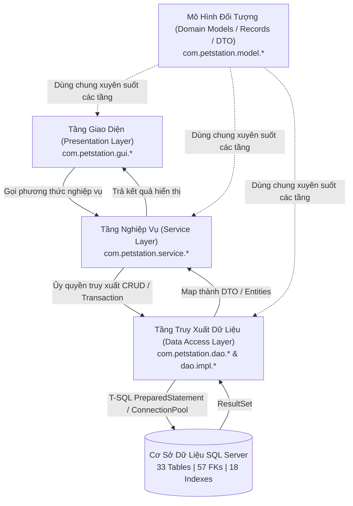
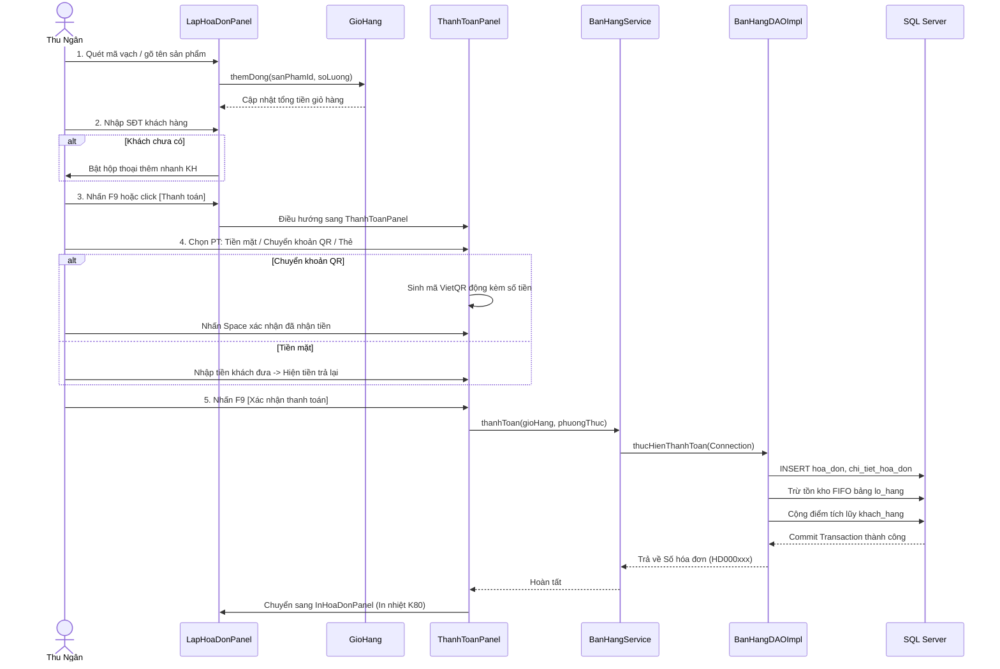
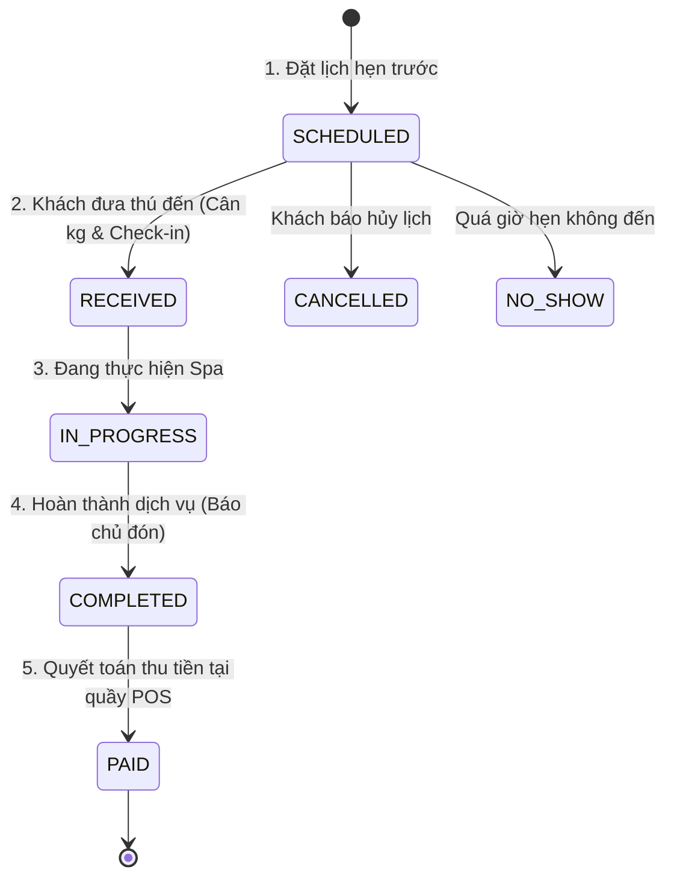

# CẨM NANG TOÀN DIỆN VỀ QUY TRÌNH NGHIỆP VỤ & BÓC TÁCH MÃ NGUỒN HỆ THỐNG QUẢN LÝ CỬA HÀNG THÚ CƯNG (PET STATION)

---

## MỤC LỤC TỔNG QUAN

1. [Kiến trúc nền tảng & Luồng dữ liệu tổng thể (System Architecture)](#1-kien-truc-nen-tang--luong-du-lieu-tong-the)
2. [Nhóm 1: Tab Hệ thống (System)](#2-nhom-1-tab-he-thong-system)
   - [Đăng nhập & Phiên làm việc (DangNhapFrame)](#21-dang-nhap--khoi-tao-phien-lam-viec)
   - [Đổi mật khẩu (DoiMatKhauPanel)](#22-doi-mat-khau)
   - [Tài khoản & Phân quyền (TaiKhoanPhanQuyenPanel)](#23-quan-ly-tai-khoan--ma-tran-phan-quyen)
   - [Cài đặt hệ thống (CaiDatPanel)](#24-cai-dat-he-thong--thong-tin-cua-hang)
   - [Nhật ký hệ thống / Audit Log (NhatKyHeThongPanel)](#25-nhat-ky-he-thong-audit-log)
3. [Nhóm 2: Tab Danh mục (Catalog - Generic CRUD Framework)](#3-nhom-2-tab-danh-muc-catalog)
   - [Khung quản lý danh mục dùng chung (QuanLyDanhMucPanel)](#31-kien-truc-khung-danh-muc-dung-chung)
   - [Khách hàng (DanhMucKhachHangPanel)](#32-danh-muc-khach-hang)
   - [Hồ sơ thú cưng (DanhMucThuCungPanel)](#33-danh-muc-ho-so-thu-cung)
   - [Nhân viên (DanhMucNhanVienPanel)](#34-danh-muc-nhan-vien)
   - [Sản phẩm hàng hóa (DanhSachSanPhamPanel)](#35-danh-muc-san-pham-hang-hoa)
   - [Dịch vụ Spa & Bảng giá ma trận (DanhMucDichVuSpaPanel)](#36-danh-muc-dich-vu-spa)
   - [Phòng khách sạn lưu trú (DanhMucPhongHotelPanel)](#37-danh-muc-phong-luu-tru-pet-hotel)
   - [Nhà cung cấp (DanhMucNhaCungCapPanel)](#38-danh-muc-nha-cung-cap)
   - [Khuyến mãi (DanhMucKhuyenMaiPanel)](#39-danh-muc-khuyen-mai)
   - [Tích điểm & Voucher (TichDiemVoucherPanel)](#310-tich-diem-va-voucher)
4. [Nhóm 3: Tab Xử lý - Nghiệp vụ cốt lõi (Processing & Transactions)](#4-nhom-3-tab-xu-ly---nghiep-vu-cot-loi)
   - [Quy trình Bán hàng & Lập hóa đơn (LapHoaDonPanel -> ThanhToanPanel -> InHoaDonPanel)](#41-quy-trinh-ban-hang--lap-hoa-don-pos)
   - [Treo đơn & Quản lý đơn hàng chờ (DonHangTreoPanel)](#42-treo-don--quan-ly-don-cho)
   - [Đổi trả phụ kiện trong 3 ngày (DoiTraPanel / DoiPhuKienDialog)](#43-doi-tra-phu-kien-trong-3-ngay)
   - [Quy trình Dịch vụ Spa thú cưng khép kín 5 bước (Spa Workflow)](#44-quy-trinh-dich-vu-spa-thu-cung)
   - [Quy trình Khách sạn thú cưng Pet Hotel 4 bước (Hotel Workflow)](#45-quy-trinh-khach-san-thu-cung-pet-hotel)
   - [Lập phiếu nhập kho & Quản lý lô hàng FIFO (NhapKhoPanel)](#46-nhap-kho-hang-hoa--quan-ly-lo-fifo)
   - [Xuất hủy hàng hóa hư hỏng / hết hạn (XuatHuyKhoPanel)](#47-xuat-huy-hang-hoa)
   - [Kiểm kê kho & Cân bằng tồn kho (KiemKePanel)](#48-kiem-ke-va-can-bang-ton-kho)
   - [Mở ca, chốt ca & Bàn giao quỹ thu ngân (CaThuNganPanel)](#49-ca-thu-ngan--chot-ket-ban-giao-quy)
   - [Phân lịch làm việc theo tuần (PhanLichNhanVienPanel)](#410-phan-lich-nhan-vien)
   - [Trung tâm phê duyệt yêu cầu nhạy cảm (TrungTamPheDuyetPanel)](#411-trung-tam-phe-duyet-yeu-cau)
5. [Nhóm 4: Tab Tìm kiếm & Tra cứu (Search & Query)](#5-nhom-4-tab-tim-kiem--tra-cuu)
   - [Tìm kiếm hóa đơn & Xem trước K80 (TimKiemHoaDonPanel)](#51-tim-kiem-hoa-don--xem-truoc-in-nhiet)
   - [Hồ sơ lịch sử khách hàng 360° (LichSuKhachHangPanel)](#52-ho-so-lich-su-khach-hang-360)
   - [Tra cứu tồn kho theo lô & hạn dùng (TimKiemTonTheoLoPanel)](#53-tra-cuu-ton-kho-theo-lo)
   - [Tra cứu phiếu Spa (TraCuuPhieuSpaPanel)](#54-tra-cuu-phieu-spa)
   - [Sơ đồ phòng lưu trú trực quan (TraCuuPhongHotelPanel)](#55-so-do-phong-luu-tru-pet-hotel)
   - [Tra cứu lịch làm việc & Lịch cá nhân (TraCuuLichLamViecPanel)](#56-tra-cuu-lich-lam-viec)
6. [Nhóm 5: Tab Thống kê & Báo cáo (Reports & Analytics)](#6-nhom-5-tab-thong-ke--bao-cao)
   - [Thống kê doanh thu đa chiều & Xuất Excel (ThongKeDoanhThuPanel)](#61-thong-ke-doanh-thu)
   - [Thống kê hàng hóa & Phân tích tồn kho (ThongKeHangHoaPanel)](#62-thong-ke-hang-hoa)
   - [Thống kê dịch vụ Spa & Hotel (ThongKeSpaPanel, ThongKeHotelPanel)](#63-thong-ke-spa--pet-hotel)
   - [Thống kê khách hàng & Công nợ NCC (ThongKeKhachHangPanel, ThongKeCongNoPanel)](#64-thong-ke-khach-hang--cong-no-nha-cung-cap)
   - [Thống kê nhân viên & Hiệu suất ca (ThongKeNhanVienPanel)](#65-thong-ke-nhan-vien)
7. [Cẩm nang trả lời phản biện & Hướng dẫn sửa code theo yêu cầu của Giảng viên](#7-cam-nang-tra-loi-phan-bien--huong-dan-sua-code)

---

## 1. KIẾN TRÚC NỀN TẢNG & LUỒNG DỮ LIỆU TỔNG THỂ

### 1.1 Mô hình phân tầng (3-Tier Layered Architecture)
Toàn bộ dự án tuân thủ nghiêm ngặt nguyên lý thiết kế phân tầng:



* **Quy tắc bất biến:** UI không bao giờ được viết câu lệnh SQL trực tiếp. UI chỉ nhận sự kiện người dùng (click, type), đóng gói dữ liệu và gọi sang Service. Service chịu trách nhiệm thẩm định nghiệp vụ (validation, tính toán, kiểm tra quyền hạn), mở Database Transaction (`setAutoCommit(false)`) và gọi DAO. DAO thực thi JDBC `PreparedStatement` an toàn chống SQL Injection.

### 1.2 Cơ chế Điều hướng & Phân quyền Router
* **Bộ điều hướng (`ChinhFrame.java`):** Quản lý layout khung viền chính với Menu thanh bên (`ThanhDieuHuong`) và vùng hiển thị trung tâm (`BorderLayout.CENTER`). Sử dụng `Consumer<MaManHinh> dieuHuong` làm cầu nối chuyển đổi giữa các màn hình mà không gây rò rỉ bộ nhớ (memory leak).
* **Đăng ký màn hình (`DangKyManHinh.java`):** Đóng vai trò là Screen Registry / Factory Pattern. Ánh xạ từng `MaManHinh` enum sang JPanel tương ứng.
* **Ma trận phân quyền (`Quyen.java` & `VaiTro.java`):** 
  * `VaiTro`: `QUAN_LY_CUA_HANG` (toàn quyền), `NHAN_VIEN_BAN_HANG`, `NHAN_VIEN_KHO`, `NHAN_VIEN_SPA`.
  * `Quyen`: Sử dụng `EnumSet<Quyen>` (`BAN_HANG`, `SPA`, `HOTEL`, `KHO`, `QUAN_LY`, `ADMIN`).
  * Hàm `coTheTruyCap(MaManHinh id)` trong `DangKyManHinh.java`: Nếu tài khoản không có quyền, hệ thống sẽ ẩn mục menu hoặc chặn đứng bằng ngoại lệ `PhanQuyenException`.

---

## 2. NHÓM 1: TAB HỆ THỐNG (SYSTEM)

### 2.1 Đăng nhập & Khởi tạo phiên làm việc
* **Màn hình hiển thị:** `DangNhapFrame.java`
* **Mục đích:** Xác thực danh tính nhân viên, nạp quyền hạn và thiết lập phiên làm việc (`PhienDangNhap`).

#### Luồng thao tác của người dùng:
1. Mở phần mềm -> Cửa sổ Đăng nhập hiển thị ở chính giữa màn hình.
2. Click vào ô **"Tên đăng nhập"**: Nhập tên đăng nhập hoặc mã nhân viên (ví dụ: `QL001`, `NV001`).
3. Click vào ô **"Mật khẩu"**: Nhập mật khẩu bí mật (mặc định: `123456`).
4. Nhấn phím **Enter** hoặc click nút **[Đăng nhập]**.
5. **Phản hồi hệ thống:**
   * Nếu sai thông tin: Hiển thị dialog thông báo *"Tên đăng nhập hoặc mật khẩu không chính xác"*, focus lại ô mật khẩu.
   * Nếu thành công: Ẩn `DangNhapFrame`, mở cửa sổ chính `ChinhFrame`, hiển thị tên nhân viên và vai trò trên thanh tiêu đề, tự động nạp màn hình **Tổng quan (Dashboard)**.

#### Giải thích mã nguồn thực thi:
* **UI:** [`DangNhapFrame.java`](file:///d:/01_HK1_Nam4/PTUD/PTUD_Nhom03_QuanLyCuaHangThuCung/src/main/java/com/petstation/gui/system/DangNhapFrame.java) bắt sự kiện nút đăng nhập tại `thucHienDangNhap()`.
* **Service:** Gọi [`TaiKhoanService.dangNhap(username, password)`](file:///d:/01_HK1_Nam4/PTUD/PTUD_Nhom03_QuanLyCuaHangThuCung/src/main/java/com/petstation/service/TaiKhoanService.java).
* **DAO:** [`TaiKhoanDAOImpl.timTheoTenDangNhap()`](file:///d:/01_HK1_Nam4/PTUD/PTUD_Nhom03_QuanLyCuaHangThuCung/src/main/java/com/petstation/dao/impl/TaiKhoanDAOImpl.java) truy vấn bảng `tai_khoan` JOIN với `nhan_vien`.
* **Bảo mật:** Dùng thư viện `jbcrypt`: `BCrypt.checkpw(matKhauNhap, matKhauHashTrongDB)`. Không bao giờ lưu mật khẩu dạng text thuần.
* **Audit:** Gọi [`NhatKyHeThongService.ghiNhan("LOGIN", "Đăng nhập thành công", taiKhoanId)`](file:///d:/01_HK1_Nam4/PTUD/PTUD_Nhom03_QuanLyCuaHangThuCung/src/main/java/com/petstation/service/NhatKyHeThongService.java) lưu vào bảng `nhat_ky_he_thong`.

---

### 2.2 Đổi mật khẩu
* **Màn hình hiển thị:** `DoiMatKhauPanel.java`
* **Mã màn hình:** `MaManHinh.DOI_MAT_KHAU`

#### Luồng thao tác:
1. Người dùng vào Menu **Hệ thống** -> Chọn **Đổi mật khẩu**.
2. Nhập **"Mật khẩu hiện tại"**.
3. Nhập **"Mật khẩu mới"** (tối thiểu 6 ký tự).
4. Nhập **"Xác nhận mật khẩu mới"**.
5. Click nút **[Lưu mật khẩu]**.
6. Hệ thống kiểm tra: Mật khẩu cũ phải khớp; Mật khẩu mới và xác nhận phải giống nhau; Mật khẩu mới không được trùng mật khẩu cũ.
7. Thông báo thành công và chuyển hướng về Tổng quan.

#### Vị trí Code:
* [`DoiMatKhauPanel.java`](file:///d:/01_HK1_Nam4/PTUD/PTUD_Nhom03_QuanLyCuaHangThuCung/src/main/java/com/petstation/gui/system/DoiMatKhauPanel.java#L80)
* [`TaiKhoanService.doiMatKhau(long taiKhoanId, String cu, String moi)`](file:///d:/01_HK1_Nam4/PTUD/PTUD_Nhom03_QuanLyCuaHangThuCung/src/main/java/com/petstation/service/TaiKhoanService.java): Thực hiện `BCrypt.hashpw(moi, BCrypt.gensalt(12))` và gọi `TaiKhoanDAO.capNhatMatKhau()`.

---

### 2.3 Quản lý Tài khoản & Ma trận Phân quyền
* **Màn hình hiển thị:** `TaiKhoanPhanQuyenPanel.java`
* **Mã màn hình:** `MaManHinh.TAI_KHOAN_PHAN_QUYEN` (Chỉ Quản lý được truy cập).

#### Luồng thao tác:
1. Xem bảng danh sách tài khoản: Cột Mã NV, Tên NV, Tên đăng nhập, Vai trò, Trạng thái (Hoạt động / Bị khóa).
2. **Cấp tài khoản mới cho nhân viên:**
   * Bấm nút **[+ Cấp tài khoản]**.
   * Chọn nhân viên chưa có tài khoản từ dropdown list.
   * Nhập Tên đăng nhập và Mật khẩu khởi tạo.
   * Chọn Vai trò: `Quản lý cửa hàng`, `Bán hàng`, `Kho`, `Spa`.
   * Bấm **[Lưu]**.
3. **Khóa / Kích hoạt tài khoản:**
   * Click chọn 1 dòng tài khoản.
   * Bấm **[Khóa tài khoản]** (hoặc **[Mở khóa]**): Trạng thái đổi tức thì và tài khoản bị khóa sẽ không thể đăng nhập.
4. **Cấu hình ma trận quyền (Tab Ma trận quyền):**
   * Tick chọn các quyền chi tiết tương ứng với vai trò.

#### Vị trí Code:
* UI: [`TaiKhoanPhanQuyenPanel.java`](file:///d:/01_HK1_Nam4/PTUD/PTUD_Nhom03_QuanLyCuaHangThuCung/src/main/java/com/petstation/gui/system/TaiKhoanPhanQuyenPanel.java)
* DAO: [`TaiKhoanDAOImpl.java`](file:///d:/01_HK1_Nam4/PTUD/PTUD_Nhom03_QuanLyCuaHangThuCung/src/main/java/com/petstation/dao/impl/TaiKhoanDAOImpl.java) tương tác bảng `tai_khoan`.

---

### 2.4 Cài đặt hệ thống & Thông tin cửa hàng
* **Màn hình hiển thị:** `CaiDatPanel.java`
* **Mã màn hình:** `MaManHinh.CAI_DAT`

#### Luồng thao tác:
1. Nhập thông tin đơn vị: Tên cửa hàng, Địa chỉ, Số điện thoại hotline, Lời chào chân trang hóa đơn.
2. Cấu hình VietQR: Chọn Ngân hàng thụ hưởng (MB, Vietcombank, Techcombank,...), Nhập Số tài khoản ngân hàng, Nhập Tên chủ tài khoản.
3. Cấu hình máy in: Khổ giấy mặc định (K80 in nhiệt hoặc A5/A4), Tùy chọn tự động bật dialog in sau thanh toán.
4. Bấm **[Lưu cài đặt]**.

#### Vị trí Code:
* [`CaiDatPanel.java`](file:///d:/01_HK1_Nam4/PTUD/PTUD_Nhom03_QuanLyCuaHangThuCung/src/main/java/com/petstation/gui/system/CaiDatPanel.java)
* Dữ liệu lưu trong bảng `cai_dat` (cấu trúc key-value) thông qua [`CaiDatDAOImpl.java`](file:///d:/01_HK1_Nam4/PTUD/PTUD_Nhom03_QuanLyCuaHangThuCung/src/main/java/com/petstation/dao/impl/CaiDatDAOImpl.java).

---

### 2.5 Nhật ký hệ thống (Audit Log)
* **Màn hình hiển thị:** `NhatKyHeThongPanel.java`
* **Mã màn hình:** `MaManHinh.NHAT_KY_HE_THONG`

#### Luồng thao tác:
1. Thanh lọc: Chọn Khoảng ngày (Hôm nay, 7 ngày qua, Tùy chọn), Chọn Loại sự kiện (`LOGIN`, `CREATE`, `UPDATE`, `DELETE`, `PAYMENT`, `INVENTORY`), Chọn Kết quả (`Thành công`, `Thất bại`).
2. Nhập từ khóa tìm kiếm người thực hiện hoặc nội dung hành động.
3. Bảng hiển thị: ID, Thời gian, Người thực hiện, Loại sự kiện, Nội dung tóm tắt, Chi tiết IP / máy trạm, Kết quả.
4. Bấm **[Xuất Excel]** để lưu trữ phục vụ kiểm toán nội bộ.

---

## 3. NHÓM 2: TAB DANH MỤC (CATALOG)

### 3.1 Kiến trúc khung danh mục dùng chung (Generic CRUD Pattern)
Tất cả các màn hình Danh mục trong phần mềm đều kế thừa từ lớp trừu tượng [`QuanLyDanhMucPanel.java`](file:///d:/01_HK1_Nam4/PTUD/PTUD_Nhom03_QuanLyCuaHangThuCung/src/main/java/com/petstation/gui/components/QuanLyDanhMucPanel.java).
* **Bố cục màn hình chuẩn Master-Detail:**
  * **Bên trái (Master):** Thanh tìm kiếm nhanh, nút [+ Thêm], nút [Sửa], nút [Ngừng hoạt động / Xóa], nút [Xuất Excel], Bảng hiển thị dữ liệu có phân trang/cuộn và tự động định dạng màu sắc.
  * **Bên phải (Detail Form):** Khung form nhập liệu tự động sinh dựa trên khai báo cấu hình `TruongDuLieu`. Có nút **[Lưu]** (Xanh lá) và nút **[Hủy]** (Trong suốt).
* **Luồng chung cho mọi danh mục:**
  1. **Thêm:** Bấm `[+ Thêm]` -> Xóa trắng form bên phải -> Mở khóa các ô nhập -> Nhập dữ liệu -> Bấm `[Lưu]` -> Kiểm tra ràng buộc duy nhất & bắt buộc -> Thêm vào CSDL -> Chọn dòng mới trên bảng.
  2. **Sửa:** Click chọn 1 dòng trên bảng -> Dữ liệu đổ sang form bên phải -> Bấm `[Sửa]` -> Form chuyển sang chế độ chỉnh sửa -> Sửa thông tin -> Bấm `[Lưu]` -> Cập nhật CSDL & bảng.
  3. **Ngừng hoạt động (Xóa mềm - Soft Delete):** Chọn dòng -> Bấm `[Ngừng hoạt động]` -> Bật dialog xác nhận -> Chuyển cột `trang_thai` thành `Ngừng hoạt động`. Tuyệt đối không xóa vật lý (HARD DELETE) để tránh vi phạm toàn vẹn dữ liệu khóa ngoại với hóa đơn/chứng từ cũ.

---

### 3.2 Danh mục Khách hàng
* **File:** [`DanhMucKhachHangPanel.java`](file:///d:/01_HK1_Nam4/PTUD/PTUD_Nhom03_QuanLyCuaHangThuCung/src/main/java/com/petstation/gui/catalog/DanhMucKhachHangPanel.java) | **Mã màn hình:** `DANH_MUC_KHACH_HANG`
* **Các trường:** Mã KH (tự sinh tiền tố `KH`), Họ tên (bắt buộc), Số điện thoại (bắt buộc, 10 số, duy nhất), Email, Địa chỉ, Hạng thẻ (Đồng, Bạc, Vàng, Kim Cương), Điểm tích lũy, Trạng thái.
* **Tính năng đặc biệt:** Cung cấp phương thức tĩnh `DanhMucKhachHangPanel.moThem(Component cha, String sdtBanDau)` cho phép màn hình Lập hóa đơn hoặc Lập phiếu Spa bật cửa sổ modal thêm nhanh khách hàng mới ngay tại chỗ mà không cần thoát khỏi màn hình bán hàng.

---

### 3.3 Danh mục Hồ sơ thú cưng
* **File:** [`DanhMucThuCungPanel.java`](file:///d:/01_HK1_Nam4/PTUD/PTUD_Nhom03_QuanLyCuaHangThuCung/src/main/java/com/petstation/gui/catalog/DanhMucThuCungPanel.java) | **Mã màn hình:** `DANH_MUC_THU_CUNG`
* **Các trường:** Mã thú cưng (`TC`), Tên thú (bắt buộc), Loài (Chó, Mèo), Giống loài (Poodle, Corgi, Mèo Anh lông ngắn,...), Giới tính (Đực, Cái, Triệt sản), Cân nặng (kg), Ngày sinh, Chủ nuôi (chọn từ ComboBox liên kết bảng `khach_hang`), Ghi chú dị ứng / tính trạng sức khỏe.

---

### 3.4 Danh mục Nhân viên
* **File:** [`DanhMucNhanVienPanel.java`](file:///d:/01_HK1_Nam4/PTUD/PTUD_Nhom03_QuanLyCuaHangThuCung/src/main/java/com/petstation/gui/catalog/DanhMucNhanVienPanel.java) | **Mã màn hình:** `DANH_MUC_NHAN_VIEN`
* **Các trường:** Mã NV (`NV`), Họ tên, Số điện thoại, Email, Chức danh (Thu ngân, Chuyên viên Spa, Quản lý kho, Quản lý cửa hàng), Lương cơ bản, Ngày vào làm, Trạng thái làm việc.

---

### 3.5 Danh mục Sản phẩm hàng hóa
* **File:** [`DanhSachSanPhamPanel.java`](file:///d:/01_HK1_Nam4/PTUD/PTUD_Nhom03_QuanLyCuaHangThuCung/src/main/java/com/petstation/gui/catalog/DanhSachSanPhamPanel.java) | **Mã màn hình:** `DANH_MUC_SAN_PHAM`
* **Các trường:** Mã SP (`SP`), Tên sản phẩm, Mã vạch Barcode (duy nhất, dùng quét súng barcode khi bán hàng), Phân loại nhóm hàng (Thức ăn, Phụ kiện, Thuốc thú y, Cát vệ sinh, Đồ chơi), Đơn vị tính (Gói, Lon, Chai, Cái), Giá bán lẻ (₫), Giá nhập tham khảo (₫), Tồn kho tối thiểu, Ảnh sản phẩm (chọn file JPG/PNG, tự động copy vào thư mục ứng dụng).

---

### 3.6 Danh mục Dịch vụ Spa
* **File:** [`DanhMucDichVuSpaPanel.java`](file:///d:/01_HK1_Nam4/PTUD/PTUD_Nhom03_QuanLyCuaHangThuCung/src/main/java/com/petstation/gui/catalog/DanhMucDichVuSpaPanel.java) | **Mã màn hình:** `DANH_MUC_DICH_VU_SPA`
* **Điểm nhấn thiết kế:**
  * **Tên dịch vụ:** Được căn chỉnh độ rộng tối ưu 180px không bị thừa khoảng trắng.
  * **Thời gian dự kiến (phút):** Mở rộng 185px, hiển thị trọn vẹn tiêu đề cột.
  * **Bảng giá ma trận theo loài / cân nặng:** Sử dụng component chuyên biệt [`BoSoanThaoBangGia.java`](file:///d:/01_HK1_Nam4/PTUD/PTUD_Nhom03_QuanLyCuaHangThuCung/src/main/java/com/petstation/gui/components/common/BoSoanThaoBangGia.java). Giá dịch vụ Spa phụ thuộc vào: Loài (Chó/Mèo) và Cân nặng (Dưới 5kg, 5-10kg, 10-20kg, Trên 20kg). Bảng giá được lưu dưới dạng chuỗi JSON cấu trúc chuẩn trong cột `bang_gia` của bảng `dich_vu_spa`.

---

### 3.7 Danh mục Phòng lưu trú Pet Hotel
* **File:** [`DanhMucPhongHotelPanel.java`](file:///d:/01_HK1_Nam4/PTUD/PTUD_Nhom03_QuanLyCuaHangThuCung/src/main/java/com/petstation/gui/catalog/DanhMucPhongHotelPanel.java) | **Mã màn hình:** `DANH_MUC_PHONG_LUU_TRU`
* **Các trường:** Mã phòng (`PH`), Tên phòng, Phân loại phòng (Phòng VIP, Phòng Thường, Phòng Cát chuyên mèo), Giá theo ngày đêm (₫), Sức chứa, Trạng thái (Trống, Có thú, Đang dọn, Bảo trì).

---

### 3.8 Danh mục Nhà cung cấp
* **File:** [`DanhMucNhaCungCapPanel.java`](file:///d:/01_HK1_Nam4/PTUD/PTUD_Nhom03_QuanLyCuaHangThuCung/src/main/java/com/petstation/gui/catalog/DanhMucNhaCungCapPanel.java) | **Mã màn hình:** `DANH_MUC_NHA_CUNG_CAP`
* **Các trường:** Mã NCC (`NCC`), Tên công ty/nhà phân phối, Người liên hệ, Điện thoại, Địa chỉ, Mã số thuế. Liên kết chặt chẽ với quy trình Nhập kho và Quản lý công nợ.

---

### 3.9 Danh mục Khuyến mãi
* **File:** [`DanhMucKhuyenMaiPanel.java`](file:///d:/01_HK1_Nam4/PTUD/PTUD_Nhom03_QuanLyCuaHangThuCung/src/main/java/com/petstation/gui/catalog/DanhMucKhuyenMaiPanel.java) | **Mã màn hình:** `DANH_MUC_KHUYEN_MAI`
* **Các trường:** Mã CTKM, Tên chương trình, Ngày bắt đầu, Ngày kết thúc, Hình thức giảm giá (% hoặc số tiền trực tiếp), Giá trị đơn hàng tối thiểu được áp dụng.

---

### 3.10 Tích điểm và Voucher
* **File:** [`TichDiemVoucherPanel.java`](file:///d:/01_HK1_Nam4/PTUD/PTUD_Nhom03_QuanLyCuaHangThuCung/src/main/java/com/petstation/gui/catalog/TichDiemVoucherPanel.java) | **Mã màn hình:** `TICH_DIEM_VOUCHER`
* **Tab 1: Quy tắc điểm & Hạng:** Tỷ lệ tích điểm (ví dụ: mỗi 100.000₫ tích 1 điểm, 1 điểm đổi 1.000₫); Ngưỡng chi tiêu thăng hạng (Đồng -> Bạc: 2 triệu, Bạc -> Vàng: 5 triệu, Vàng -> Kim Cương: 10 triệu).
* **Tab 2: Mã Voucher:** Quản lý mã voucher giảm giá, ngày hết hạn, số lượt sử dụng tối đa, số lượt đã dùng.

---

## 4. NHÓM 3: TAB XỬ LÝ - NGHIỆP VỤ CỐT LÕI

### 4.1 Quy trình Bán hàng & Lập hóa đơn POS
* **Màn hình liên quan:** [`LapHoaDonPanel.java`](file:///d:/01_HK1_Nam4/PTUD/PTUD_Nhom03_QuanLyCuaHangThuCung/src/main/java/com/petstation/gui/processing/sales/LapHoaDonPanel.java) -> [`ThanhToanPanel.java`](file:///d:/01_HK1_Nam4/PTUD/PTUD_Nhom03_QuanLyCuaHangThuCung/src/main/java/com/petstation/gui/processing/sales/ThanhToanPanel.java) -> [`InHoaDonPanel.java`](file:///d:/01_HK1_Nam4/PTUD/PTUD_Nhom03_QuanLyCuaHangThuCung/src/main/java/com/petstation/gui/processing/sales/InHoaDonPanel.java)
* **Phím tắt hỗ trợ:** `F2` (Mở lập hóa đơn), `F9` (Chuyển sang thanh toán / Xác nhận thanh toán), `F4` (Treo đơn), `Space` (Xác nhận nhận tiền VietQR), `Esc` (Hủy/Quay lại).



#### Chi tiết từng bước thao tác:
1. **Tìm và thêm hàng:**
   * Con trỏ chuột mặc định nằm ở ô quét mã vạch.
   * Dùng súng bắn mã vạch barcode trên bao bì sản phẩm, hoặc gõ mã/tên sản phẩm rồi nhấn Enter.
   * Hàng được đưa vào giỏ hàng. Tại cột **Số lượng**, thu ngân có thể gõ trực tiếp số lượng cần mua hoặc bấm nút `+` / `-`. Cột thành tiền tự động tính lại.
2. **Chọn khách hàng & Tích điểm:**
   * Gõ SĐT khách vào ô tìm kiếm khách hàng.
   * Nếu khách đã có hồ sơ: Tự động hiển thị tên khách, hạng thẻ, số điểm hiện có. Có tùy chọn tick vào **"Dùng điểm tích lũy"** để trừ tiền trực tiếp trên hóa đơn.
   * Nếu khách chưa có hồ sơ: Hiện thông báo *"Không tìm thấy khách hàng. Bạn có muốn thêm mới không?"*, tự động mở form thêm khách hàng nằm ngay chính giữa màn hình (giống chỗ lập phiếu Spa). Sau khi lưu, thông tin khách tự động điền vào hóa đơn.
3. **Áp dụng khuyến mãi / Voucher:**
   * Gõ mã voucher vào ô Voucher -> Bấm **[Áp dụng]**. Hệ thống kiểm tra điều kiện giá trị đơn tối thiểu và hạn dùng để trừ tiền chiết khấu.
4. **Thanh toán:**
   * Nhấn **F9** -> Mở giao diện `ThanhToanPanel`.
   * **Phương thức thanh toán:** Có 3 hình thức chuẩn:
     * **Tiền mặt:** Nhập số tiền khách đưa -> Nhãn "Tiền trả lại" tự động tính số tiền thối.
     * **Chuyển khoản QR:** Hệ thống tự động sinh ảnh VietQR chuẩn ngân hàng với số tiền chính xác và nội dung chuyển khoản `HD000xxx`. Thu ngân nhấn phím **Space** để kích hoạt nhanh checkbox "Đã nhận tiền".
     * **Thẻ ngân hàng:** Quẹt thẻ POS ngân hàng, nhập mã chuẩn chi.
5. **Xác nhận & In biên lai:**
   * Nhấn **F9** để chốt hóa đơn. CSDL thực hiện trừ kho FIFO: Lô nào nhập trước thì trừ số lượng ở lô đó trước.
   * Mở màn hình xem trước hóa đơn khổ 80mm (K80) -> Bấm **[In hóa đơn]** gửi lệnh in ra máy in nhiệt.

---

### 4.2 Treo đơn & Quản lý đơn chờ
* **Màn hình:** `DonHangTreoPanel.java` | **Mã màn hình:** `HOA_DON_CHO`
* **Nghiệp vụ thực tế:** Khi khách hàng đang tính tiền nhưng muốn quay lại kệ lấy thêm hàng, thu ngân không thể hủy đơn của khách mà cần phục vụ khách tiếp theo.
* **Thao tác:**
  * Tại `LapHoaDonPanel`, thu ngân bấm nút **[Treo giỏ]** (phím `F4`).
  * Giỏ hàng hiện tại được lưu vào CSDL với trạng thái `GIO_TREO` và mã định danh riêng.
  * Giỏ hàng trên màn hình bán hàng được xóa sạch để phục vụ khách mới.
  * Khi khách quay lại: Bấm nút **[Đơn treo]** -> Mở `DonHangTreoPanel` -> Click chọn đơn treo của khách -> Bấm **[Mở lại đơn]** -> Dữ liệu giỏ hàng được phục hồi 100% để tiếp tục thanh toán.

---

### 4.3 Đổi trả phụ kiện trong 3 ngày
* **Màn hình:** `DoiTraPanel.java` / `DoiPhuKienDialog.java` | **Mã màn hình:** `DOI_TRA_HANG_HOA`
* **Chính sách:** Chỉ đổi phụ kiện trong vòng 3 ngày kể từ ngày mua trên hóa đơn gốc. Không hoàn tiền thừa nếu phụ kiện mới rẻ hơn, thu thêm tiền nếu phụ kiện mới đắt hơn. Thức ăn và thuốc thú y đã mở gói không áp dụng đổi trả.
* **Thao tác:**
  1. Nhập Số hóa đơn gốc (ví dụ: `HD000005`) -> Bấm [Tìm kiếm].
  2. Bảng hiện danh sách hàng hóa trên hóa đơn gốc.
  3. Chọn dòng phụ kiện muốn đổi -> Nhập số lượng đổi.
  4. Chọn sản phẩm phụ kiện thay thế từ danh mục sản phẩm.
  5. Hệ thống tính toán chênh lệch:
     * `GiaMoi > GiaCu`: Số tiền cần thu thêm = `GiaMoi - GiaCu`.
     * `GiaMoi <= GiaCu`: Tiền thu thêm = 0₫ (không hoàn tiền).
  6. Bấm **[Xác nhận đổi hàng]** -> Hệ thống hoàn nhập tồn kho phụ kiện cũ, xuất tồn kho phụ kiện mới, sinh hóa đơn đổi trả và biên lai thu thêm tiền nếu có.

---

### 4.4 Quy trình Dịch vụ Spa thú cưng (5 Bước khép kín)
* **Các màn hình liên quan:** `LichHenSpaPanel.java`, `TiepNhanSpaPanel.java`, `QuanLySpaPanel.java`.



#### Bóc tách từng bước:
1. **Bước 1 - Đặt lịch hẹn (`LichHenSpaPanel`):**
   * Người dùng bấm **[+ Đặt lịch hẹn]**.
   * Chọn khách hàng, chọn thú cưng, chọn ngày giờ hẹn, chọn gói dịch vụ (Tắm sấy, Cắt tỉa lông, Vệ sinh toàn diện,...), chọn nhân viên Spa phụ trách.
   * Trạng thái tạo mới: `SCHEDULED` (Đã hẹn).
2. **Bước 2 - Tiếp nhận & Cân nặng thực tế (`TiepNhanSpaPanel`):**
   * Khách mang bé đến cửa hàng -> Thu ngân bấm **[Khách đã đến]** trên lịch hẹn hoặc tạo phiếu mới.
   * **Điểm cốt lõi:** Nhân viên đặt bé lên cân điện tử và nhập **Cân nặng thực tế (kg)**.
   * Hệ thống tự động bóc tách JSON bảng giá ma trận của dịch vụ đã cấu hình trong `dich_vu_spa`, đối soát Loài (Chó/Mèo) và mức cân nặng để gán giá tiền chuẩn xác 100%.
   * Trạng thái phiếu: `RECEIVED` (Đã tiếp nhận).
3. **Bước 3 - Thực hiện dịch vụ:**
   * Kỹ thuật viên Spa nhận thú, bấm **[Bắt đầu]** -> Trạng thái: `IN_PROGRESS` (Đang thực hiện).
   * Ghi nhận tình trạng da lông (nếu có ve rận, viêm da thì tích chọn dịch vụ tắm trị liệu phát sinh).
4. **Bước 4 - Hoàn tất dịch vụ:**
   * Dịch vụ xong -> Bấm **[Hoàn thành]** -> Trạng thái: `COMPLETED`. Hệ thống kích hoạt gửi thông báo SMS/Zalo cho chủ nuôi đến đón.
5. **Bước 5 - Quyết toán phiếu Spa:**
   * Chủ đến nhận thú -> Thu ngân bấm **[Thanh toán phiếu Spa]**.
   * Phiếu Spa tự động được đóng gói thành hóa đơn bán hàng -> Đẩy sang `ThanhToanPanel` -> Thu tiền -> Phiếu Spa chuyển thành `PAID`.

---

### 4.5 Quy trình Khách sạn thú cưng Pet Hotel (4 Bước)
* **Các màn hình liên quan:** `DatPhongHotelDialog.java`, `LuuTruHotelPanel.java`, `NhatKyLuuTruPanel.java`, `QuyetToanLuuTruPanel.java`.

#### Bóc tách từng bước:
1. **Bước 1 - Đặt phòng & Thu cọc (`DatPhongHotelDialog`):**
   * Bấm **[+ Đặt phòng lưu trú]**.
   * Chọn thú cưng, chọn phòng (chỉ danh sách phòng có trạng thái `Trống` mới hiển thị), chọn Ngày vào và Ngày ra dự kiến.
   * Hệ thống tính số ngày lưu trú: `SoNgay = NgayRa - NgayVao`.
   * Tiền dự tính: `Tong = SoNgay * GiaDem`.
   * **Cọc tối thiểu:** Hệ thống tự động tính tiền cọc yêu cầu (mặc định 30% tổng tiền). Thu ngân tích chọn **"Đã nhận cọc"**, chọn phương thức thu cọc.
   * Tạo hợp đồng lưu trú ở trạng thái `BOOKED` (Đã đặt phòng).
2. **Bước 2 - Check-in nhận phòng:**
   * Đến ngày hẹn, khách đưa thú đến gửi.
   * Thu ngân bấm **[Nhận phòng]** -> Hợp đồng đổi sang `CHECKED_IN`, trạng thái phòng chuyển sang `OCCUPIED` (Có thú).
3. **Bước 3 - Nhật ký chăm sóc hàng ngày (`NhatKyLuuTruPanel`):**
   * Mỗi ngày, nhân viên chăm sóc bấm vào hợp đồng lưu trú -> Bấm **[+ Thêm nhật ký]**.
   * Nhập: Thời gian, Nhân viên chăm sóc, Tình trạng ăn uống (Ăn hết phần, Ăn ít), Tình trạng vệ sinh, Tinh thần/Sức khỏe bé, Ghi chú đặc biệt.
4. **Bước 4 - Check-out & Quyết toán (`QuyetToanLuuTruPanel`):**
   * Khách đến đón bé về -> Bấm **[Trả phòng & Quyết toán]**.
   * Hệ thống tính ngày thực tế lưu trú:
     * Nếu trả đúng hạn: Tính theo ngày hợp đồng.
     * Nếu trả trễ giờ: Tự động cộng thêm phụ phí phát sinh.
   * Tiền thanh toán = `(Số ngày thực tế * Giá đêm) + Phụ phí dịch vụ ăn uống/spa kèm - Tiền cọc đã nhận`.
   * Đẩy số tiền sang thu tiền tại `ThanhToanPanel`.
   * Phòng sau khi trả tự động chuyển trạng thái sang `CLEANING` (Đang dọn vệ sinh) để đảm bảo an toàn khử trùng trước khi đón bé tiếp theo.

---

### 4.6 Nhập kho hàng hóa & Quản lý lô FIFO
* **Màn hình:** `NhapKhoPanel.java` | **Mã màn hình:** `NHAP_KHO`
* **Nghiệp vụ cốt lõi:** Quản lý hàng hóa thú cưng (đặc biệt là thức ăn, pate, thuốc) bắt buộc quản lý theo Lô và Hạn sử dụng (Batch / Lot tracking). Khi bán hàng, hệ thống tự động trừ theo nguyên tắc FIFO (First In First Out - Lô nào hết hạn trước hoặc nhập trước sẽ xuất trước).
* **Thao tác:**
  1. Chọn Nhà cung cấp từ danh sách.
  2. Chọn kho nhập.
  3. Bấm **[+ Thêm sản phẩm nhập]**:
     * Chọn Sản phẩm.
     * Nhập **Số lô sản xuất** (ví dụ: `LOT-202611-01`).
     * Nhập **Hạn sử dụng** (bắt buộc phải lớn hơn ngày hiện tại).
     * Nhập **Số lượng nhập**.
     * Nhập **Đơn giá nhập**.
  4. Thanh toán NCC: Chọn hình thức (Thanh toán ngay bằng Tiền mặt / Chuyển khoản, hoặc Ghi nợ công nợ NCC).
  5. Bấm **[Xác nhận nhập kho]**.
  6. **Cơ sở dữ liệu cập nhật:**
     * Bảng `phieu_nhap_kho`: Thêm 1 dòng phiếu nhập kèm tổng tiền.
     * Bảng `chi_tiet_phieu_nhap`: Lưu chi tiết các mặt hàng.
     * Bảng `lo_hang`: Tạo mới bản ghi lô hàng với số lượng tồn kho ban đầu = số lượng nhập.
     * Bảng `san_pham`: Tăng tổng số lượng tồn kho tổng.
     * Bảng `cong_no_ncc`: Nếu ghi nợ, cập nhật số dư công nợ của nhà cung cấp.

---

### 4.7 Xuất hủy hàng hóa
* **Màn hình:** `XuatHuyKhoPanel.java` | **Mã màn hình:** `XUAT_HUY_KHO`
* **Mục đích:** Xử lý hàng cận date hết hạn, hàng rách bao bì, rơi vỡ, hư hỏng do bảo quản.
* **Thao tác:**
  1. Bấm **[+ Lập phiếu xuất hủy]**.
  2. Chọn lô hàng bị hư hỏng (hệ thống hiển thị tồn kho hiện tại của lô).
  3. Nhập số lượng xuất hủy (không được vượt quá số tồn thực tế của lô).
  4. Chọn Lý do xuất hủy: `Hết hạn sử dụng`, `Hư hỏng / Rách bao bì`, `Hư hao do bảo quản`, `Khác`.
  5. Bấm **[Xác nhận]** -> Hệ thống trừ trực tiếp số tồn kho của lô hàng và ghi nhận vào bảng `phieu_xuat_huy` để tính vào chi phí tổn thất kinh doanh.

---

### 4.8 Kiểm kê & Cân bằng tồn kho
* **Màn hình:** `KiemKePanel.java` | **Mã màn hình:** `KIEM_KE_TON_KHO`
* **Thao tác:**
  1. Chọn Nhóm hàng cần kiểm kê (Thức ăn, Phụ kiện, Thuốc, Tất cả).
  2. Bảng hiển thị: Mã SP, Tên SP, Số lô, Hạn dùng, **Tồn sổ sách** (số liệu máy đang lưu).
  3. Nhân viên kiểm kê thực tế tại kệ và gõ số lượng đếm được vào cột **"Thực tế"**.
  4. Cột **Chênh lệch** tự động tính: `Chênh lệch = Thực tế - Sổ sách`:
     * Bằng 0: Màu đen bình thường (khớp).
     * Dương (> 0): Màu xanh lá (thừa hàng).
     * Âm (< 0): Màu đỏ (thiếu/thất thoát hàng).
  5. Chọn **Lý do chênh lệch** cho các dòng sai lệch (Mất mát, Nhầm lẫn hàng hóa, Sai sót khi nhập,...).
  6. Bấm nút **[Cân bằng kho]**:
     * Hệ thống tự động ghi đè số lượng tồn kho theo số thực tế đếm được.
     * Sinh phiếu điều chỉnh kho phục vụ kiểm tra đối chiếu.

---

### 4.9 Ca thu ngân & Chốt két bàn giao quỹ
* **Màn hình:** `CaThuNganPanel.java` | **Mã màn hình:** `CA_THU_NGAN`
* **Mục đích:** Đảm bảo trách nhiệm tiền mặt của từng thu ngân, chống thất thoát doanh thu tiền mặt tại quầy.
* **Quy trình 3 giai đoạn:**
  1. **Đầu ca (Mở ca):**
     * Thu ngân đăng nhập vào ca làm việc.
     * Đếm tiền mặt có sẵn trong ngăn kéo (tiền lẻ thối ban đầu) -> Nhập vào ô **"Tiền đầu ca"** (ví dụ: 1.000.000₫) -> Bấm **[Mở ca]**.
  2. **Trong ca:**
     * Mọi giao dịch bán hàng bằng Tiền mặt tự động cộng vào quỹ tiền mặt trong ca.
     * Mọi giao dịch qua VietQR / Thẻ tự động cộng vào doanh thu điện tử riêng biệt.
  3. **Cuối ca (Đóng ca & Bàn giao):**
     * Thu ngân bấm **[Kết ca & Bàn giao quỹ]**.
     * Hệ thống hiển thị:
       * Tiền đầu ca: 1.000.000₫
       * Doanh thu tiền mặt trong ca: 4.500.000₫
       * Tổng tiền mặt lý thuyết trong két: 5.500.000₫
     * Thu ngân kiểm tiền thực tế trong két và nhập vào ô **"Tiền thực kiểm"**.
     * Hệ thống tính số chênh lệch thừa/thiếu.
     * Chọn phương thức bàn giao: **Nộp về két trung tâm** hoặc **Bàn giao cho thu ngân ca sau**.
     * Bấm **[In biên bản bàn giao ca]** -> Chốt đóng ca trong bảng `phien_lam_viec`.

---

### 4.10 Phân lịch nhân viên
* **Màn hình:** `PhanLichNhanVienPanel.java` / `LichTuanPanel.java` | **Mã màn hình:** `PHAN_LICH_NHAN_VIEN`
* **Thao tác:**
  1. Giao diện lưới lịch tuần từ Thứ 2 đến Chủ nhật.
  2. Mỗi ngày chia 2 ca: **Ca sáng (08:00 - 16:00)** và **Ca chiều (14:00 - 22:00)**.
  3. Quản lý bấm vào ô ca làm việc của từng nhân viên để:
     * Gán ca làm việc.
     * Đổi ca giữa 2 nhân viên.
     * Duyệt đơn xin nghỉ phép.

---

### 4.11 Trung tâm phê duyệt yêu cầu
* **Màn hình:** `TrungTamPheDuyetPanel.java` | **Mã màn hình:** `PHE_DUYET_YEU_CAU`
* **Nguyên lý:** Phân quyền kiểm soát chéo (Four-eyes principle).
* **Nghiệp vụ áp dụng:**
  * Nhân viên bán hàng muốn hủy 1 hóa đơn đã thanh toán.
  * Nhân viên kho muốn xuất hủy lô hàng bị hỏng.
  * Nhân viên chiết khấu vượt quá 15% cho khách hàng VIP.
* **Quy trình:**
  * Nhân viên gửi yêu cầu -> Trạng thái: `PENDING` (Chờ duyệt).
  * Quản lý mở `TrungTamPheDuyetPanel` -> Đọc lý do và bằng chứng -> Bấm **[Phê duyệt]** (chấp thuận cho thực thi) hoặc **[Từ chối]** (ghi rõ lý do từ chối).

---

## 5. NHÓM 4: TAB TÌM KIẾM & TRA CỨU

### 5.1 Tìm kiếm hóa đơn & Xem trước in nhiệt K80
* **Màn hình:** [`TimKiemHoaDonPanel.java`](file:///d:/01_HK1_Nam4/PTUD/PTUD_Nhom03_QuanLyCuaHangThuCung/src/main/java/com/petstation/gui/search/TimKiemHoaDonPanel.java) | **Mã màn hình:** `TIM_KIEM_HOA_DON` (Phím tắt: `F3`)

#### Cải tiến giao diện & Luồng sử dụng:
* **Thanh công cụ đơn dòng chuẩn hóa:**
  * Toàn bộ cụm tìm kiếm được gom trên **1 hàng duy nhất** bên trái:
    `[Tìm trong danh sách...]` + `Từ ngày:` `[dd/MM/yyyy] [📅]` + `Đến ngày:` `[dd/MM/yyyy] [📅]` + `Phương thức:` `[TẤT CẢ ▾]` + `Trạng thái:` `[TẤT CẢ ▾]`.
  * Hai nút hành động `[Làm mới]` và `[Xuất Excel]` được neo cố định ở góc bên phải.
* **Cơ chế lọc đa tiêu chí đồng thời:**
  * Người dùng có thể lọc kết hợp: gõ tên khách/thu ngân + chọn khoảng ngày + chọn phương thức `Tiền mặt` + chọn trạng thái `Đã thanh toán`.
  * Bảng bên trái lập tức cập nhật số lượng kết quả khớp (ví dụ: `· 34/34 kết quả`).
* **Xem trước chi tiết biên lai K80 bên phải:**
  * Click chọn bất kỳ dòng hóa đơn nào bên trái -> Panel bên phải (`HoaDonDocPanel`) lập tức nạp chi tiết hóa đơn: Logo Pet Station, Số hóa đơn, Ngày giờ, Tên khách hàng, Thu ngân, Danh sách hàng hóa/dịch vụ (số lượng, đơn giá, thành tiền), Chiết khấu, Điểm dùng, Tổng thanh toán, Phương thức thanh toán tiếng Việt chuẩn.
  * Nút **[In lại hóa đơn]**: Gửi lệnh in trực tiếp ra máy in nhiệt mà không cần tính tiền lại.
  * Nút **[Xuất file HTML / PDF]**: Lưu hóa đơn ra máy tính để gửi qua Zalo/Email cho khách hàng.

---

### 5.2 Hồ sơ lịch sử khách hàng 360°
* **Màn hình:** `LichSuKhachHangPanel.java` | **Mã màn hình:** `TRA_CUU_KHACH_HANG`
* **Mục đích:** Cung cấp cái nhìn toàn diện về một khách hàng để chăm sóc khách hàng VIP và tư vấn chu đáo.
* **Thao tác:**
  1. Gõ Tên hoặc Số điện thoại của khách hàng -> Nhấn Enter.
  2. Màn hình hiển thị:
     * **Thẻ thông tin cá nhân:** Mã KH, Họ tên, SĐT, Email, Địa chỉ, Hạng thẻ, Điểm tích lũy hiện tại, Tổng chi tiêu trọn đời (LTV - Lifetime Value).
     * **Danh sách thú cưng của khách:** Tên bé, Loài, Giống, Cân nặng, Ngày sinh.
     * **Tab Lịch sử mua hàng:** Danh sách tất cả các hóa đơn mua đồ, click xem chi tiết từng món đồ đã mua.
     * **Tab Lịch sử Spa:** Các lần bé đi tắm tỉa lông, nhân viên làm, ghi chú da lông.
     * **Tab Lịch sử Lưu trú Pet Hotel:** Các đợt gửi khách sạn, số ngày ở, phòng đã ở.

---

### 5.3 Tra cứu tồn kho theo lô
* **Màn hình:** `TimKiemTonTheoLoPanel.java` | **Mã màn hình:** `TRA_CUU_LO_HANG`
* **Mục đích:** Kiểm soát chất lượng hàng hóa, nhận biết các lô hàng sắp hết hạn (Near-Expiry Date) để lên kế hoạch xả hàng hoặc khuyến mãi.
* **Thao tác:**
  * Xem danh sách chi tiết: Mã SP, Tên SP, Số lô, Ngày nhập kho, Hạn sử dụng, Số lượng tồn kho của lô, Trạng thái.
  * Lọc nhanh: Cảnh báo đỏ đối với các lô có hạn sử dụng dưới 30 ngày.

---

### 5.4 Tra cứu phiếu Spa
* **Màn hình:** `TraCuuPhieuSpaPanel.java` | **Mã màn hình:** `TRA_CUU_LICH_SPA`
* **Thao tác:** Lọc danh sách phiếu dịch vụ theo Khoảng ngày và Trạng thái thuần Việt (`Tất cả trạng thái`, `Đã tiếp nhận`, `Đang thực hiện`, `Hoàn thành`, `Đã thanh toán`). Click chọn dòng xem chi tiết phiếu dịch vụ và nhân viên phụ trách.

---

### 5.5 Sơ đồ phòng lưu trú Pet Hotel trực quan
* **Màn hình:** `TraCuuPhongHotelPanel.java` | **Mã màn hình:** `SO_DO_PHONG_LUU_TRU`
* **Giao diện trực quan:** Các phòng được hiển thị dưới dạng khối Card đồ họa:
  * **Màu Xanh lá:** Phòng Trống (`AVAILABLE`) -> Sẵn sàng đón thú.
  * **Màu Vàng cam:** Có thú đang ở (`OCCUPIED`) -> Hiển thị tên thú cưng, tên chủ nuôi và ngày dự kiến trả.
  * **Màu Tím:** Đang dọn dẹp khử trùng (`CLEANING`).
  * **Màu Xám:** Phòng đang bảo trì (`MAINTENANCE`).
* **Tương tác:** Click vào phòng có thú để xem nhanh thông tin hợp đồng và nhật ký chăm sóc của bé trong ngày.

---

## 6. NHÓM 5: TAB THỐNG KÊ & BÁO CÁO

### 6.1 Thống kê doanh thu
* **Màn hình:** `ThongKeDoanhThuPanel.java` | **Mã màn hình:** `THONG_KE_DOANH_THU`
* **Nghiệp vụ:**
  * Chọn mốc thời gian: `Hôm nay`, `Hôm qua`, `7 ngày gần nhất`, `Tháng này`, `Tháng trước`, `Tùy chọn khoảng ngày`.
  * **Chỉ số tổng hợp (KPI Cards):** Tổng doanh thu (₫), Số hóa đơn đã xuất, Giá trị trung bình / đơn hàng (AOV), Doanh thu tiền mặt vs Doanh thu chuyển khoản QR / Quẹt thẻ.
  * **Biểu đồ cột / đường:** Trực quan hóa diễn biến doanh thu theo từng ngày trong kỳ.
  * **Bảng chi tiết doanh thu:** Thống kê theo ngày/giờ.
  * Nút **[Xuất Excel]**: Xuất file `.xlsx` định dạng kế toán chuẩn.

---

### 6.2 Thống kê hàng hóa
* **Màn hình:** `ThongKeHangHoaPanel.java` | **Mã màn hình:** `THONG_KE_HANG_HOA`
* **Các báo cáo chuyên sâu:**
  * **Top sản phẩm bán chạy:** Xếp hạng theo số lượng bán ra và doanh thu mang lại.
  * **Báo cáo tồn kho & giá trị vốn:** Số lượng tồn kho thực tế, Tổng giá trị tồn kho theo giá vốn (giúp chủ cửa hàng nắm bắt dòng vốn bị ứ đọng).
  * **Cảnh báo hàng dưới mức tồn kho tối thiểu:** Tự động lên danh sách các mặt hàng sắp hết để nhập thêm.

---

### 6.3 Thống kê Spa & Pet Hotel
* **File:** `ThongKeSpaPanel.java` & `ThongKeHotelPanel.java`
* **Chỉ số phân tích:**
  * Dịch vụ Spa được sử dụng nhiều nhất (Tắm sấy chiếm bao nhiêu %, Cắt tỉa tạo kiểu chiếm bao nhiêu %).
  * Tỷ lệ lấp đầy phòng khách sạn theo tháng (Occupancy Rate).
  * Doanh thu bình quân từ mỗi lượt thú cưng lưu trú.

---

### 6.4 Thống kê Khách hàng & Công nợ Nhà cung cấp
* **File:** `ThongKeKhachHangPanel.java` & `ThongKeCongNoPanel.java`
* **Khách hàng:** Báo cáo cơ cấu khách hàng theo hạng thẻ (Kim Cương, Vàng, Bạc, Đồng), phân tích tần suất quay lại của khách hàng.
* **Công nợ NCC:** Thống kê chi tiết từng Nhà cung cấp: Tổng tiền hàng đã nhập, Số tiền đã thanh toán, Số tiền nợ còn lại, Thời hạn thanh toán (giúp quản lý tài chính dòng tiền không bị phạt trễ hạn).

---

## 7. CẨM NANG TRẢ LỜI PHẢN BIỆN & HƯỚNG DẪN SỬA CODE

Dưới đây là tập hợp các câu hỏi chất vấn phổ biến nhất của Hội đồng Giảng viên và câu trả lời bóc tách mã nguồn tương ứng:

---

### Câu 1: "Khi khách mua hàng, nếu sản phẩm có nhiều lô với hạn sử dụng khác nhau thì hệ thống trừ kho như thế nào?"
* **Trả lời của sinh viên:**
  > "Dạ thưa Thầy/Cô, hệ thống áp dụng nguyên tắc **FIFO (First In, First Out)** dựa trên bảng `lo_hang`. Khi quét mã sản phẩm và thanh toán, hệ thống sẽ tự động tìm kiếm các lô hàng của sản phẩm đó còn tồn kho (`so_luong_ton > 0`) và ưu tiên trừ ở các lô có `han_su_dung` gần nhất trước. Nếu số lượng mua vượt quá số tồn của lô thứ nhất, hệ thống sẽ trừ hết lô thứ nhất rồi tự động trừ tiếp sang lô tiếp theo cho đến khi đủ số lượng khách mua."
* **Vị trí Code chứng minh:**
  * File: [`com.petstation.dao.impl.BanHangDAOImpl.java`](file:///d:/01_HK1_Nam4/PTUD/PTUD_Nhom03_QuanLyCuaHangThuCung/src/main/java/com/petstation/dao/impl/BanHangDAOImpl.java)
  * Phương thức: `truTonKhoFIFO(Connection con, long sanPhamId, int soLuongCanTru)`
  * Câu lệnh SQL: `SELECT id, so_luong_ton FROM lo_hang WHERE san_pham_id = ? AND so_luong_ton > 0 ORDER BY han_su_dung ASC, id ASC`

---

### Câu 2: "Tại sao khi xóa một khách hàng hoặc nhân viên thì trong CSDL không thấy mất dòng đó?"
* **Trả lời của sinh viên:**
  > "Dạ thưa Thầy/Cô, hệ thống sử dụng cơ chế **Xóa mềm (Soft Delete)**. Trong cơ sở dữ liệu, bảng `khach_hang`, `nhan_vien`, `san_pham` đều có cột `trang_thai` (nhận giá trị `Đang hoạt động` hoặc `Ngừng hoạt động`). Nếu xóa vật lý bằng lệnh `DELETE FROM`, các bảng hóa đơn cũ (`hoa_don`) và phiếu tiếp nhận Spa (`phieu_tiep_nhan_spa`) có chứa khóa ngoại tham chiếu đến khách hàng đó sẽ bị lỗi vi phạm ràng buộc toàn vẹn khóa ngoại (Foreign Key Violation), hoặc nếu dùng `CASCADE DELETE` thì sẽ làm mất sạch lịch sử doanh thu và kiểm toán. Vì vậy, hệ thống chỉ cập nhật `trang_thai = N'Ngừng hoạt động'` để ẩn khỏi danh sách chọn mới mà vẫn bảo toàn 100% dữ liệu lịch sử."
* **Vị trí Code chứng minh:**
  * File: [`QuanLyDanhMucPanel.java`](file:///d:/01_HK1_Nam4/PTUD/PTUD_Nhom03_QuanLyCuaHangThuCung/src/main/java/com/petstation/gui/components/QuanLyDanhMucPanel.java#L441)
  * Phương thức: `layNhatXoa()` gọi `DanhMucService.capNhatTrangThai(id, "Ngừng hoạt động")`.

---

### Câu 3: "Làm sao bảo đảm tính toàn vẹn khi thanh toán hóa đơn nếu đang lưu hóa đơn mà bị cúp điện hoặc lỗi mạng?"
* **Trả lời của sinh viên:**
  > "Dạ thưa Thầy/Cô, toàn bộ quy trình thanh toán được bọc trong một **Database Transaction** của JDBC. Trước khi thực thi, code thiết lập `con.setAutoCommit(false)`. Quy trình gồm 4 bước: (1) Insert hóa đơn, (2) Insert chi tiết hóa đơn, (3) Trừ tồn kho lô hàng, (4) Cộng điểm tích lũy khách hàng. Chỉ khi tất cả 4 bước đều thành công thì mới gọi `con.commit()`. Nếu có bất kỳ bước nào phát sinh ngoại lệ (SQLException hoặc lỗi logic), khối `catch` sẽ lập tức gọi `con.rollback()`, đưa CSDL về trạng thái nguyên vẹn ban đầu, không bao giờ xảy ra tình trạng hóa đơn đã lưu mà kho chưa trừ hoặc ngược lại."
* **Vị trí Code chứng minh:**
  * File: [`BanHangDAOImpl.java`](file:///d:/01_HK1_Nam4/PTUD/PTUD_Nhom03_QuanLyCuaHangThuCung/src/main/java/com/petstation/dao/impl/BanHangDAOImpl.java) -> `luuHoaDon(...)`.

---

### Câu 4: "Cơ chế sinh mã VietQR động hoạt động như thế nào? Có cần đăng ký API tốn phí không?"
* **Trả lời của sinh viên:**
  > "Dạ thưa Thầy/Cô, hệ thống sử dụng chuẩn thanh toán **VietQR (EMVCo QR Code specification)** của Napas. Hệ thống không cần gọi qua trung gian thanh toán tốn phí mà sử dụng thuật toán đóng gói chuỗi payload EMVCo theo cấu ngữ TLV (Tag-Length-Value) kết hợp mã kiểm tra CRC-16 (CCITT):
  > - Tag 00: Phiên bản EMVCo (01)
  > - Tag 01: Loại QR (12: Động - có sẵn số tiền)
  > - Tag 38: Thông tin ngân hàng thụ hưởng (Mã BIN ngân hàng + Số tài khoản)
  > - Tag 53: Đơn vị tiền tệ (704 - VNĐ)
  > - Tag 54: Số tiền thanh toán chính xác của hóa đơn
  > - Tag 62: Nội dung chuyển khoản (Mã số hóa đơn `HD000xxx`)
  > Chuỗi payload sau đó được thư viện `com.google.zxing` render trực tiếp thành hình ảnh QR Code hiển thị trên màn hình. Khách hàng dùng app bất kỳ ngân hàng nào quét mã là tự động điền sẵn đúng số tài khoản, đúng số tiền và đúng nội dung hóa đơn."
* **Vị trí Code chứng minh:**
  * File: [`VietQRUtil.java`](file:///d:/01_HK1_Nam4/PTUD/PTUD_Nhom03_QuanLyCuaHangThuCung/src/main/java/com/petstation/util/VietQRUtil.java) và [`ThanhToanPanel.java`](file:///d:/01_HK1_Nam4/PTUD/PTUD_Nhom03_QuanLyCuaHangThuCung/src/main/java/com/petstation/gui/processing/sales/ThanhToanPanel.java#L300).

---

### Câu 5: "Nếu Thầy/Cô yêu cầu: 'Hãy thêm một trường dữ liệu Địa chỉ Facebook/Zalo vào Danh mục Khách hàng' thì em sửa code ở những đâu?"
* **Hướng dẫn trả lời và sửa code trực tiếp trong 2 phút:**
  > "Dạ thưa Thầy, nhờ kiến trúc Generic của `QuanLyDanhMucPanel`, em chỉ cần sửa 3 bước rất nhanh:"
  1. **Bước 1 (Database):** Mở SQL Server chạy lệnh:
     ```sql
     ALTER TABLE khach_hang ADD zalo_facebook NVARCHAR(255) NULL;
     ```
  2. **Bước 2 (Cấu hình danh mục Java):** Mở file [`DanhMucKhachHangPanel.java`](file:///d:/01_HK1_Nam4/PTUD/PTUD_Nhom03_QuanLyCuaHangThuCung/src/main/java/com/petstation/gui/catalog/DanhMucKhachHangPanel.java), tại phương thức `cacTruong()`, thêm 1 dòng khai báo:
     ```java
     TruongDuLieu.tao("Zalo / Facebook", Kieu.VAN_BAN)
     ```
     -> Hệ thống sẽ **tự động** sinh thêm cột trên bảng JTable bên trái và **tự động** sinh thêm ô nhập liệu trên form bên phải mà không cần chỉnh sửa giao diện thủ công!
  3. **Bước 3 (Truy vấn DAO):** Trong file `DanhMucService.java` hoặc `DanhMucDAOImpl.java`, bổ sung tên cột `zalo_facebook` vào câu lệnh `SELECT`, `INSERT`, `UPDATE` của bảng khách hàng.

---

### Câu 6: "Làm thế nào để thay đổi thời gian lọc mặc định hoặc bổ sung phương thức thanh toán mới?"
* **Thay đổi thời gian lọc mặc định của Tìm kiếm hóa đơn:**
  * File: [`TimKiemHoaDonPanel.java`](file:///d:/01_HK1_Nam4/PTUD/PTUD_Nhom03_QuanLyCuaHangThuCung/src/main/java/com/petstation/gui/search/TimKiemHoaDonPanel.java#L55)
  * Thay đổi dòng: `LocalDate macDinhTuNgay = LocalDate.now().minusDays(60);` thành số ngày mong muốn (hoặc `minusMonths(3)`).
* **Bổ sung phương thức thanh toán mới (ví dụ: Ví MoMo):**
  * Thêm `"Ví MoMo"` vào mảng khởi tạo `cboPhuongThuc` trong `TimKiemHoaDonPanel.java`.
  * Thêm `case "Ví MoMo" -> ...` trong khối switch lọc `apDungBoLocNangCao()`.
  * Bổ sung nhãn hiển thị trong `DinhDangBang.tenTrangThai()`: `case "MOMO" -> "Ví MoMo"`.
